# 大学生个人 Markdown 笔记与知识管理工具
# 架构设计与系统设计文档

> 文档状态：作业二改进提交版 1.2  
> 需求基线：作业一改进提交版 1.2（D-001～D-066）  
> 设计范围：完整首版；详细设计聚焦首个里程碑及高优先级安全闭环  
> 目标平台：Windows 10 22H2 / Windows 11 64 位桌面环境

## 1. 文档目的与范围

本文档在《大学生个人 Markdown 笔记与知识管理工具需求分析文档》1.2 版基础上，说明系统的架构、模块、关键流程、接口、数据、界面交互、非功能设计、异常恢复、设计权衡、需求追溯及验证方法，为后续实现和测试提供依据。

本设计覆盖完整首版产品。首个里程碑重点落实知识库管理、笔记与目录操作、Markdown 编辑和预览、自动保存、标签、基础检索、Wiki 链接与反向链接、附件导入、回收站和草稿恢复；连接图、三方冲突、批量回滚、导出、完整备份与恢复等能力保留清晰的模块、接口和数据边界，并在首版收尾阶段实现。

### 1.1 需求基线

| 项目 | 基线内容 |
|---|---|
| 基线来源 | 作业一 `01_需求分析文档.md`，改进提交版 1.2 |
| 决策编号 | D-001～D-066 |
| 功能需求 | 109 项 FR |
| 非功能需求 | 44 项 NFR |
| 业务规则 | 118 项 BR |
| 数据要求 | 35 项 DR |
| 接口与环境依赖 | 5 项 IR |
| 功能验收用例 | 210 项 AC |
| 本次基线变更 | 无；沿用原编号、含义、优先级和验收标准 |

若后续设计发现基线存在矛盾或不可实现约束，必须先记录变更项、原因、受影响需求和替代方案，经确认后再修改设计；不得静默改变原需求。

### 1.2 设计元素编号

| 前缀 | 含义 | 示例 |
|---|---|---|
| ARCH-VIEW | 架构视图 | ARCH-VIEW-LOGICAL-001 |
| MOD | 逻辑模块 | MOD-EDITOR |
| IF | 接口 | IF-NOTE-001 |
| DATA | 数据实体、存储或交换结构 | DATA-NOTE-001 |
| FLOW | 关键业务流程 | FLOW-SAVE-001 |
| UI | 界面或交互状态 | UI-WORKSPACE-001 |
| NFD | 非功能设计措施 | NFD-PERF-001 |
| DEC | 设计决策与权衡 | DEC-001 |
| TEST-ARCH/DATA/IF/FLOW/UI | 架构与具体设计元素验证项 | TEST-ARCH-001 |
| TEST-USE | 非功能易用性验证项 | TEST-USE-001 |

`ARCH-VIEW-*` 只标识架构表达视角，`DEC-*` 标识经过权衡的架构或系统设计决策；`TEST-UI-*` 检查界面状态与交互设计，`TEST-USE-*` 检查 NFR-USE-* 的真实易用性指标，二者不得互换计数或互相替代。

## 2. 设计目标与约束

### 2.1 设计目标

1. 保证 Markdown 正文和附件始终由用户控制，应用损坏或卸载后仍可直接读取。
2. 为编辑、保存、检索、链接、附件和恢复形成完整本地工作闭环。
3. 将文件系统写入、索引更新和界面状态更新分离，避免派生数据故障损坏真实数据。
4. 通过清晰的模块和接口边界，使每项需求能够定位到实现与测试对象。
5. 将高耗时索引、图布局、导出和备份任务移出界面主线程，保证交互响应。
6. 在不引入服务器、账号或云同步的前提下满足离线、隐私和可迁移要求。

### 2.2 关键约束

- 系统是 Windows 本地桌面应用，不部署远程业务服务器。
- 首版不提供账号、云同步、多人协作、移动端、插件系统、在线发布、生成式 AI、OCR 或笔记正文加密。
- 普通 Markdown、YAML 元数据和附件是唯一真实用户数据。
- SQLite 数据库仅保存可重建的搜索、链接和附件索引，不作为正文的唯一存储。
- 渲染进程不能直接访问 Node.js、任意本地文件、原始 IPC 或系统命令。
- 对知识库的持久化修改必须经过应用服务与路径边界校验。
- 同一知识库同一时间只允许一个应用实例取得写锁；其他实例只能取消或只读打开。

## 3. 总体架构设计

### 3.1 架构风格

`DEC-001`：采用“本地桌面模块化单体 + 分层架构 + 后台工作任务”的形式。

- **模块化单体**：所有业务能力随一个桌面应用安装和运行，但按知识库、笔记、编辑、索引、链接、附件、数据保护等领域划分模块。
- **分层架构**：界面层、应用层、领域层和基础设施层单向依赖；领域规则不依赖 Electron、React 或具体数据库。
- **后台工作任务**：索引、全局图布局、批量操作预检、导出和备份等长任务使用工作线程或受控子进程执行，并通过任务接口报告进度和取消状态。
- **文件为真实数据、索引为派生数据**：即使索引或界面配置损坏，Markdown 与附件仍可读取，索引可以重新扫描构建。

选择该架构是因为产品为单用户、本地优先桌面工具，不需要微服务或远程分布式部署；模块化边界能够满足课程项目的可实现性，同时为后续功能扩展和独立测试保留接口。

### 3.2 ARCH-VIEW-LOGICAL-001：逻辑分层视图

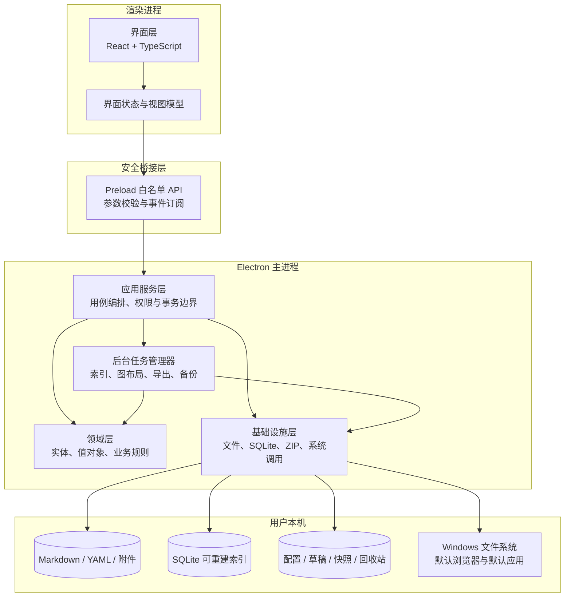

### 3.3 分层职责与依赖规则

| 层次 | 主要职责 | 允许依赖 | 禁止事项 |
|---|---|---|---|
| 界面层 | 页面、组件、视图状态、用户输入、进度与错误展示 | 视图模型、安全桥接接口 | 直接读写磁盘、直接执行 SQL、直接调用系统命令 |
| 安全桥接层 | 向界面暴露按用途划分的白名单 API；验证参数、调用来源和返回结构 | Electron 受控 IPC、接口数据结构 | 暴露原始 IPC、任意文件读写、通用命令执行 |
| 应用服务层 | 执行用例、编排模块、维护事务边界、任务进度和取消语义 | 领域层定义的端口、基础设施接口 | 在界面组件中散落业务事务或恢复逻辑 |
| 领域层 | 笔记、标签、链接、附件、知识库等实体及业务不变量 | 纯 TypeScript 与领域接口 | 依赖 React、Electron、SQLite 或具体文件路径 API |
| 基础设施层 | 文件系统、SQLite、文件监视、ZIP、哈希、PDF、外部打开 | 领域层定义的仓储/网关接口 | 绕过路径检查写入库外文件；把索引当作正文唯一来源 |
| 后台任务层 | 执行耗时或批量任务，报告进度、支持安全取消 | 应用服务、领域规则、基础设施接口 | 直接更新界面；在未提交状态下宣称任务成功 |

依赖方向固定为“界面 → 安全桥接 → 应用服务 → 领域接口”，基础设施实现领域接口并在启动时注入。模块之间不直接访问彼此的数据库表或内部目录，跨模块协作由应用服务和显式接口完成。

### 3.4 ARCH-VIEW-RUNTIME-001：进程与运行视图

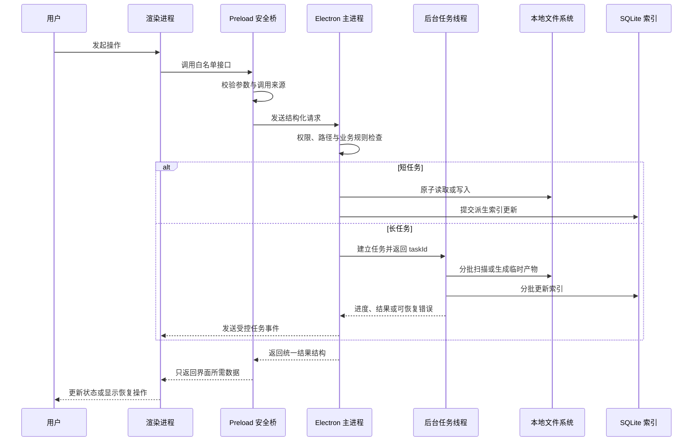

运行时采用以下规则：

1. 主进程是文件系统、数据库、外部程序调用和知识库写锁的唯一可信入口。
2. 渲染进程只保存正在编辑的缓冲区和界面状态，不直接持有系统能力。
3. 短操作返回统一结果；长操作立即返回 `taskId`，通过事件推送进度，用户取消时在安全检查点停止。
4. 正文文件先原子提交，索引随后更新；索引失败不得回滚已经安全保存的正文，而应记录“待重新索引”状态。
5. 批量移动、重命名、标签更新和链接维护先生成操作计划并预检，全部可执行后再提交；失败时依据操作日志回滚。
6. 文件监视事件进入去重队列；存在本地未保存缓冲区时，不自动覆盖，而是进入三方冲突流程。

### 3.5 ARCH-VIEW-DEPLOY-001：部署视图

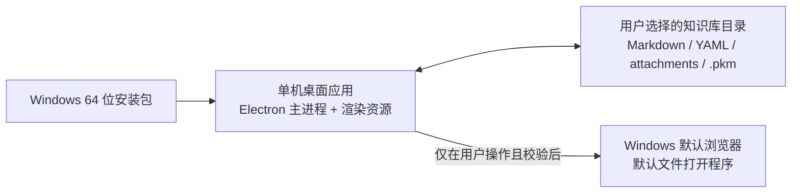

- 应用及其运行依赖随 Windows 64 位安装包交付，不依赖远程服务。
- 用户可将一个或多个知识库放在自己选择的本地目录；应用安装目录与知识库目录相互独立。
- `.pkm` 保存索引、配置、草稿、快照和回收站等系统数据，均位于对应知识库内。
- 应用可以调用系统默认浏览器或默认文件打开程序，但必须逐次校验协议、真实路径和文件风险类型。
- 位于第三方同步目录的知识库仍按普通本地目录处理；本系统不承诺控制第三方同步顺序或解决其服务内部冲突。

### 3.6 ARCH-VIEW-MODULE-001：总体模块视图

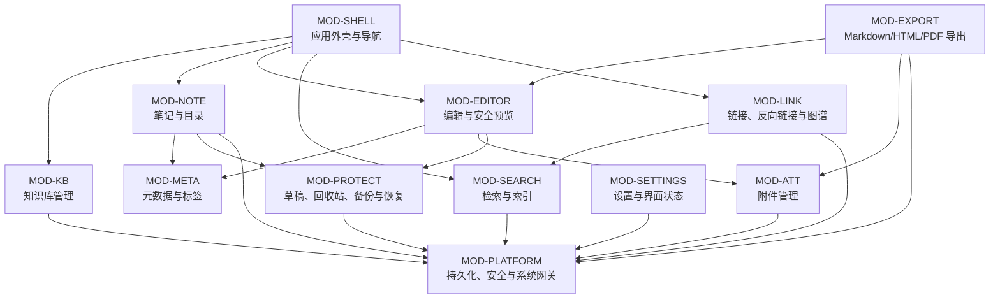

箭头表示“发起协作或依赖公开接口”，不表示可以访问被依赖模块的内部数据。`MOD-PLATFORM` 提供技术能力实现，不包含具体产品业务规则。

## 4. 架构决策摘要

本节列出总体架构阶段确定的核心决策；第 12 节给出完整决策记录、风险、复核条件和变更流程。

| 编号 | 决策 | 采用方案 | 备选方案 | 取舍理由 | 主要关联需求 |
|---|---|---|---|---|---|
| DEC-001 | 应用形态 | Electron 模块化单体桌面应用 | 浏览器 Web 应用；本地服务加浏览器 | 需要完整离线文件访问、系统对话框、默认应用调用和 Windows 打包；单体更符合个人课程项目规模 | D-003、D-063；NFR-COMP-* |
| DEC-002 | 真实数据存储 | Markdown/YAML/附件保存在用户目录 | 正文只存数据库 | 保证可迁移、可直接读取和应用损坏后仍可恢复；代价是需要处理外部修改和跨文件一致性 | DR-NOTE-*、NFR-REL-* |
| DEC-003 | 检索存储 | SQLite FTS5 可重建索引 | 每次全目录扫描；远程搜索服务 | 能满足离线检索和排序性能；索引损坏可重建，不锁定正文 | FR-SEARCH-*、NFR-PERF-* |
| DEC-004 | 进程安全 | 沙箱渲染进程 + 白名单 preload API | 渲染进程直接启用 Node.js | 降低恶意 Markdown、链接或附件获得系统能力的风险；代价是需维护明确 IPC 契约 | NFR-SEC-*、IR-ENV-002 |
| DEC-005 | 长任务执行 | 工作线程/受控子进程 + taskId | 全部在界面线程执行 | 避免索引、图布局和备份阻塞界面，并可统一进度与取消语义 | NFR-PERF-*、NFR-USE-* |
| DEC-006 | 一致性 | 原子文件替换 + 操作计划/日志 + 索引最终一致 | 直接覆盖多个文件；分布式事务 | 文件系统无法与 SQLite 形成单一 ACID 事务，使用可恢复操作日志更可实现；索引可重建 | NFR-REL-001～007、BR-* |

## 5. 架构级验证考虑

| 编号 | 验证目标 | 方法 | 通过标准 |
|---|---|---|---|
| TEST-ARCH-001 | 渲染进程不能越过安全边界 | 在端到端测试中尝试访问 Node.js、原始 IPC、任意路径和危险协议 | 所有非白名单能力不可达，调用被拒绝并记录安全事件 |
| TEST-ARCH-002 | 索引不是正文唯一来源 | 删除或损坏 SQLite 索引后重新打开知识库 | Markdown 和附件不丢失；系统提示并可重建索引 |
| TEST-ARCH-003 | 主线程不被长任务阻塞 | 在标准规模知识库执行索引、图布局、导出和备份并持续输入 | 输入、切换和取消操作满足对应响应指标 |
| TEST-ARCH-004 | 多实例写入受控 | 同时用两个实例打开同一知识库 | 只有一个实例获得写锁；另一个只读或取消，不发生并发覆盖 |
| TEST-ARCH-005 | 文件与索引故障隔离 | 在正文原子提交后注入索引更新失败 | 正文保持成功版本；界面标记待索引并可重试或重建 |
| TEST-ARCH-006 | 批量变更可恢复 | 在批量移动、重命名及链接更新中注入权限或磁盘错误 | 操作最终完全处于变更前或变更后状态，不出现半完成集合 |

## 6. 模块详细设计

### 6.1 模块划分原则

1. 一个业务概念只由一个模块维护其核心规则和状态，其他模块只能通过公开契约使用。
2. 跨模块业务流程由应用服务层编排，不允许两个领域模块相互调用形成循环依赖。
3. 模块对外暴露用例级命令、查询和领域事件，不暴露数据库表、内部目录或可变实体对象。
4. 文件、SQLite、ZIP、PDF 和系统程序调用统一通过 `MOD-PLATFORM` 的技术端口实现。
5. 派生数据模块可以订阅正文变更事件，但不能反向修改正文；需要改变正文时必须发起显式业务命令。
6. 跨模块失败使用统一错误结构；批量流程由应用服务维护操作计划、补偿步骤和最终结果。

### 6.2 模块总表

| 模块 | 核心职责 | 主要公开能力 | 主要需求归属 |
|---|---|---|---|
| MOD-SHELL | 应用外壳、工作区布局、标签页和导航历史 | 打开视图、切换/固定标签、前进后退、恢复工作区 | FR-NAV-001～005；DR-NAV-001～003；BR-052～058 |
| MOD-KB | 知识库生命周期、初始化、扫描、写锁和安全模式 | 创建、打开、初始化、切换、关闭、重扫、重新定位 | FR-KB-001～010；DR-KB-001～003；BR-001～007 |
| MOD-NOTE | 笔记/文件夹生命周期及单项、批量文件操作 | 新建、重命名、移动、复制、删除、撤销文件操作 | FR-NOTE-001～013；DR-NOTE-001～004；BR-008～023 |
| MOD-EDITOR | 编辑会话、Markdown 预览、自动保存与冲突会话 | 打开编辑会话、更新缓冲区、保存、预览、查找替换、解决冲突 | FR-EDIT-001～016；DR-EDIT-001～004；BR-024～035 |
| MOD-META | YAML 系统字段、标签模型和元数据校验 | 解析/序列化元数据、标签补全、重命名、合并、筛选条件规范化 | FR-TAG-001～009；DR-TAG-001～003；BR-036～043 |
| MOD-SEARCH | 增量索引、索引重建、查询解析、排序和摘要 | 索引文档、删除索引、搜索、组合筛选、报告索引健康度 | FR-SEARCH-001～007；DR-SEARCH-001～002；BR-044～051 |
| MOD-LINK | Wiki 链接解析、消歧、反向链接、路径维护和连接图 | 解析链接、查询出入站链接、生成链接修改计划、查询图子集 | FR-LINK-001～008、FR-GRAPH-001～005；DR-LINK-001～002、DR-GRAPH-001～003；BR-059～073 |
| MOD-ATT | 附件导入、引用、预览判定、外部打开与风险分类 | 导入/粘贴附件、解析引用、检查类型、预览、风险确认、清理检查 | FR-ATT-001～011；DR-ATT-001～004；BR-074～086 |
| MOD-PROTECT | 草稿、快照、回收站记录、备份、恢复和操作恢复 | 写入草稿/快照、恢复删除、创建/验证备份、执行恢复、回滚操作计划 | FR-BACKUP-001～003、FR-RESTORE-001～006，并协作实现 FR-NOTE-009～013、FR-EDIT-004/016；DR-BACKUP-001、DR-RESTORE-001～002；BR-094～107 |
| MOD-EXPORT | 单篇 Markdown 包、HTML 和 PDF 导出 | 预检导出、资源收集、路径改写、生成临时产物、校验并提交 | FR-EXP-001～006；DR-EXP-001；BR-087～093 |
| MOD-SETTINGS | 设置值、快捷键、主题和持久化界面状态 | 读取/修改/恢复设置、校验快捷键、保存知识库级界面状态 | FR-SET-001～010；DR-SET-001～003；BR-108～118 |
| MOD-PLATFORM | 文件、数据库、任务、系统程序和安全技术网关 | 原子文件操作、真实路径检查、SQLite 事务、文件监视、ZIP/PDF、外部打开 | IR-ENV-001～005；NFR-SEC-001～007；跨模块基础能力 |

`MOD-PROTECT` 与 `MOD-NOTE` 的边界为：`MOD-NOTE` 决定“删除、撤销、恢复”的业务语义并生成操作计划，`MOD-PROTECT` 保存回收站内容、撤销记录和恢复材料并执行可验证恢复。`MOD-EDITOR` 决定何时需要保存或进入冲突，`MOD-PROTECT` 只负责持久化草稿、快照和未选版本。

### 6.3 MOD-SHELL：应用外壳与导航

| 内部组件 | 职责 |
|---|---|
| WorkspaceController | 维护欢迎页、主工作区、设置、回收站和恢复中心等顶层视图状态 |
| TabManager | 管理临时预览标签、固定标签、活动标签以及同一笔记单标签约束 |
| NavigationHistory | 保存前进/后退节点、标题位置、滚动位置和光标位置 |
| LayoutStateAdapter | 将边栏、分屏、标签页和活动笔记状态交给 MOD-SETTINGS 持久化 |

公开能力：`openNoteView`、`openPreviewTab`、`pinTab`、`closeTab`、`navigateBack`、`navigateForward`、`restoreWorkspace`。本模块只管理导航表现，不读取笔记文件、不判断链接有效性、不执行保存。

依赖：通过应用查询读取 MOD-KB 当前状态和笔记摘要；通过 MOD-SETTINGS 保存界面状态。任何文件变化由业务模块先完成，再通知外壳刷新。

### 6.4 MOD-KB：知识库管理

| 内部组件 | 职责 |
|---|---|
| VaultLifecycleService | 创建、打开、切换、关闭知识库并维护当前活动知识库 |
| VaultInitializer | 扫描普通 Markdown 文件夹，生成初始化摘要并在确认后创建隐藏结构 |
| VaultScanner | 分类笔记、附件、异常文件和忽略项，支持受控重扫 |
| VaultLockService | 取得、检查和释放写锁，决定读写或只读打开 |
| VaultRecoveryService | 在配置或索引损坏时进入安全模式并协调重建 |
| RecentVaultRepository | 保存最近 10 个知识库和失效路径状态 |

公开能力：`createVault`、`inspectFolderForInitialization`、`initializeVault`、`openVault`、`switchVault`、`closeVault`、`rescanVault`、`relocateVault`、`rebuildVaultMetadata`。

边界：不修改已有 Markdown 正文；初始化时只创建必要的 `.pkm` 结构。重建搜索或链接索引分别委托 MOD-SEARCH 和 MOD-LINK，不在本模块复制索引规则。

### 6.5 MOD-NOTE：笔记与目录管理

| 内部组件 | 职责 |
|---|---|
| NoteCommandService | 新建、重命名、移动、复制和删除单篇笔记 |
| FolderCommandService | 新建及批量移动、复制、删除文件夹树 |
| NamingPolicy | 检查 Windows 文件名、保留名、同名冲突和“未命名笔记”序号 |
| FileOperationPlanner | 在写入前计算受影响文件、链接、附件、目标路径及补偿步骤 |
| FileOperationHistory | 记录可撤销文件操作的对象、时间、结果和有效期，不保存正文 |

公开能力：`createNote`、`renameNote`、`moveNote`、`copyNote`、`createFolder`、`moveFolder`、`copyFolder`、`moveToTrash`、`undoFileOperation`、`previewBatchPlan`、`executeBatchPlan`。

边界：笔记 ID、标签和 YAML 由 MOD-META 校验；链接更新计划由 MOD-LINK 生成；回收站实体保存及恢复材料由 MOD-PROTECT 管理。跨知识库移动不由本模块实现。

### 6.6 MOD-EDITOR：编辑与安全预览

| 内部组件 | 职责 |
|---|---|
| EditorSessionManager | 管理打开版本、编辑缓冲区、脏状态、光标和会话内撤销栈 |
| AutoSaveScheduler | 停止输入 5 秒保存、切换/退出前立即保存、连续输入时触发草稿 |
| MarkdownPipeline | 按固定顺序解析 Markdown、GFM、脚注、公式、Wiki 链接和 Mermaid |
| PreviewSanitizer | 清除脚本、事件属性、危险嵌入和自动播放内容，隔离局部渲染失败 |
| ConflictCoordinator | 以最后成功保存版本为基准建立本地/外部/基准三方冲突会话 |
| FindReplaceService | 提供大小写、全词等笔记内查找替换能力 |

公开能力：`openEditorSession`、`updateBuffer`、`saveNote`、`renderPreview`、`findInNote`、`replaceInNote`、`getConflict`、`resolveConflict`、`closeEditorSession`。

边界：编辑器不直接写磁盘；保存由应用服务调用 MOD-META 序列化、MOD-PLATFORM 原子写入，并在成功后发布 `NoteSaved`。预览结果不得反向修改 Markdown 正文。

### 6.7 MOD-META：元数据与标签

| 内部组件 | 职责 |
|---|---|
| FrontMatterCodec | 解析、验证和序列化 YAML，保留未知自定义字段 |
| SystemMetadataPolicy | 维护 id、title、tags、created、updated 的格式和只读规则 |
| TagCatalog | 维护标签显示形式、大小写等价、层级关系和使用数量 |
| TagCommandService | 执行标签重命名、合并、删除和批量更新计划 |
| TagFilterNormalizer | 将“同时满足、满足任一、排除、父标签含后代”转换为标准筛选表达式 |

公开能力：`parseFrontMatter`、`validateMetadata`、`serializeMetadata`、`suggestTags`、`renameTag`、`mergeTags`、`deleteTag`、`normalizeTagFilter`。

边界：YAML 语法错误时返回带位置的结构化错误，不丢弃正文或最后一次有效系统元数据；批量写入仍由 MOD-NOTE 与应用服务统一提交。

### 6.8 MOD-SEARCH：检索与索引

| 内部组件 | 职责 |
|---|---|
| IndexProjector | 将笔记、标签、路径、链接和附件名投影到可重建 SQLite 索引 |
| IncrementalIndexQueue | 合并文件监视和保存事件，去重后执行增量索引 |
| IndexRebuilder | 扫描真实数据重建索引，维护进度、取消和错误清单 |
| SearchQueryParser | 解析关键词、短语、前缀及关键词/目录/标签/时间组合条件 |
| SearchRanker | 实现标题、标签、章节、路径、正文等权重及排序规则 |
| SearchResultAssembler | 返回标题、路径、命中字段和最多三个安全高亮片段 |

公开能力：`indexNote`、`removeIndexedNote`、`search`、`rebuildIndex`、`getIndexHealth`、`markPendingIndex`。

边界：索引数据不能覆盖 Markdown；当前未保存缓冲区由应用查询在索引结果上合并并标注“未保存”。搜索模块不保存用户查询历史到磁盘。

### 6.9 MOD-LINK：链接、反向链接与连接图

| 内部组件 | 职责 |
|---|---|
| WikiLinkParser | 解析目标、别名和章节锚点，并报告源码位置 |
| LinkResolver | 按 ID、路径和标题解析目标，对同名目标生成消歧结果 |
| BacklinkQueryService | 查询来源笔记、引用上下文和失效状态 |
| LinkRewritePlanner | 在应用内移动/重命名时生成确定性的引用修改计划 |
| GraphProjection | 从链接索引形成节点与边，并按条件提取全局或局部图 |
| GraphLayoutTask | 在后台执行布局、增量展开和固定节点位置处理 |

公开能力：`suggestLinkTargets`、`resolveWikiLink`、`getBacklinks`、`planLinkRewrite`、`validateLinks`、`getLocalGraph`、`getGlobalGraph`、`layoutGraph`。

边界：本模块生成链接修改计划但不直接覆盖来源文件；应用服务与 MOD-NOTE 共同预检并提交。图节点和边是派生数据，不能成为笔记关系的唯一来源。

### 6.10 MOD-ATT：附件管理

| 内部组件 | 职责 |
|---|---|
| AttachmentImporter | 从选择、拖放或粘贴来源复制附件并处理同名冲突 |
| AttachmentTypeInspector | 同时检查扩展名和实际文件类型，识别双扩展名及风险类型 |
| AttachmentReferenceService | 生成相对路径、解析笔记引用并统计被引用状态 |
| AttachmentPreviewPolicy | 决定直接预览、过滤后预览、外部打开或拒绝 |
| OrphanAttachmentScanner | 生成未引用附件候选清单，只在用户确认后交由删除流程处理 |

公开能力：`inspectAttachment`、`importAttachment`、`pasteAttachment`、`resolveAttachmentReference`、`previewAttachment`、`requestExternalOpen`、`scanOrphanAttachments`。

边界：库外文件必须先复制后引用；预览器不得获得任意本地文件访问能力；外部打开交由 MOD-PLATFORM 且每次执行风险校验和必要确认。

### 6.11 MOD-PROTECT：数据保护、备份与恢复

| 内部组件 | 职责 |
|---|---|
| DraftStore | 保存连续输入期间的紧急草稿和基准版本 |
| SnapshotStore | 按时间与数量策略保存短期恢复快照 |
| TrashStore | 保存回收站内容、原路径、删除时间和类型 |
| OperationJournal | 保存批量操作计划、已完成步骤、补偿步骤和最终状态 |
| BackupService | 构建备份清单、计算 SHA-256、生成临时 ZIP 并回读校验 |
| RestoreService | 预检版本、路径、容量、数量和哈希，在临时位置恢复后原子切换 |

公开能力：`writeEmergencyDraft`、`createSnapshot`、`listRecoveryCandidates`、`restoreTrashItem`、`rollbackOperation`、`createBackup`、`verifyBackup`、`previewRestore`、`executeRestore`。

边界：普通正文保存不经过备份 ZIP；备份和恢复不修改原 ZIP。覆盖恢复、清空回收站和永久删除属于不可普通撤销操作，必须由调用方取得二次确认。

### 6.12 MOD-EXPORT：内容导出

| 内部组件 | 职责 |
|---|---|
| ExportPreflight | 检查目标格式、资源可读性、预估大小和目标目录权限 |
| ExportResourceCollector | 收集当前笔记实际引用的附件和本地渲染资源 |
| MarkdownPackageExporter | 生成 `note.md`、`attachments/` 和导出清单并改写路径 |
| HtmlExporter | 使用受控模板生成安全 HTML，处理资源内联或复制 |
| PdfExporter | 使用受控渲染窗口和 A4 参数生成 PDF |
| ExportCommitter | 在临时位置生成、回读验证后原子提交到用户目标 |

公开能力：`inspectExport`、`exportMarkdownPackage`、`exportHtml`、`exportPdf`、`cancelExport`。

边界：导出只读取已经保存或用户明确选择的当前缓冲区快照；不修改原笔记。内部链接目标未包含时保留可读文字并标记，而不是伪造目标文件。

### 6.13 MOD-SETTINGS：设置与界面状态

| 内部组件 | 职责 |
|---|---|
| SettingsSchema | 定义设置键、类型、默认值、作用域和版本迁移 |
| SettingsService | 读取、更新、重置和校验全局/知识库级设置 |
| ShortcutRegistry | 检测快捷键冲突，保留系统保留组合并支持恢复默认 |
| ThemeService | 管理浅色、深色、跟随系统和必要的辅助显示选项 |
| UiStateRepository | 保存边栏、分屏、标签页、活动笔记、图位置等界面状态 |

公开能力：`getSettings`、`updateSettings`、`resetSettings`、`validateShortcut`、`saveUiState`、`restoreUiState`。

边界：设置损坏时使用默认值并保留损坏副本；主题和布局设置不得改变 Markdown 内容、索引语义或导出正文。

### 6.14 MOD-PLATFORM：持久化、安全与系统网关

| 内部组件 | 职责 |
|---|---|
| SafeFileGateway | 真实路径规范化、知识库边界检查、原子写入、重命名、复制和目录操作 |
| FileWatchGateway | 监视受管理文件，处理事件丢失、溢出、重连和去重 |
| SqliteGateway | 管理 SQLite 连接、迁移、事务和损坏检测 |
| ArchiveGateway | 安全读写 ZIP，拒绝绝对路径、`..`、重复规范路径和符号链接 |
| SystemOpenGateway | 校验 URL 协议、真实文件路径和风险类型后调用默认程序 |
| PdfGateway | 管理隔离的本地打印窗口及 PDF 生成参数 |
| TaskRuntime | 调度工作线程/受控子进程，统一进度、取消、超时和退出清理 |
| SecurityAuditLogger | 记录安全拒绝、恢复操作和失败原因，不记录笔记正文 |

公开能力以技术端口提供，包括 `FilePort`、`WatchPort`、`IndexStorePort`、`ArchivePort`、`ExternalOpenPort`、`PdfPort` 和 `BackgroundTaskPort`；具体接口契约将在接口设计章节定义。

边界：本模块不决定“是否应该删除、覆盖或打开”，只在上层已经获得业务授权后执行技术操作，并再次进行安全校验。任何模块不得绕过它直接获得任意系统能力。

### 6.15 跨模块协作与依赖控制

跨模块流程由应用服务层中的用例协调器负责。协调器只依赖各模块公开契约，并通过以下领域事件通知派生模块：

| 事件 | 发布条件 | 主要订阅者 | 用途 |
|---|---|---|---|
| VaultOpened | 知识库校验并成功打开 | MOD-SHELL、MOD-SEARCH、MOD-SETTINGS | 恢复工作区并检查索引状态 |
| NoteSaved | Markdown 原子写入成功 | MOD-SEARCH、MOD-LINK、MOD-SHELL | 更新索引、链接投影和保存状态 |
| NotePathChanged | 移动或重命名事务成功 | MOD-SEARCH、MOD-LINK、MOD-SHELL | 更新路径索引、导航标题和失效链接状态 |
| NoteMovedToTrash | 正文及附件进入回收站 | MOD-SEARCH、MOD-LINK、MOD-SHELL | 从普通搜索和图谱中移除并刷新界面 |
| MetadataChanged | 合法 YAML 或标签提交成功 | MOD-SEARCH、MOD-LINK、MOD-SHELL | 更新标签筛选、标题和节点信息 |
| AttachmentChanged | 附件成功导入、移动或删除 | MOD-SEARCH、MOD-EDITOR | 更新附件名索引与预览状态 |
| IndexHealthChanged | 索引损坏、待更新或恢复健康 | MOD-SHELL | 展示降级状态、重试或重建入口 |
| TaskProgressed | 长任务进度、完成、取消或失败 | MOD-SHELL | 显示进度和可恢复操作 |

事件只携带 ID、版本、相对路径和必要摘要，不携带完整正文。事件处理失败不得撤销已经安全提交的真实数据；失败模块进入待重试状态。需要“全部成功或全部回滚”的业务操作不能仅依赖事件，而必须在同一操作计划中同步预检并写入操作日志。

### 6.16 模块依赖规则检查

| 检查项 | 约束 |
|---|---|
| 循环依赖 | 领域模块之间不得形成编译期循环；跨模块流程上移到应用服务协调器 |
| 数据所有权 | 每种核心状态只有一个所有者；其他模块保存的仅为只读投影或引用 |
| 数据库访问 | 只有 MOD-PLATFORM 实现数据库技术访问；业务模块通过仓储端口使用自己的表或视图 |
| 文件访问 | 所有持久化文件操作必须经过 SafeFileGateway 和知识库路径校验 |
| 事件一致性 | 事件用于派生更新；真实数据提交成功后事件失败可重试，不伪装为正文保存失败 |
| 原子业务操作 | 批量文件及链接修改采用操作计划和日志，不以异步事件代替事务语义 |
| 安全边界 | 界面层不能获得模块内部对象、绝对路径以外的系统句柄或任意系统调用入口 |

## 7. 数据设计

### 7.1 数据设计原则

1. **真实数据可直接读取**：Markdown、YAML 和附件不依赖应用或数据库即可读取。
2. **派生数据可重建**：搜索、标签、链接、反向链接、附件引用和图谱索引损坏后均可由真实数据重建。
3. **恢复数据独立保存**：草稿、快照、回收站和操作日志不与搜索索引混存，索引损坏不能破坏恢复能力。
4. **路径始终相对**：知识库内部引用、索引、清单和操作日志使用规范化相对路径，不持久化机器相关绝对路径。
5. **先校验再提交**：写入前校验类型、范围、冲突和空间；写入临时目标并复验后再提交。
6. **正文优先、索引最终一致**：正文成功提交后再更新派生索引；索引失败只产生待重建状态，不回滚已安全保存的正文。
7. **最少敏感记录**：日志和文件操作历史不保存笔记正文、附件正文或未脱敏的库外绝对路径。

### 7.2 数据分类与所有权

| 分类 | 数据 | 权威来源 | 所有模块 | 损坏处理 |
|---|---|---|---|---|
| 用户真实数据 | `.md` 正文、YAML、`attachments/` | 用户选择的知识库目录 | MOD-NOTE、MOD-EDITOR、MOD-META、MOD-ATT | 禁止以空索引覆盖；保留原文件并报告 |
| 知识库身份数据 | `.pkm/vault.json` | 知识库配置文件 | MOD-KB | 安全模式打开，依据用户确认重建配置 |
| 可重建派生数据 | `.pkm/index.sqlite` | Markdown、YAML 和附件扫描结果 | MOD-SEARCH、MOD-LINK | 隔离损坏文件并全量重建 |
| 恢复数据 | 草稿、快照、冲突版本、回收站 | `.pkm/recovery/`、`.pkm/snapshots/`、`.pkm/trash/` | MOD-PROTECT | 不自动删除；逐项校验并提供抢救入口 |
| 操作一致性数据 | 操作计划、步骤状态和补偿结果 | `.pkm/operations/` | MOD-PROTECT | 启动时恢复未完成操作或提示人工处理 |
| 知识库界面状态 | `.pkm/ui-state.json` | 界面状态文件 | MOD-SETTINGS | 保留诊断副本并恢复默认值 |
| 应用全局设置 | 主题、字体、快捷键、最近知识库 | Windows 应用配置目录 | MOD-SETTINGS、MOD-KB | 保留诊断副本并恢复默认值 |
| 交换数据 | 导出包、备份 ZIP、清单、恢复报告 | 用户指定的库外目标 | MOD-EXPORT、MOD-PROTECT | 原产物只读；失败时不标记成功 |

### 7.3 核心数据实体关系

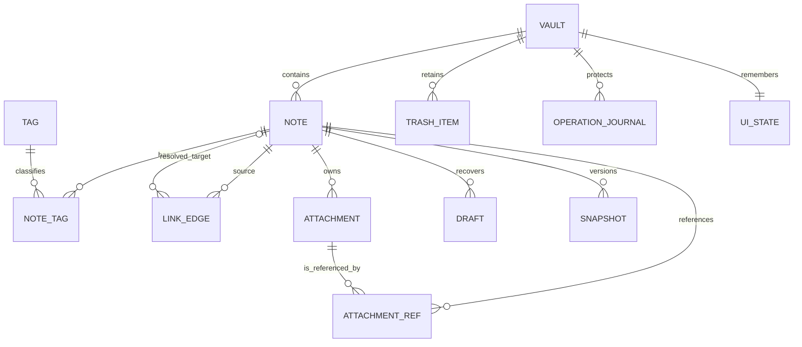

图中的 `NOTE_TAG`、`LINK_EDGE`、`ATTACHMENT_REF` 属于可重建索引；`DRAFT`、`SNAPSHOT`、`TRASH_ITEM` 和 `OPERATION_JOURNAL` 属于恢复数据，不能因重建索引而删除。

### 7.4 DATA-VAULT-001：知识库身份

存储位置：`.pkm/vault.json`。

| 字段 | 类型 | 必填 | 约束与含义 |
|---|---|---|---|
| schemaVersion | 正整数 | 是 | 知识库结构版本；未知高版本只读打开或拒绝写入 |
| vaultId | UUID v4 字符串 | 是 | 知识库稳定且全局唯一的身份 |
| displayName | 字符串 | 是 | 去除首尾空白后 1～255 个字符 |
| createdAt | RFC 3339 字符串 | 是 | 必须带时区，创建后不修改 |
| appVersionCreated | 字符串 | 是 | 创建该结构的应用版本，仅用于诊断 |

配置采用 UTF-8 JSON。写入时保留未知字段，便于向前兼容；`vaultId` 与目录名称无关，知识库移动或重命名后保持不变。对应 DR-KB-001。

### 7.5 DATA-NOTE-001：Markdown 笔记文档

每篇笔记是一个 UTF-8 `.md` 文件，由文件开头的 YAML front matter 和 Markdown 正文组成。

| YAML 键 | 类型 | 必填 | 格式与约束 | 更新规则 |
|---|---|---|---|---|
| id | 字符串 | 是 | 新建时使用 UUID v4；导入 ID 可匹配 `^[A-Za-z0-9][A-Za-z0-9._-]{0,127}$`；知识库内唯一 | 移动、重命名不变；复制生成新值；界面只读 |
| title | 字符串 | 是 | 去除首尾空白后 1～255 个字符；符合 Windows 文件名规则 | 应用内改标题时同步文件名；正文一级标题不自动覆盖 |
| tags | 字符串数组 | 是 | 可为空；保存完整层级路径；去空白、去重，不允许空层级 | 标签命令或属性面板更新 |
| created | RFC 3339 字符串 | 是 | 带时区 | 创建时写入；普通编辑、移动和重命名不变 |
| updated | RFC 3339 字符串 | 是 | 带时区且不早于 created | 正文或受管理元数据成功提交后更新 |
| 其他键 | 合法 YAML 值 | 否 | 键名不得与系统字段冲突 | 解析和序列化时原样保留 |

正文可以为空，但整个文件必须能以 UTF-8 解码。YAML 错误时，正文仍可编辑，依赖元数据的标签、链接维护和批量操作暂停；系统保留最后一次有效系统元数据，不自动生成新 ID 覆盖异常 ID。对应 DR-NOTE-001、DR-TAG-001。

### 7.6 DATA-ATT-001：附件及引用

附件默认存储在 `attachments/<note-id>/`。附件文件本身是权威数据，以下记录存入可重建索引。

| 字段 | 类型 | 约束与含义 |
|---|---|---|
| attachmentId | 字符串 | 由所属 noteId 与规范化相对路径确定的稳定索引键 |
| ownerNoteId | 字符串 | 指向所属笔记；导入时必填 |
| relativePath | 字符串 | 知识库内规范化相对路径；知识库内唯一 |
| displayName | 字符串 | 用户可见文件名，保留实际大小写 |
| sizeBytes | 非负整数 | 实际字节数 |
| detectedType | 字符串 | 依据文件签名与扩展名共同判断 |
| sha256 | 64 位十六进制字符串 | 导入、导出和备份完整性验证值 |
| modifiedAt | UTC 毫秒整数 | 文件最后修改时间，仅作为变更提示，不能单独证明版本相同 |
| riskClass | 枚举 | `safe-preview`、`sanitized-preview`、`external-open`、`dangerous`、`unknown` |

`ATTACHMENT_REF` 记录 `sourceNoteId`、`attachmentId`、`sourceStart`、`sourceEnd` 和 `status`；`status` 为 `resolved`、`missing`、`outside-vault` 或 `type-mismatch`。风险确认仅记录本次操作的布尔结果及时间，不形成永久信任。对应 DR-ATT-001～004。

### 7.7 DATA-INDEX-001：SQLite 可重建索引

存储位置：`.pkm/index.sqlite`。数据库不进入完整备份，删除后可从真实数据重建。

| 表/虚拟表 | 关键字段 | 主键与约束 | 用途 |
|---|---|---|---|
| schema_meta | schema_version、built_at、source_scan_id、health | 单行；health 为 `healthy/pending/rebuilding/damaged` | 索引版本和健康状态 |
| notes | note_id、relative_path、title、created_ms、updated_ms、content_hash、source_size、source_mtime_ms | note_id 主键；规范化路径唯一 | 笔记身份与文件版本投影 |
| note_fts | note_id、title、headings、body、tags、path、attachment_names | FTS5 虚拟表；note_id 不分词 | 全文检索、摘要和高亮 |
| tags | tag_key、display_name、parent_key、last_used_ms、direct_count | tag_key 主键；英文大小写折叠后唯一 | 标签目录及计数 |
| note_tags | note_id、tag_key | 联合主键；外键级联删除 | 笔记与完整标签路径多对多关系 |
| links | link_id、source_note_id、raw_target、target_note_id、alias、anchor、source_start、source_end、status | link_id 主键；目标可空 | Wiki 链接和失效状态 |
| attachments | attachment_id、owner_note_id、relative_path、display_name、size_bytes、detected_type、sha256、risk_class | attachment_id 主键；路径唯一 | 附件摘要 |
| attachment_refs | source_note_id、attachment_id、source_start、source_end、status | 来源与源码位置联合唯一 | 附件引用和未引用检查 |

索引规则：

- `content_hash` 使用 Markdown 文件 UTF-8 字节的 SHA-256；文件修改时间只用于快速判断是否需要重新计算哈希。
- 标签 `tag_key` 使用去除首尾空白、英文大小写折叠后的完整路径；`display_name` 保留首次创建形式。
- 链接状态限定为 `resolved`、`ambiguous`、`missing`、`invalid-anchor`；同一来源中的每次引用单独保存，图边查询时聚合。
- 每篇笔记的 notes、FTS、标签、链接和附件引用投影在一个 SQLite 事务中替换，避免同一笔记出现半更新索引。
- 外键约束开启；索引迁移失败时隔离旧库并重建，不修改 Markdown。

对应 DR-SEARCH-001～002、DR-TAG-002、DR-LINK-001～002、DR-GRAPH-001～002。

### 7.8 DATA-DRAFT-001 与 DATA-SNAPSHOT-001：草稿和快照

#### 紧急草稿

存储位置：`.pkm/recovery/drafts/<note-id>.json` 与独立正文文件。

| 字段 | 类型 | 含义 |
|---|---|---|
| schemaVersion | 正整数 | 草稿格式版本 |
| noteId | 字符串 | 所属笔记 ID |
| capturedAt | RFC 3339 | 缓存时间 |
| editorSessionId | UUID | 产生草稿的编辑会话 |
| baseVersion | 对象 | 最后成功保存文件的 sha256、size、mtimeMs |
| bodyFile | 相对路径 | 未保存完整正文文件；不得越出 drafts 目录 |
| reason | 枚举 | `continuous-input`、`save-failed`、`conflict-pending`、`unexpected-exit` |
| bodySha256 | 字符串 | 草稿正文完整性校验 |

#### 恢复快照

存储位置：`.pkm/snapshots/<note-id>/<timestamp>/`。

快照元数据记录 `noteId`、`createdAt`、`reason`、`sourceVersion`、`contentFile` 和 `sha256`。同一笔记默认最多保留 20 份；连续编辑时每 5 分钟最多生成一份。清理只能删除超过策略的最旧快照，正在冲突处理或被恢复候选引用的快照不得删除。对应 DR-EDIT-001～002。

### 7.9 DATA-CONFLICT-001：三方冲突记录

存储位置：`.pkm/recovery/conflicts/<conflict-id>/`。

| 字段 | 类型 | 约束与含义 |
|---|---|---|
| conflictId | UUID v4 | 主标识 |
| noteId | 字符串 | 冲突笔记 |
| detectedAt | RFC 3339 | 检测时间 |
| status | 枚举 | `pending`、`resolved-local`、`resolved-external`、`resolved-merged`、`saved-separately` |
| base/local/external | 对象 | 各自包含相对内容文件、SHA-256、大小和来源时间 |
| resolution | 对象或空 | 最终选择、结果 noteId、提交时间和未选版本保存位置 |

冲突未解决时暂停该笔记的普通自动保存，但继续写紧急草稿。三个版本均通过哈希校验后才显示；任何版本损坏都必须单独标记，不能以另一版本静默代替。对应 DR-EDIT-003。

### 7.10 DATA-TRASH-001：回收站项目

存储位置：`.pkm/trash/<trash-id>/`。每项包含原内容和 `metadata.json`。

| 字段 | 类型 | 约束与含义 |
|---|---|---|
| trashId | UUID v4 | 回收站项目标识 |
| itemType | 枚举 | `note`、`folder`、`attachment` |
| stableId | 字符串 | 笔记 ID；无稳定 ID 的目录使用本次生成 ID |
| originalPath | 相对路径 | 删除前路径 |
| deletedAt | RFC 3339 | 删除时间 |
| contentPath | 相对路径 | 回收站内实际内容位置 |
| attachments | 数组 | 关联附件的原路径、回收站路径、大小和 SHA-256 |
| expiresAt | RFC 3339 | 默认 deletedAt 后 30 天；用户设置可调整 |
| originalSha256 | 字符串或空 | 单文件项目的完整性校验 |

恢复时若原路径冲突，用户必须选择新名称、其他位置或取消，不得覆盖。到期清理属于永久删除，执行前按产品设置和确认规则处理。对应 DR-NOTE-002。

### 7.11 DATA-OP-001：操作计划与日志

存储位置：`.pkm/operations/<operation-id>.json`。用于批量移动、复制、重命名、标签更新、链接维护以及覆盖恢复。

| 字段 | 类型 | 约束与含义 |
|---|---|---|
| operationId | UUID v4 | 操作标识 |
| type | 枚举 | `move`、`copy`、`rename`、`tag-update`、`link-rewrite`、`restore-overwrite` 等 |
| state | 枚举 | `prepared`、`applying`、`committed`、`rolling-back`、`rolled-back`、`recovery-required` |
| createdAt/updatedAt | RFC 3339 | 创建和最后状态变化时间 |
| objects | 数组 | 对象 ID、原相对路径、目标相对路径；不记录正文 |
| idMap | 对象或空 | 文件夹复制期间的原 noteId 到副本 noteId 映射 |
| steps | 数组 | 步骤编号、动作、前置哈希、临时路径、提交状态、补偿动作 |
| failure | 对象或空 | 错误代码、安全消息和失败步骤 |

状态只能按合法状态机前进；每完成一个不可重复步骤就原子更新日志。`committed` 或 `rolled-back` 后可清理临时 ID 映射；`recovery-required` 必须在下次打开知识库时优先处理。文件操作历史从已完成日志提取，只包含操作类型、对象、路径、时间和结果。对应 DR-NOTE-003～004、NFR-REL-003。

### 7.12 DATA-SETTINGS-001 与 DATA-UISTATE-001：设置和界面状态

#### 全局设置

存储在 Windows 当前用户的应用配置目录，包含：

| 字段 | 类型 | 约束 |
|---|---|---|
| schemaVersion | 正整数 | 支持迁移；高版本不得覆盖 |
| theme | 枚举 | `light`、`dark`、`system` |
| fontFamily/fontSize | 字符串/数值 | 字体必须可用；字号位于允许范围 |
| wrap/lineNumbers | 布尔值 | 编辑器默认值 |
| shortcuts | 键值对象 | 动作 ID 到按键组合；不得覆盖系统保留组合或产生冲突 |
| recentVaults | 数组 | vaultId、最后有效绝对路径、lastOpenedAt；最多 10 项 |

全局最近路径不写入知识库、导出包或诊断日志。

#### 知识库界面状态

`.pkm/ui-state.json` 使用以下字段级契约；未知字段在同一主版本内保留，高版本文件不得被旧应用覆盖。

| 字段 | 类型/基数 | 约束与默认值 |
|---|---|---|
| schemaVersion | 正整数，1 | 必填；由迁移器逐版本升级，高于当前支持版本时只读并回退默认工作区 |
| stateVersion | 非负整数，1 | 每次成功提交界面状态递增；IF-NAV-001 使用它拒绝迟到写入 |
| vaultId | 字符串，1 | 必须等于当前 `.pkm/vault.json` 的 vaultId |
| sidebar | 对象，1 | `leftOpen/rightOpen` 为布尔值，`leftWidth/rightWidth` 限 180～600 px；非法值回退默认宽度 |
| viewMode | 枚举，1 | `edit/preview/split`，默认 `split` |
| scrollSync | 布尔值，1 | 默认 `true`；只影响编辑与预览联动 |
| tabs | 数组，0..20 | 每项含 tabId、noteId、`preview/pinned`、可选 scroll/cursor；noteId 去重，失效项恢复时跳过并报告 |
| activeTabId/activeNoteId | 字符串或 null，各 1 | 必须指向 tabs 中同一活动对象；不一致时选择首个固定标签或欢迎页 |
| sort | 对象，1 | `key=name/modified/created`、`direction=asc/desc`；默认 name/asc |
| recentNoteIds | 字符串数组，0..20 | 按最近访问倒序、去重；失效 ID 在恢复时清理 |
| pinnedGraphPositions | 映射，0..2000 | noteId → `{x,y}` 有限数值；仅保存固定节点，不保存派生边 |
| snapshotPolicy | 对象，1 | enabled、intervalMinutes、retainCount；必须符合第 7.8 节和 NFR-REL 约束 |
| trashRetentionDays | 整数，1 | 1～365，默认 30；不得绕过永久删除确认 |
| updatedAt | RFC 3339，1 | 界面状态最后成功提交时间，带时区 |

完整前进/后退历史和搜索筛选不跨重启保存；恢复时只读取白名单字段并逐项校验，不能因单个失效标签导致整个文件不可用。对应 DR-EDIT-004、DR-NAV-001～003、DR-GRAPH-003、DR-SET-001～003。

配置解析失败时将原文件复制到 `.pkm/diagnostics/` 或全局诊断目录，记录检测时间和失败原因后使用默认值；诊断副本不得额外收集正文。

### 7.13 DATA-BACKUP-001：完整备份格式

完整备份 ZIP 根目录只包含 `manifest.json` 和 `vault/`。所有 ZIP 条目使用 UTF-8 名称和 `/` 分隔符。

| manifest 字段 | 类型 | 约束 |
|---|---|---|
| schemaVersion | 正整数 | 高于当前支持版本时禁止普通恢复 |
| backupId | UUID v4 | 每次成功备份唯一 |
| vaultId | 字符串 | 必须与被备份 `.pkm/vault.json` 一致 |
| vaultName | 字符串 | 备份时的显示名称 |
| createdAt | RFC 3339 | 带时区 |
| appVersion | 字符串 | 创建备份的应用版本 |
| scope | 对象 | activeContent、attachments、trash、snapshots、recovery、uiState 布尔值 |
| fileCount | 非负整数 | 等于 files 数组长度 |
| totalBytes | 非负整数 | 等于所有未压缩文件大小之和 |
| files | 对象数组 | path、size、sha256、type；按规范化路径升序 |

索引、缓存、临时文件和普通日志不得进入备份。恢复前必须拒绝盘符、绝对路径、`..`、重复规范路径、越界符号链接和异常压缩膨胀；逐项验证数量、大小和 SHA-256。对应 DR-BACKUP-001、DR-RESTORE-001～002。

### 7.14 DATA-EXPORT-001：单篇 Markdown 导出包

导出 ZIP 包含：

| 路径 | 内容与约束 |
|---|---|
| note.md | 当前笔记；默认移除 id、created、updated，可按选择保留标题和标签 |
| attachments/ | 实际引用且通过预检的本地资源；安全文件名，同名追加确定性序号 |
| export-manifest.json | schemaVersion、createdAt、originalTitle、fileCount、totalBytes、files[path/size/sha256/type] |

清单不得包含知识库真实绝对路径。笔记内资源路径改写为包内相对路径；未包含的内部链接保留可读文字并标记“目标未包含”。导出预检另外在内存中记录格式、目标、预计内容、缺失附件、失效链接、远程资源和同名冲突，不因预检创建最终文件。对应 DR-EXP-001。

### 7.15 路径、标识、时间与版本规范

| 项目 | 统一规则 |
|---|---|
| 内部路径 | 使用相对知识库根目录的 `/` 分隔路径；禁止空段、`.`、`..`、盘符、UNC、NUL、Windows 保留设备名以及结尾空格/点 |
| 路径比较 | 保存实际显示形式；边界与唯一性比较使用 Unicode 规范化及 Windows 不区分大小写规则 |
| 真实路径检查 | 执行文件操作前解析父目录和已存在目标的真实路径，确认仍处于知识库或用户明确选择的目标范围 |
| 稳定 ID | 新建知识库、笔记、备份、操作和冲突记录使用 UUID v4；导入 ID 另按兼容规则校验 |
| 时间交换格式 | Markdown、JSON 和清单使用带时区 RFC 3339；SQLite 排序字段使用 UTC Unix 毫秒 |
| 文件版本 | 使用 SHA-256、字节数和 mtimeMs 组成；冲突判断以 SHA-256 为准，mtime 只作快速筛选 |
| 模式版本 | 每种 JSON/ZIP/SQLite 结构独立维护 schemaVersion；迁移只作用于副本或事务，失败保留原数据 |

### 7.16 一致性与事务策略

#### 7.16.1 单篇笔记保存

1. 读取当前磁盘版本并与编辑会话 `baseVersion` 比较。
2. 若磁盘哈希变化且本地缓冲区也有修改，建立 DATA-CONFLICT-001，不覆盖任一版本。
3. 校验 YAML、系统字段、文件名和目标路径；依赖元数据的校验失败时阻止提交但保留草稿。
4. 在同目录写入临时文件，完成 UTF-8、YAML 和 SHA-256 复验。
5. 使用受保护的替换操作提交；失败时保留原文件和紧急草稿。
6. 提交成功后发布 `NoteSaved`，在单一 SQLite 事务中替换该笔记的全部派生投影。
7. 索引失败时标记 `pending` 并排队重试；界面显示“已保存，待索引”。

#### 7.16.2 多文件和批量操作

1. 生成 DATA-OP-001，列出全部源、目标、前置哈希、临时路径和补偿动作。
2. 一次性检查路径、冲突、权限、空间、未保存编辑会话和受影响链接。
3. 在临时位置准备新文件并逐项校验；未完成预检不得改变正式路径。
4. 状态改为 `applying` 后按确定顺序提交，每步原子更新日志。
5. 任一步失败立即进入 `rolling-back` 并逆序补偿。
6. 全部成功后标记 `committed` 并发布领域事件；补偿失败则标记 `recovery-required`，禁止继续修改相关对象。

#### 7.16.3 外部修改与文件监视

- 文件事件以规范化路径、文件身份和短时间窗口去重；监视溢出或重连触发受控重扫。
- 没有本地未保存内容时，外部新版本经校验后刷新编辑会话和索引。
- 存在本地未保存内容时建立三方冲突记录；不得因监视事件自动保存或自动合并。
- 文件被外部删除或移动时先标记缺失，允许用户重新定位；不得创建空白文件替代。

### 7.17 生命周期与清理规则

| 数据 | 保留与清理规则 |
|---|---|
| Markdown 与附件 | 仅在用户明确删除、批量操作或恢复操作中改变 |
| 搜索索引 | 可随时重建；关闭知识库前完成未提交事务，临时索引任务可取消 |
| 紧急草稿 | 成功保存并正常关闭会话后才可清理；异常退出或冲突未解决时保留 |
| 快照 | 默认每篇最多 20 份；处于冲突、恢复候选或当前操作引用中的快照不清理 |
| 回收站 | 默认 30 天；永久删除和清空必须确认，不得作为普通撤销操作 |
| 操作日志 | committed/rolled-back 且超过撤销窗口后可压缩为不含正文的历史；未完成日志必须保留 |
| 筛选与搜索查询 | 仅当前会话内存保存，退出后清除 |
| 导出/备份临时文件 | 成功提交或失败清理；无法清理时记录安全路径并在下次启动重试 |

### 7.18 数据设计验证

| 编号 | 验证目标 | 方法与通过标准 |
|---|---|---|
| TEST-DATA-001 | YAML 字段与未知字段保留 | 对合法、缺失、重复、非法和自定义 YAML 往返读写；合法未知字段不丢失，非法系统字段不覆盖有效值 |
| TEST-DATA-002 | 路径边界安全 | 使用绝对路径、`..`、符号链接、大小写冲突、保留名和双重编码输入；全部越界目标被拒绝 |
| TEST-DATA-003 | 索引可重建 | 删除 index.sqlite 后扫描标准知识库；搜索、标签、链接和附件引用结果与删除前一致 |
| TEST-DATA-004 | 单文件原子保存 | 在临时写入、校验和替换阶段分别注入错误；磁盘上始终存在完整旧版或完整新版，草稿可恢复 |
| TEST-DATA-005 | 批量操作一致性 | 在每个提交步骤注入权限、占用和磁盘错误；结果完全回滚或完整提交，日志状态与文件一致 |
| TEST-DATA-006 | 三方冲突完整性 | 同时产生基准、本地和外部版本；三份内容及哈希均可独立读取，未选择版本进入恢复记录 |
| TEST-DATA-007 | 备份与恢复校验 | 修改路径、数量、大小、哈希、版本及压缩比例；任一不符均禁止普通恢复且原 ZIP 不改变 |
| TEST-DATA-008 | 数据规模 | 使用 5,000 篇、500 MB Markdown、20,000 条链接和 2 GB 附件测试索引体积、查询和重建指标 |

## 8. 接口设计

### 8.1 接口分层与基本约定

系统接口分为三类：

1. **渲染进程安全接口**：由 preload 通过 `contextBridge` 暴露给界面，只提供白名单用例，不暴露原始 IPC。
2. **内部模块接口**：由应用服务调用领域模块的命令、查询与端口；接口使用 TypeScript 数据契约表达，但不暴露内部实体和数据库记录。
3. **外部环境接口**：由 MOD-PLATFORM 封装文件系统、文件监视、SQLite、ZIP、PDF、系统选择对话框、默认浏览器和默认文件程序。

统一约定如下：

- 所有跨进程数据必须可结构化克隆，不传递函数、系统句柄、数据库连接或可变领域对象。
- 所有命令请求包含 `requestId`；批量和长任务另包含 `operationId` 或返回 `taskId`。
- 所有知识库内对象以 `vaultId`、稳定对象 ID 和规范化相对路径标识；普通界面调用不提交任意绝对路径。
- 只有系统文件选择对话框可以产生库外目标；界面获得 `displayPath` 与短期 `selectionToken`，后续命令使用 token，不使用用户拼接路径。
- 查询接口无持久化副作用；命令接口必须明确是否幂等、是否可取消以及成功提交点。
- 正文、草稿和差异内容只在确有业务需要的接口中返回，不进入普通日志、错误详情或任务进度事件。
- 版本字段缺失、未知枚举、额外危险字段或超出允许范围的输入一律拒绝，不进行猜测性转换。

### 8.2 通用返回结构

#### 8.2.1 同步结果

```typescript
type Result<T> =
  | { ok: true; data: T; correlationId: string }
  | { ok: false; error: AppError; correlationId: string };

interface AppError {
  code: ErrorCode;
  message: string;               // 可向用户显示，不含敏感正文
  retryable: boolean;
  fieldErrors?: Array<{ field: string; reason: string }>;
  recoveryActions: Array<'retry' | 'rename' | 'choose-location' |
    'open-readonly' | 'rebuild-index' | 'resolve-conflict' |
    'view-details' | 'cancel'>;
  technicalRef?: string;         // 只引用诊断记录，不返回堆栈或正文
}
```

#### 8.2.2 长任务结果

```typescript
interface TaskAccepted {
  taskId: string;
  operationId?: string;
  acceptedAt: string;
  cancellable: boolean;
}

interface TaskEvent<TSummary = unknown> {
  taskId: string;
  sequence: number;
  state: 'queued' | 'running' | 'cancelling' |
    'completed' | 'cancelled' | 'failed' | 'recovery-required';
  completedUnits?: number;
  totalUnits?: number;
  phase: string;
  summary?: TSummary;
  error?: AppError;
}
```

事件 `sequence` 对同一任务严格递增；界面忽略重复或倒序事件。取消只在安全检查点生效；接口返回“已请求取消”不等于任务已经回滚完成，只有终态事件可作为最终结果。

### 8.3 统一错误代码

| 错误代码 | 含义 | 是否可重试 | 典型恢复操作 |
|---|---|---:|---|
| E-VALIDATION | 字段缺失、格式或枚举非法 | 否 | 修正输入 |
| E-NOT-FOUND | 知识库、笔记、附件或任务不存在 | 视情况 | 重新定位、刷新或取消 |
| E-NAME-CONFLICT | 目标名称或路径已存在 | 否 | 改名、跳过或取消 |
| E-VERSION-CONFLICT | 磁盘版本与编辑基准不一致 | 否 | 进入三方冲突处理 |
| E-VAULT-READONLY | 知识库未取得写锁 | 否 | 保持只读或重新打开 |
| E-PATH-OUTSIDE | 规范化后路径越出授权范围 | 否 | 重新选择合法位置 |
| E-PERMISSION | 文件或目录无访问权限 | 是 | 修改权限、重新选择或取消 |
| E-DISK-SPACE | 可用空间不足 | 是 | 清理空间或改选目标 |
| E-FILE-IN-USE | 文件被其他程序占用 | 是 | 关闭占用程序后重试 |
| E-INDEX-DAMAGED | SQLite 索引无法读取或迁移 | 是 | 重建索引 |
| E-METADATA-INVALID | YAML 或系统字段非法 | 否 | 修复指定位置 |
| E-ARCHIVE-UNSAFE | ZIP 路径、大小、数量或哈希不安全 | 否 | 取消普通恢复或仅执行合规抢救提取 |
| E-UNSUPPORTED-VERSION | 数据结构版本高于当前支持范围 | 否 | 使用兼容版本或只读查看 |
| E-EXTERNAL-OPEN-DENIED | URL/文件风险校验或确认未通过 | 否 | 取消或重新确认合法目标 |
| E-TASK-CANCELLED | 长任务已在安全点取消 | 是 | 重新发起任务 |
| E-RECOVERY-REQUIRED | 自动补偿未完全成功 | 否 | 打开恢复中心处理 |
| E-INTERNAL | 未分类内部错误 | 视情况 | 查看诊断编号并安全重试 |

所有错误必须先映射为上述安全错误再返回界面。系统日志可记录错误类别、模块、操作 ID 和相对路径摘要，但不能记录正文、草稿、附件内容、密码类信息或未脱敏的库外绝对路径。

### 8.4 渲染进程安全 API

preload 只在 `window.pkm` 下暴露以下命名空间：

| 命名空间 | 方法示例 | 对应内部接口 | 限制 |
|---|---|---|---|
| pkm.dialog | chooseVaultFolder、chooseImportFiles、chooseExportTarget | IF-EXT-DIALOG-001 | 必须由可见用户操作触发；返回 selectionToken |
| pkm.vault | create、inspect、initialize、open、switch、close、rescan | IF-KB-001/002 | 写操作要求当前窗口和合法选择 token |
| pkm.navigation | openNoteView、openPreviewTab、pinTab、closeTab、navigateBack、navigateForward、restoreWorkspace | IF-NAV-001 | 只操作导航状态；目标 noteId 必须属于活动知识库 |
| pkm.note | create、rename、move、copy、trash、undo、executeBatch | IF-NOTE-001/002 | 要求活动 vaultId；写入时检查锁和对象版本 |
| pkm.editor | openSession、save、renderPreview、find、replace、resolveConflict | IF-EDIT-001～003 | 同一 noteId 同时最多一个活动写会话 |
| pkm.tag | suggest、rename、merge、remove、normalizeFilter | IF-META-001/002 | 批量写入走 operationId |
| pkm.search | query、rebuild、getHealth | IF-SEARCH-001/002 | 查询可并发；重建为长任务 |
| pkm.link | suggest、backlinks、validate、rewrite、getGraph | IF-LINK-001/002 | 链接重写只返回计划，提交走批量操作 |
| pkm.attachment | inspect、import、preview、openExternal、scanOrphans | IF-ATT-001/002 | 外部打开必须再次确认高风险文件 |
| pkm.protection | listRecovery、restoreTrash、backup、verifyBackup、restore | IF-PROTECT-001～003 | 覆盖恢复、永久删除必须带确认凭证 |
| pkm.export | inspect、markdown、html、pdf | IF-EXPORT-001 | 目标来自选择 token；长任务返回 taskId |
| pkm.settings | get、update、reset、validateShortcut | IF-SET-001 | 只接受已定义设置键 |
| pkm.tasks | subscribe、cancel、getSnapshot | IF-TASK-001 | subscribe 返回取消订阅函数，不暴露原始 IPC |

preload 在发送 IPC 前执行结构校验，主进程必须重复校验，不能信任渲染进程已经检查。IPC channel 在代码中固定注册，不能由界面提交任意 channel 名称。

#### IF-NAV-001：工作区与标签导航接口

| 方法 | 输入 | 输出 | 错误/调用限制 |
|---|---|---|---|
| openNoteView | vaultId、noteId、可选 heading/line、openMode=`preview/pinned` | activeTabId、定位结果、navigationEntryId | noteId 必须属于活动知识库；不存在返回 E-NOT-FOUND；不读取任意路径 |
| openPreviewTab | vaultId、noteId、可选定位 | previewTabId、replacedPreviewTabId? | 同一笔记只保留一个标签；未固定预览标签可被下一次预览替换 |
| pinTab / closeTab | tabId、expectedWorkspaceVersion；关闭时可带 dirtyAction | 新 workspaceVersion、活动标签摘要 | 脏编辑会话必须先经 IF-EDIT-002 保存或明确取消/放弃；不能由导航接口直接丢弃正文 |
| navigateBack / navigateForward | expectedWorkspaceVersion | 目标标签、noteId、heading/scroll/cursor、historyState | 历史目标缺失时返回 E-NOT-FOUND 并保留当前位置；一次调用只移动一个历史节点 |
| restoreWorkspace | vaultId、expectedStateVersion? | 已恢复标签、活动视图、跳过项和警告 | 只恢复 DATA-UISTATE-001 中仍属于当前知识库的对象；高版本或损坏状态回退安全默认值 |

所有方法只改变或读取工作区导航状态，不写 Markdown、附件或索引；接口输出与 DATA-UISTATE-001 的 `stateVersion` 对齐，迟到结果不得覆盖较新工作区状态。对应 FR-NAV-001～005、DR-NAV-001～003、BR-052～058。

### 8.5 知识库接口

#### IF-KB-001：知识库生命周期接口

| 项目 | 定义 |
|---|---|
| 用途 | 创建、打开、切换、关闭和重新定位知识库 |
| 主要方法 | createVault、openVault、switchVault、closeVault、relocateVault |
| 输入 | requestId、selectionToken 或 vaultId、名称；打开时可选 `mode=readwrite/readonly` |
| 输出 | VaultSummary：vaultId、displayName、displayPath、mode、health、active、warning 列表 |
| 错误 | E-NAME-CONFLICT、E-PERMISSION、E-VAULT-READONLY、E-UNSUPPORTED-VERSION、E-NOT-FOUND |
| 限制 | 同一窗口只激活一个知识库；切换前必须完成或取消当前保存；写模式必须取得锁 |
| 幂等性 | requestId 重复且参数一致时返回首次结果；closeVault 对已关闭目标返回成功 |

#### IF-KB-002：初始化与扫描接口

| 项目 | 定义 |
|---|---|
| 用途 | 检查普通 Markdown 文件夹、展示摘要并在确认后初始化或重扫 |
| 输入 | selectionToken/vaultId、scanOptions；初始化另需 scanId 和确认标志 |
| 输出 | ScanSummary：scanId、markdownCount、attachmentCount、unknownCount、issues[]、estimatedBytes |
| 错误 | E-PATH-OUTSIDE、E-PERMISSION、E-VERSION-CONFLICT、E-TASK-CANCELLED |
| 限制 | inspect 无写入；initialize 只能使用未过期且目标版本未变化的 scanId；不改写原 Markdown |
| 执行方式 | 大目录扫描返回 taskId；完成事件只包含摘要，不传输所有正文 |

### 8.6 笔记与目录接口

#### IF-NOTE-001：单项文件操作接口

```typescript
interface NoteCommandRequest {
  requestId: string;
  vaultId: string;
  command: 'create-note' | 'create-folder' | 'rename' |
    'move' | 'copy' | 'move-to-trash' | 'undo';
  objectId?: string;
  parentRelativePath?: string;
  targetRelativePath?: string;
  requestedName?: string;
  expectedVersion?: { sha256: string; size: number; mtimeMs: number };
  conflictPolicy?: 'ask' | 'rename' | 'skip' | 'cancel';
}
```

输出 `FileOperationResult`：operationId、对象 ID、最终相对路径、受影响对象数量、undoUntil、warnings。错误包括名称冲突、版本冲突、只读、权限、占用和路径越界。创建命令用 requestId 幂等；移动、复制和删除用 operationId 防止重复执行。对应 FR-NOTE-001～010、013。

#### IF-NOTE-002：批量操作计划接口

| 方法 | 输入 | 输出 | 限制 |
|---|---|---|---|
| previewBatch | vaultId、对象 ID 列表、操作类型、目标、冲突策略 | operationId、影响笔记/附件/链接数量、冲突、预计字节和步骤摘要 | 只预检，不改变数据 |
| executeBatch | operationId、planVersion、确认标志 | TaskAccepted | planVersion 必须仍匹配磁盘；单知识库同时只允许一个批量写任务 |
| cancelBatch | taskId | 当前取消请求状态 | 只在安全检查点取消；进入提交阶段后按日志完成或回滚 |

批量计划过期、任何源版本变化或出现新冲突时返回 E-VERSION-CONFLICT，要求重新预检，不复用旧计划。

### 8.7 编辑、元数据与冲突接口

#### IF-EDIT-001：编辑会话接口

| 方法 | 输入 | 输出 | 错误/限制 |
|---|---|---|---|
| openEditorSession | vaultId、noteId | sessionId、正文、元数据、baseVersion、只读状态、恢复候选摘要 | 找不到返回 E-NOT-FOUND；同一笔记复用已有会话 |
| updateBuffer | sessionId、clientRevision、正文或最小文本变更 | acceptedRevision、dirty、draftDueAt | revision 必须连续；只修改内存缓冲区 |
| closeEditorSession | sessionId、action=`save/discard/cancel` | closed、saveResult | dirty 会话不得无确认丢弃 |
| renderPreview | sessionId、revision、范围 | sanitizedHtml、diagnostics[]、outline[] | 结果仅对应指定 revision；不得加载库外资源 |
| find/replace | sessionId、revision、查询与选项 | 匹配位置或 newRevision | 首版不接受正则替换；替换后仍只在缓冲区 |
| pasteContent | sessionId、clientRevision、剪贴板条目（纯文本/受限富文本/图片） | newRevision、insertedMarkdown、importedAttachment?、warnings[] | 富文本先去除脚本、事件属性和外部样式再转换为安全 Markdown；图片转交 IF-ATT-001 `pasteAttachment`，导入失败时不插入无效引用 |

`pasteContent` 明确落实 FR-EDIT-011：纯文本按原文插入；富文本只能转换为安全 Markdown；图片必须完成附件校验与提交后才写入相对引用。任一步失败均保持原缓冲区 revision，不允许部分插入。

#### IF-EDIT-002：保存接口

```typescript
interface SaveNoteRequest {
  requestId: string;
  sessionId: string;
  noteId: string;
  clientRevision: number;
  baseVersion: { sha256: string; size: number; mtimeMs: number };
  reason: 'autosave' | 'switch' | 'close' | 'manual';
}

interface SaveNoteResult {
  noteId: string;
  savedRevision: number;
  newVersion: { sha256: string; size: number; mtimeMs: number };
  savedAt: string;
  indexState: 'updated' | 'pending';
  warnings: string[];
}
```

同一 noteId 保存串行化；旧 revision 的延迟保存请求被拒绝或合并，不能覆盖新 revision。磁盘版本变化返回 E-VERSION-CONFLICT 并创建冲突记录。索引失败时保存仍返回成功，但 `indexState=pending`。

#### IF-EDIT-003：冲突处理接口

输入 conflictId、expectedConflictVersion、决策 `keep-local/keep-external/manual-merge/save-separately/defer`，手动合并时另带合并正文。输出最终 noteId、版本、未选版本恢复位置和索引状态。冲突已由其他操作处理时返回 E-VERSION-CONFLICT；`defer` 不改变磁盘正文并继续保存草稿。

#### IF-META-001/002：元数据和标签接口

| 接口 | 输入 | 输出 | 错误与限制 |
|---|---|---|---|
| IF-META-001 parse/validate/serialize | Markdown 或 YAML、最后有效系统元数据 | 正文、系统字段、自定义字段、带源码位置的 diagnostics | 非法 YAML 返回 E-METADATA-INVALID；不得丢失正文或未知字段 |
| IF-META-002 suggest/query | vaultId、输入前缀或标准筛选表达式 | 标签显示名、规范键、直接数、含后代数 | 查询无持久化副作用 |
| IF-META-002 previewTagMutation | requestId、vaultId、action=`rename/merge/delete`、sourceTagKey、可选 targetTagKey/deleteScope、expectedCatalogVersion、冲突策略 | operationId、planVersion、规范化源/目标、受影响笔记与后代数量、逐项前置哈希、冲突和警告 | 只生成 DATA-OP-001 计划，不写文件；标签不存在、非法目标、缺少 deleteScope 或版本变化返回统一错误 |
| IF-META-002 executeTagMutation | requestId、operationId、planVersion、confirmationToken | TaskAccepted；完成摘要含更新/跳过/失败数量、新 catalogVersion、indexState | 与 IF-NOTE-002 粒度一致：同一计划只执行一次，单知识库批量写串行，任一前置哈希变化返回 E-VERSION-CONFLICT |
| IF-META-002 cancelTagMutation | operationId 或 taskId | cancelled/cancelling 与安全点摘要 | prepared 状态可无副作用取消；applying 后按 DATA-OP-001 完成补偿，不能静默留下部分 YAML |

命令语义：`rename` 将源标签及其后代路径映射到新前缀；`merge` 把来源关联转移到目标并按规范键去重；`delete` 必须携带 `parent-only` 或 `subtree`，且只移除标签关联、不删除笔记。`requestId`、`operationId`、`planVersion`、前置哈希、确认凭证、取消和终态规则与 IF-NOTE-002 相同，确保批量标签命令具有同等幂等、并发控制和恢复粒度。

### 8.8 检索接口

#### IF-SEARCH-001：搜索查询接口

```typescript
interface SearchQuery {
  vaultId: string;
  text?: string;
  folders?: string[];
  includeTags?: string[];
  excludeTags?: string[];
  tagMode: 'all' | 'any';
  modifiedFrom?: string;
  modifiedTo?: string;
  scope: 'active' | 'trash';
  sort: 'relevance' | 'modified-desc' | 'title-asc';
  cursor?: string;
  pageSize: number;
}
```

输出：items[]（noteId、title、relativePath、matchedFields、最多三个安全片段、score、modifiedAt、unsaved）、nextCursor、indexHealth、queryDiagnostics。pageSize 必须在接口允许范围内；cursor 与原查询哈希绑定，查询变化后不可复用。未保存缓冲区由应用服务合并并明确标记。对应 FR-SEARCH-001～007。

#### IF-SEARCH-002：索引维护接口

`rebuildIndex(vaultId, reason)` 返回 TaskAccepted；`getIndexHealth(vaultId)` 返回状态、待索引数量、最后成功时间和可恢复操作；`retryPending(vaultId)` 只处理待更新项。单知识库同时只运行一个全量重建，重复请求返回同一活动 taskId。

### 8.9 链接与图谱接口

#### IF-LINK-001：链接接口

| 方法 | 输入 | 输出 | 约束 |
|---|---|---|---|
| suggestTargets | vaultId、输入文本、当前 noteId | noteId、标题、路径、消歧信息 | 不返回回收站和隐藏系统文件 |
| resolveLink | vaultId、sourceNoteId、rawTarget、anchor | resolved/ambiguous/missing、候选列表 | 同名目标不得静默任选 |
| getBacklinks | vaultId、targetNoteId、cursor | 来源、位置、上下文和引用次数 | 上下文经过转义且受长度限制 |
| validateLinks | vaultId、noteId 或范围 | 失效、歧义、非法锚点清单 | 大范围验证返回 taskId |
| planLinkRewrite | operationId、路径变更映射 | 文件级修改计划、前置哈希和冲突 | 只生成计划，不直接写入文件 |

#### IF-LINK-002：连接图接口

输入 `GraphQuery`：vaultId、mode=`global/local`、centerNoteId、depth、标签/目录筛选、是否包含孤立节点、节点上限和 continuationToken。输出 nodes（noteId、title、path、tags、入/出度）、edges（source、target、count）、truncated 和 continuationToken。布局任务另返回 taskId，并只接收节点 ID、边和固定坐标，不接收正文。

### 8.10 附件接口

#### IF-ATT-001：检查与导入接口

| 方法 | 输入 | 输出 | 错误/限制 |
|---|---|---|---|
| inspectAttachment | vaultId、sourceSelectionToken | 名称、大小、扩展名、检测类型、风险类别、可用动作 | token 必须来自可见文件选择或拖放授权 |
| importAttachment | vaultId、noteId、selectionToken、namePolicy | attachmentId、相对路径、Markdown 引用、sha256、warnings | 先复制到临时目标并校验；不引用库外路径 |
| pasteAttachment | sessionId、受支持的剪贴板条目 | 与 import 相同 | 只接受图像或明确文件条目；不执行富文本脚本 |
| scanOrphans | vaultId、范围 | TaskAccepted/候选清单 | 只生成候选；删除必须走显式确认和回收站流程 |

#### IF-ATT-002：预览与外部打开接口

`previewAttachment` 输入 attachmentId，输出受控预览 URL 或不可预览原因；该 URL 仅允许当前知识库、当前会话和短期有效。`requestExternalOpen` 输入 attachmentId、expectedSha256 和一次性 confirmationToken；高风险、未知或类型不符文件每次都需要新确认，最终由 IF-EXT-OS-001 执行。

### 8.11 数据保护、备份与恢复接口

#### IF-PROTECT-001：草稿、快照与回收站接口

| 方法 | 输入 | 输出 | 限制 |
|---|---|---|---|
| writeEmergencyDraft | sessionId、noteId、revision、baseVersion、reason | capturedAt、sha256 | 同一会话只保留最新活动草稿；写入失败不得阻塞用户继续编辑但必须提示 |
| createSnapshot | noteId、sourceVersion、reason | snapshotId、createdAt | 遵循每 5 分钟最多一份及最多 20 份策略 |
| listRecoveryCandidates | vaultId/noteId | 草稿、快照、冲突和未完成操作摘要 | 默认不返回完整正文，查看时按项加载 |
| restoreTrashItem | trashId、目标选择、冲突策略 | operationId、恢复路径和结果 | 目标冲突不得覆盖；恢复前校验内容 |

#### IF-PROTECT-002：备份接口

输入 vaultId、目标 selectionToken 和 scope；预检输出预计文件数、字节数、缺失项和隐私提示。确认后 `createBackup` 返回 TaskAccepted。完成输出 backupId、最终 displayPath、fileCount、totalBytes、manifestSha256 和 warnings。只有回读全部条目并校验后才能进入 completed。

#### IF-PROTECT-003：恢复接口

`inspectBackup(selectionToken)` 返回版本、安全、数量、大小、哈希和可恢复范围；`previewRestore` 返回目标、迁移计划、空间要求及冲突；`executeRestore` 输入检查 ID、目标 token、模式 `new-directory/overwrite` 和必要确认凭证，返回 TaskAccepted。覆盖模式必须先成功创建安全副本。高版本、路径穿越、哈希错误或异常压缩膨胀返回 E-ARCHIVE-UNSAFE/E-UNSUPPORTED-VERSION。

### 8.12 导出接口

#### IF-EXPORT-001：内容导出接口

| 项目 | 定义 |
|---|---|
| 用途 | 导出 Markdown 资料包、单文件 HTML 或 A4 PDF |
| 输入 | vaultId、noteId、expectedVersion、format、options、目标 selectionToken |
| 预检输出 | 内容范围、预计大小、附件清单、缺失附件、失效链接、远程资源和同名冲突 |
| 执行输出 | TaskAccepted；完成事件包含格式、最终 displayPath、大小、SHA-256 和警告 |
| 错误 | E-VERSION-CONFLICT、E-NOT-FOUND、E-PERMISSION、E-DISK-SPACE、E-TASK-CANCELLED |
| 限制 | 不修改原笔记；远程资源默认不抓取；同名覆盖必须有本次确认；最终文件在临时产物复验后提交 |

当 `format=html` 且预检 `estimatedBytes > 50 MiB` 时，预检必须返回 `requiresLargeHtmlConfirmation=true`、预计大小和主要资源占比；执行请求必须携带与本次预检版本绑定的一次性确认凭证。未确认、凭证过期或源版本变化时不启动任务并返回 E-VALIDATION/E-VERSION-CONFLICT。该阈值是 FR-EXP-003、BR-089 的二次提示边界，不是文件硬上限。

相同 requestId 和输入在任务仍存在时返回相同 taskId，避免用户双击产生重复导出。

### 8.13 设置与任务接口

#### IF-SET-001：设置接口

`getSettings(scope, vaultId?)` 返回 schemaVersion、值和来源（默认/全局/知识库）；`updateSettings` 输入 expectedVersion 和已定义键值，输出新版本和生效范围；`resetSettings` 需要指定键或范围。未知键、越界字号、冲突快捷键和高版本配置返回 E-VALIDATION/E-UNSUPPORTED-VERSION。

#### IF-TASK-001：后台任务接口

`subscribe(taskId, listener)` 只订阅当前窗口有权访问的任务；`getSnapshot(taskId)` 获取最新序列和状态；`cancel(taskId)` 请求安全取消。完成、失败、取消和 recovery-required 为终态，终态后不再发送进度。窗口关闭不自动取消备份或恢复，应用退出前必须明确等待、取消或完成恢复处理。

### 8.14 外部环境接口

| 接口 | 封装对象 | 输入/输出 | 错误约定 | 调用限制 |
|---|---|---|---|---|
| IF-EXT-FS-001 FilePort | Windows/Node 文件系统 | 相对路径、字节或流、期望版本；返回文件版本和结果 | 权限、空间、占用、越界映射为统一错误 | 主进程内调用；所有目标先 realpath/父路径校验；写入使用临时文件 |
| IF-EXT-WATCH-001 WatchPort | 文件系统监视 | 注册知识库根；输出创建/修改/重命名/删除/溢出事件 | 断开、溢出产生明确 health 事件 | 事件只作变化提示，最终状态以受控重扫为准 |
| IF-EXT-SQLITE-001 IndexStorePort | SQLite FTS5 | 参数化查询和模块仓储事务；返回 DTO | 损坏、锁定、迁移失败映射为 E-INDEX-DAMAGED | 禁止拼接用户 SQL；数据库只保存派生数据 |
| IF-EXT-DIALOG-001 DialogPort | Windows 系统文件选择器 | 允许类型、模式；返回 displayPath 与 selectionToken | 用户取消不是错误 | 只能由可见用户操作触发；token 限范围、次数和有效期 |
| IF-EXT-OS-001 ExternalOpenPort | 默认浏览器/默认文件程序 | 单个已验证 URL 或文件目标 | 无关联、目标不存在、风险拒绝 | 不拼接 Shell 命令；只允许 http/https 及经确认的本地文件 |
| IF-EXT-ARCHIVE-001 ArchivePort | ZIP 读写组件 | 安全条目流和清单；输出校验摘要 | 路径、重复项、比例、哈希异常统一拒绝 | 不直接解压到最终目录；不跟随符号链接 |
| IF-EXT-PDF-001 PdfPort | Electron printToPDF | 受控本地 HTML、A4 参数；输出临时 PDF 和哈希 | 渲染/字体/写入失败映射为安全错误 | 使用隔离隐藏窗口；禁止远程导航和脚本 |
| IF-EXT-HASH-001 HashPort | SHA-256 实现 | 字节流；输出小写十六进制哈希 | 读取失败沿用文件错误 | 使用流式计算，避免整份大附件载入内存 |

这些接口是对操作系统或嵌入式组件的封装，不表示系统依赖在线第三方服务。应用离线时全部核心功能仍可运行。

### 8.15 接口调用顺序与并发限制

| 对象/操作 | 并发规则 |
|---|---|
| 单篇笔记保存 | 同一 noteId 串行；不同笔记可并发，但文件提交与索引事务分别受控 |
| 知识库切换/关闭 | 与保存、批量操作、备份恢复互斥；必须先达到安全检查点 |
| 批量文件操作 | 单知识库同时一个写任务；预检查询可以并发 |
| 全量索引重建 | 单知识库同时一个；保存产生的增量事件排队并在重建尾部合并 |
| 连接图布局 | 可取消并以最新查询为准；旧 taskId 的结果不得覆盖新视图 |
| 导出 | 不修改知识库时可以并发；同一最终目标只能一个提交者 |
| 备份 | 可与普通编辑并发，但备份每个文件按清单版本读取；变化项重读或报告不一致 |
| 恢复 | 与目标知识库所有写入互斥；覆盖恢复时目标知识库必须关闭 |
| 外部打开 | 每次只传递一个目标；高风险确认 token 一次性使用 |

### 8.16 接口安全与兼容策略

- 每个 IPC 请求都验证窗口身份、活动 vaultId、接口版本、字段白名单和对象授权。
- preload API 与主进程契约携带 `apiVersion`；新增可选字段保持向后兼容，删除或改变字段语义必须升级主版本。
- 不把应用内部绝对路径、堆栈、SQL、系统句柄或通用文件读取能力返回给 Markdown 预览内容。
- Markdown 预览链接通过受控事件转交应用处理，不允许页面直接导航到 `file:`、`javascript:` 或自定义危险协议。
- selectionToken 和 confirmationToken 均与窗口、用途和目标绑定；过期、复用或用途不符返回 E-VALIDATION/E-PATH-OUTSIDE。
- 所有外部库调用异常在模块边界转换成 AppError，业务层不依赖第三方错误字符串。

### 8.17 接口设计验证

| 编号 | 验证目标 | 方法与通过标准 |
|---|---|---|
| TEST-IF-001 | IPC 白名单 | 枚举 window.pkm 和已注册 channel；不存在原始 IPC、任意 channel、任意文件或命令执行入口 |
| TEST-IF-002 | 双重输入校验 | 绕过界面直接发送缺失字段、未知字段、非法枚举和越界路径；preload 或主进程拒绝且无副作用 |
| TEST-IF-003 | 幂等与重复点击 | 用相同 requestId 重复创建、导出和批量执行；不生成重复对象或重复任务 |
| TEST-IF-004 | 版本并发控制 | 使用过期 baseVersion、planVersion、clientRevision 调用保存和批量接口；返回冲突且不覆盖新版 |
| TEST-IF-005 | 任务事件顺序 | 注入重复、延迟和倒序进度事件；界面只接受递增 sequence，终态不会被旧事件覆盖 |
| TEST-IF-006 | 取消语义 | 在扫描、索引、布局、导出和备份各阶段取消；仅在安全点终止，临时文件和事务得到清理或标记恢复 |
| TEST-IF-007 | 外部程序调用 | 使用空格、引号、命令符号、危险协议和风险扩展名；只传递合法单目标，不产生额外命令 |
| TEST-IF-008 | 错误信息边界 | 触发所有错误类别并检查返回及日志；不包含笔记正文、草稿、附件内容或不必要的绝对路径 |

## 9. 关键流程与异常处理设计

### 9.1 流程设计约定

- 每个流程以稳定 `FLOW-*` 编号标识，描述触发、前置条件、正常路径、分支、异常路径和提交后的最终状态。
- “成功”只表示真实数据或目标产物已经通过校验并到达提交点；进入队列、生成临时文件或完成部分步骤均不算成功。
- 单文件操作以原子替换为提交点；批量操作以 DATA-OP-001 状态变为 `committed` 为提交点；备份/导出以临时产物回读校验后提交到最终目标为提交点。
- 任何异常都必须得到三类结果之一：原状态保持不变、完整新状态、或明确的 `recovery-required` 状态；不得静默留下无法识别的半完成状态。
- 流程中的错误使用第 8.3 节统一错误代码，并向用户提供可执行的恢复操作。

### 9.2 关键流程总览与追溯

| 流程 | 业务目标 | 主要模块 | 主要接口 | 主要数据 | 对应需求 |
|---|---|---|---|---|---|
| FLOW-KB-001 | 创建、初始化或打开知识库 | MOD-KB、MOD-PLATFORM、MOD-SEARCH | IF-KB-001/002、IF-EXT-FS-001 | DATA-VAULT-001、DATA-INDEX-001 | FR-KB-001～007、IR-ENV-001 |
| FLOW-SAVE-001 | 自动或手动安全保存笔记 | MOD-EDITOR、MOD-META、MOD-PROTECT、MOD-PLATFORM | IF-EDIT-002、IF-META-001、IF-EXT-FS-001 | DATA-NOTE-001、DATA-DRAFT-001 | FR-EDIT-005～006、010、016 |
| FLOW-CONFLICT-001 | 处理外部修改与本地编辑冲突 | MOD-EDITOR、MOD-PROTECT、MOD-SEARCH | IF-EDIT-003、IF-EXT-WATCH-001 | DATA-CONFLICT-001、DATA-DRAFT-001 | FR-EDIT-007、FR-NOTE-013、IR-ENV-001/003 |
| FLOW-FILE-001 | 批量移动/重命名并维护链接 | MOD-NOTE、MOD-LINK、MOD-PROTECT | IF-NOTE-002、IF-LINK-001 | DATA-OP-001、DATA-NOTE-001、DATA-INDEX-001 | FR-NOTE-003/004/007、FR-LINK-005、NFR-REL-003 |
| FLOW-TAG-001 | 删除父标签时选择仅移除父标签或删除整个子树 | MOD-META、MOD-NOTE、MOD-SEARCH、MOD-PROTECT | IF-META-002、IF-NOTE-002 | DATA-NOTE-001、DATA-INDEX-001、DATA-OP-001 | FR-TAG-008、BR-042～043 |
| FLOW-SEARCH-001 | 建立索引并查询已保存与未保存内容 | MOD-SEARCH、MOD-EDITOR | IF-SEARCH-001/002 | DATA-INDEX-001 | FR-SEARCH-001～007 |
| FLOW-LINK-001 | 插入、解析和打开 Wiki 链接 | MOD-EDITOR、MOD-LINK、MOD-SHELL | IF-LINK-001 | DATA-INDEX-001 | FR-LINK-001～004、007～008 |
| FLOW-GRAPH-001 | 构建并操作局部/全局连接图 | MOD-LINK、MOD-SHELL、MOD-SETTINGS | IF-LINK-002、IF-TASK-001 | 图投影、DATA-UISTATE-001 | FR-GRAPH-001～005 |
| FLOW-ATT-001 | 安全导入、预览或打开附件 | MOD-ATT、MOD-EDITOR、MOD-PLATFORM | IF-ATT-001/002、IF-EXT-OS-001 | DATA-ATT-001 | FR-ATT-001～005、007～011 |
| FLOW-TRASH-001 | 删除到回收站并恢复 | MOD-NOTE、MOD-PROTECT、MOD-LINK、MOD-SEARCH | IF-NOTE-001、IF-PROTECT-001 | DATA-TRASH-001、DATA-OP-001 | FR-NOTE-009～012 |
| FLOW-EXPORT-001 | 导出 Markdown/HTML/PDF | MOD-EXPORT、MOD-ATT、MOD-PLATFORM | IF-EXPORT-001 | DATA-EXPORT-001 | FR-EXP-001～006 |
| FLOW-BACKUP-001 | 创建并校验完整备份 | MOD-PROTECT、MOD-PLATFORM | IF-PROTECT-002、IF-EXT-ARCHIVE-001 | DATA-BACKUP-001 | FR-BACKUP-001～003 |
| FLOW-RESTORE-001 | 安全恢复或抢救提取备份 | MOD-PROTECT、MOD-KB、MOD-SEARCH | IF-PROTECT-003、IF-EXT-ARCHIVE-001 | DATA-BACKUP-001、恢复报告 | FR-RESTORE-001～006 |

### 9.3 FLOW-KB-001：创建、初始化或打开知识库

**触发**：用户在欢迎页选择“新建知识库”“打开已有知识库”或“将普通文件夹初始化为知识库”。  
**前置条件**：目标由系统选择对话框产生；当前知识库不存在未处理的保存、批量操作或恢复任务。

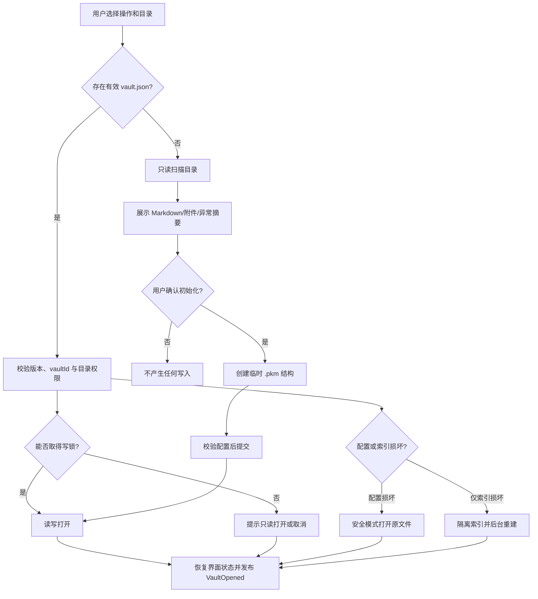

**正常路径**：

1. IF-EXT-DIALOG-001 返回 selectionToken；主进程解析真实路径并确认范围。
2. MOD-KB 检查 `.pkm/vault.json`、结构版本和目录可写性。
3. 已有知识库取得写锁后打开；普通文件夹先执行只读扫描并显示摘要。
4. 用户确认初始化后，只创建 `.pkm` 和必要配置，不修改原 Markdown。
5. MOD-SEARCH 检查索引健康度；缺失或损坏时返回可用界面并后台重建。
6. 发布 `VaultOpened`，MOD-SHELL 恢复标签页和布局。

**分支与异常**：同名目录不覆盖；不可写目录允许重新选择；写锁失败只能只读或取消；未知高版本禁止写入；配置损坏进入安全模式；扫描取消不产生配置。最终状态必须是未打开、只读打开、安全模式或完整读写打开之一。

### 9.4 FLOW-SAVE-001：自动与手动保存

**触发**：停止输入 5 秒、用户手动保存、切换笔记、关闭标签或退出应用。  
**前置条件**：存在活动编辑会话且缓冲区版本高于已保存版本。

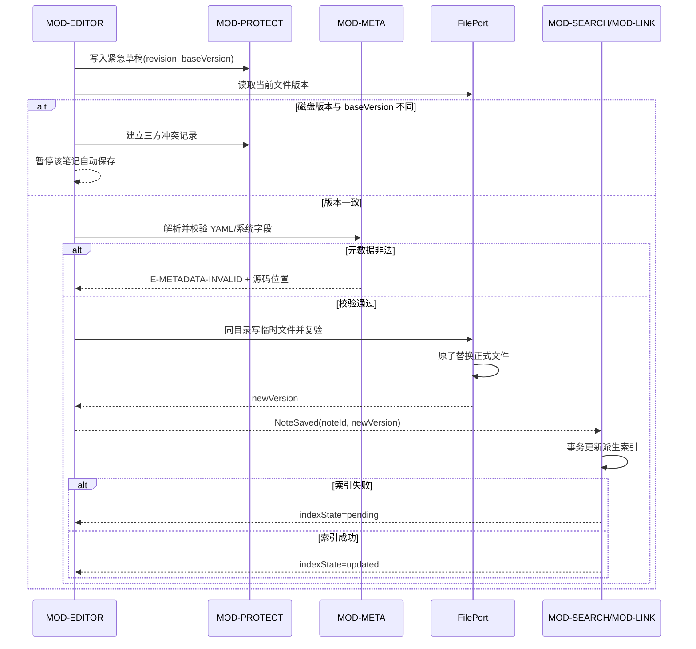

**状态机**：

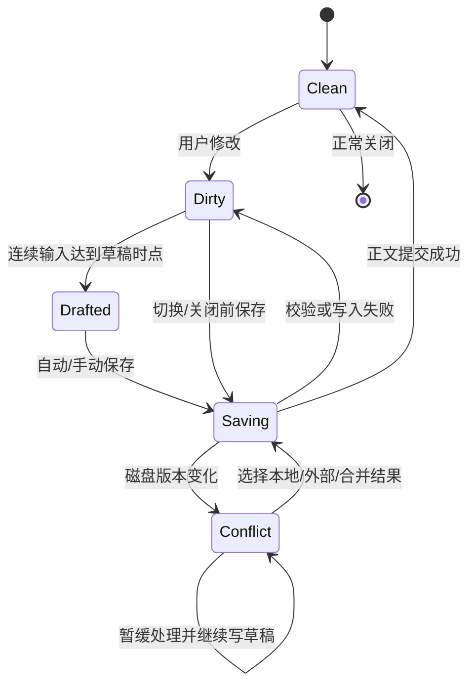

**异常处理**：YAML 错误时正文留在缓冲区和草稿中；权限、磁盘空间或占用错误不改变正式文件；原子替换后索引失败显示“已保存，待索引”，不能误报保存失败；应用异常退出后从草稿恢复。延迟到达的旧 revision 保存请求不得覆盖新 revision。

### 9.5 FLOW-CONFLICT-001：外部修改三方冲突

**触发**：文件监视发现已打开笔记被外部编辑器修改、移动或删除。  
**基准**：编辑会话最后一次成功保存的 SHA-256 版本。

1. WatchPort 发送变化提示；MOD-PLATFORM 去重并读取当前实际状态。
2. 若文件内容与已知版本相同，只更新时间信息，不触发冲突。
3. 若本地缓冲区干净，校验外部文件后刷新会话、索引和预览。
4. 若本地缓冲区有修改，保存基准、本地和外部三份内容及哈希，状态设为 `pending`。
5. 暂停该笔记普通自动保存，但继续写紧急草稿。
6. 界面提供保留本地、保留外部、手动合并、分别保存或稍后处理。
7. 用户选择后先保存未选版本到恢复记录，再提交最终版本并重建该笔记投影。

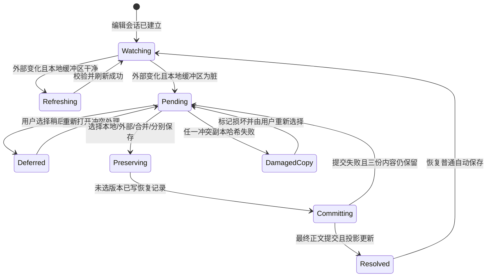

状态约束：`Pending/Deferred/DamagedCopy` 均持续写紧急草稿并禁止普通自动保存；只有恢复记录成功持久化后才能进入 `Committing`，只有正文提交和投影状态明确后才能进入 `Resolved`。

**异常分支**：外部文件删除时显示“缺失”并允许重新定位，不创建空文件；外部 YAML 非法时仍允许比较正文，但依赖元数据的操作保持暂停；任一冲突副本哈希失败时标记该版本损坏，不用另一版本替代。对应 E-VERSION-CONFLICT、E-NOT-FOUND、E-METADATA-INVALID。

### 9.6 FLOW-FILE-001：批量移动/重命名与链接维护

**触发**：用户移动、剪切粘贴、重命名一个或多个笔记/文件夹。  
**前置条件**：知识库可写；受影响编辑会话已保存或明确暂停操作；当前没有其他批量写任务。

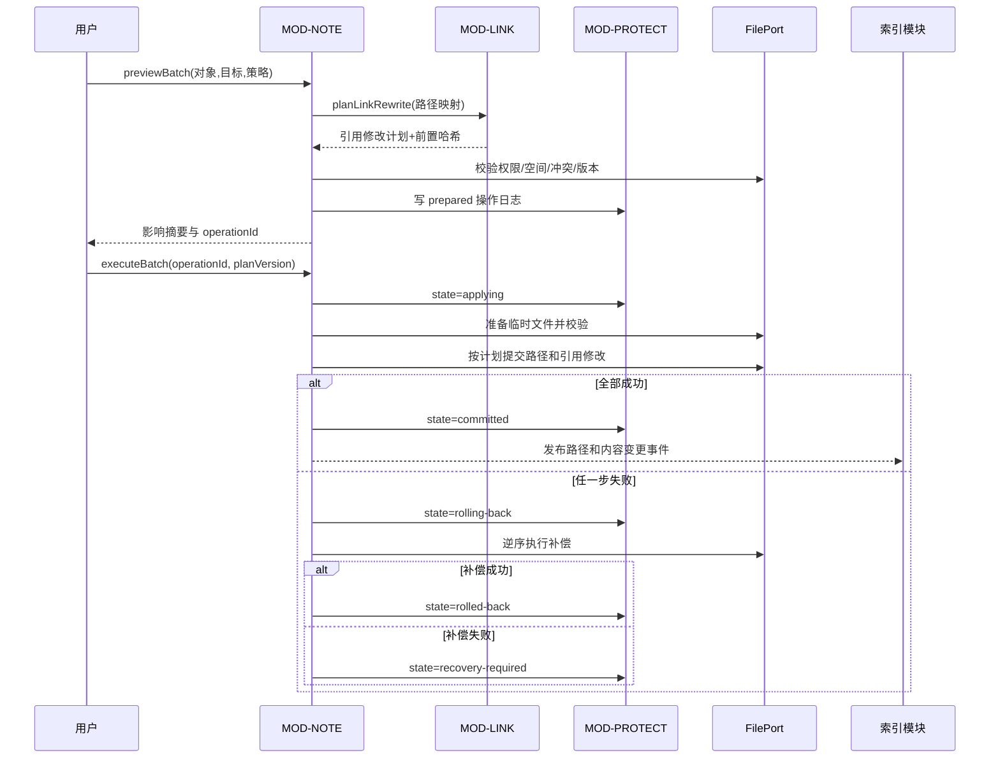

**关键分支**：同名冲突由用户选择改名、跳过或取消；批量操作中的“跳过”必须在预检时形成新的完整计划，不能在提交中临时跳过。复制生成新 noteId，并用临时 idMap 更新复制集合内部链接；移动保留 noteId。跨知识库操作被拒绝并提示使用导出/导入。

**最终状态**：完整新路径和链接、完整原状态，或锁定相关对象等待恢复；绝不允许一部分路径已移动而链接处于未知状态。

### 9.6.1 FLOW-TAG-001：删除标签或标签子树

1. 用户选择待删除标签；MOD-META 读取直接关联、后代标签和含后代总影响数。
2. 若无子标签，预检仅提供“移除该标签关联”；若有子标签，必须显示两项互斥选择：`parent-only`（仅移除父标签关联，保留子标签）或 `subtree`（移除父标签及全部后代标签关联）。
3. 用户未明确选择范围、取消确认或预检版本已过期时，流程终止且不改变任何笔记。
4. IF-META-002 生成包含受影响笔记、YAML 前置哈希、标签范围和索引更新的 DATA-OP-001；IF-NOTE-002 在单知识库批量写锁下执行。
5. 每篇笔记只移除选择范围内的标签，笔记文件及其他标签保持不变；所有文件成功后一次提交操作日志并更新索引。
6. 任一 YAML 无效、文件不可写、磁盘版本变化或索引提交前写入失败时执行逆序补偿；补偿不完整则进入 `recovery-required`，不得显示为删除成功。

**分支判定**：`parent-only` 不重命名或提升子标签，完整子标签路径继续存在；`subtree` 删除所有后代标签关联，但绝不删除笔记。通过标准直接继承 AC-FR-TAG-008-01/02，并由 TEST-FLOW-011 注入取消、过期预检和中途写入失败进行验证。

### 9.7 FLOW-SEARCH-001：增量索引与搜索

**索引路径**：

1. `NoteSaved`、`NotePathChanged`、`MetadataChanged` 和附件事件进入增量队列。
2. 队列按 noteId 合并重复事件，并读取最新已提交文件。
3. 解析标题、正文、标签、链接和附件引用。
4. 在一个 SQLite 事务中替换该笔记 notes、FTS、note_tags、links 和 attachment_refs 投影。
5. 成功后更新索引健康状态；失败则记录待索引 noteId 并退避重试。

**查询路径**：

1. SearchQueryParser 解析关键词、短语、标签、目录和时间条件。
2. 非法或空条件返回诊断，不执行猜测性查询。
3. SQLite FTS5 查询并按标题、标签、章节、路径和正文权重排序。
4. SearchResultAssembler 生成最多三个安全高亮片段。
5. 应用服务合并当前打开笔记的未保存匹配，并标记 `unsaved=true`。
6. 返回分页结果、nextCursor 和索引健康度。

**异常与降级**：索引损坏时普通查询返回 E-INDEX-DAMAGED 和重建入口，不回退到会阻塞界面的无界全目录扫描；重建期间可查询已完成部分，但必须显示“结果可能不完整”；旧 cursor 与新查询或新索引版本不匹配时要求重新查询。

### 9.8 FLOW-LINK-001：Wiki 链接插入与导航

1. 用户输入 `[[` 后，MOD-LINK 根据标题和路径返回候选，不自动添加。
2. 同名候选显示路径进行消歧；选择后插入目标、可选别名和章节锚点。
3. 预览点击链接时，LinkResolver 依据当前索引解析。
4. 唯一有效目标由 MOD-SHELL 打开并写入导航历史；章节存在时定位标题。
5. 歧义目标重新显示候选；缺失目标允许创建新笔记或取消。
6. 代码块、行内代码、转义文本和 YAML 中的相似文本不作为 Wiki 链接。

**异常**：目标已被外部移动时先受控重扫，再标为 missing；章节不存在时打开笔记并提示锚点失效；从缺失链接创建笔记时仍执行命名冲突检查。

### 9.9 FLOW-GRAPH-001：连接图生成与交互

1. 用户打开全局图或当前笔记局部图；界面发送 GraphQuery。
2. MOD-LINK 从 links 投影聚合节点、边和同向引用次数，不读取完整正文。
3. 局部图默认读取中心笔记一层相邻节点；全局图按筛选和节点上限分页。
4. GraphLayoutTask 在工作线程布局并发送递增进度；固定节点坐标来自 DATA-UISTATE-001。
5. 用户搜索、筛选、缩放、平移、展开或固定节点；点击节点交由 MOD-SHELL 打开笔记。

**异常与降级**：超过一次渲染规模时返回 truncated 和 continuationToken；旧布局任务取消后其迟到结果不得覆盖新查询；工作线程崩溃时保留已有图并提供重新布局；索引不健康时标明图可能不完整。

### 9.10 FLOW-ATT-001：附件导入、预览和外部打开

1. 用户通过选择、拖放或粘贴产生 selectionToken。
2. AttachmentTypeInspector 检查扩展名、文件签名、大小和双扩展名，生成风险摘要。
3. 对大文件或风险不明文件显示大小、类型和可取消提示；危险类型不自动预览。
4. 用户确认导入后，文件复制到临时目标，流式计算 SHA-256，并检查空间和边界。
5. 校验成功后提交到 `attachments/<note-id>/`，同名按用户策略处理。
6. 返回相对 Markdown 引用，由编辑器插入当前 revision；导入成功但插入失败时附件进入“未引用候选”，不得静默删除。
7. 预览只加载知识库内受控资源；外部打开每次重新检查当前哈希、风险类型和确认 token。

**异常**：复制取消或失败时清理临时文件；扩展名与实际类型不符时默认不预览；附件被外部移动后显示缺失并允许重新定位；默认程序不存在返回 E-EXTERNAL-OPEN-DENIED，原附件不变。

### 9.11 FLOW-TRASH-001：移入回收站与恢复

**删除到回收站**：

1. MOD-NOTE 预检笔记/文件夹、关联附件和未保存会话。
2. MOD-PROTECT 创建 trashId 和 DATA-OP-001，保存原路径、对象 ID、附件清单和哈希。
3. 内容及附件移动到 `.pkm/trash/<trash-id>/`；全部完成后提交日志。
4. 发布 `NoteMovedToTrash`，从普通搜索、普通图谱和打开标签中移除，但正文仍在回收站。
5. 界面提供 10 秒普通撤销入口；撤销实质调用恢复流程。

**恢复**：校验回收站内容和哈希；原路径空闲时恢复，冲突时要求改名、选择位置或取消；恢复成功后重新索引并恢复链接可见性。永久删除、清空和到期清理必须二次确认，失败项留在回收站并逐项报告，不能把部分失败显示为全部成功。

### 9.12 FLOW-EXPORT-001：单篇导出

1. IF-EXPORT-001 依据 noteId 和 expectedVersion 建立只读快照。
2. ExportPreflight 收集实际引用附件、远程资源、失效链接、预计大小和目标冲突。
3. 若选择 HTML 且预计大小超过 50 MiB，界面必须显示预计大小与主要资源占比；只有用户再次确认并取得一次性凭证后才能继续，取消则不产生任务或临时文件。
4. 用户选择格式、资源策略和合法目标后启动后台任务。
5. Markdown 包改写附件路径并生成清单；HTML 使用安全模板；PDF 使用隔离本地窗口和 A4 参数。
6. 产物先生成到临时目标，重新读取并校验大小、结构和哈希。
7. 同名冲突按本次选择覆盖、改名或取消；最终原子提交后才报告成功。

**异常**：源笔记版本变化时重新预检；缺失附件按用户选择取消或带明确警告导出；远程资源默认不抓取；PDF 局部渲染失败不生成“成功”产物；取消后清理临时文件。

### 9.13 FLOW-BACKUP-001：完整备份

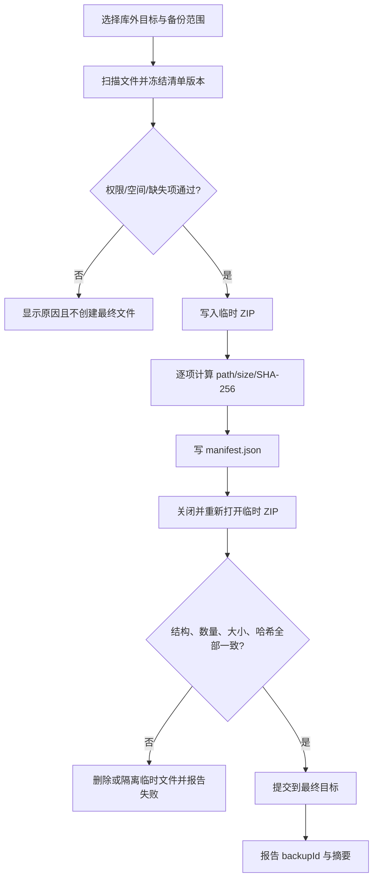

备份期间可继续普通编辑，但每个文件以清单记录的版本读取；读取时发生变化则安全重读并更新清单，连续变化无法获得一致版本时报告失败或要求暂停编辑，不能把混合版本标记为完整备份。目标必须位于知识库外，索引、缓存、临时文件和日志不进入备份。

### 9.14 FLOW-RESTORE-001：恢复与抢救提取

**普通恢复到新目录**：

1. 只读打开 ZIP，检查格式版本、条目数量、总大小、路径、重复规范路径、符号链接和压缩比例。
2. 校验 manifest 及每个文件的 SHA-256；生成检查摘要。
3. 用户选择新的空目录；系统检查空间和权限。
4. 在临时目录解压，每写一项再次检查规范路径和哈希。
5. 完成后验证 `vault.json`、文件数和总大小，再原子提交为新知识库目录。
6. 打开新知识库并重建索引；恢复报告分别记录内容恢复和索引重建结果。

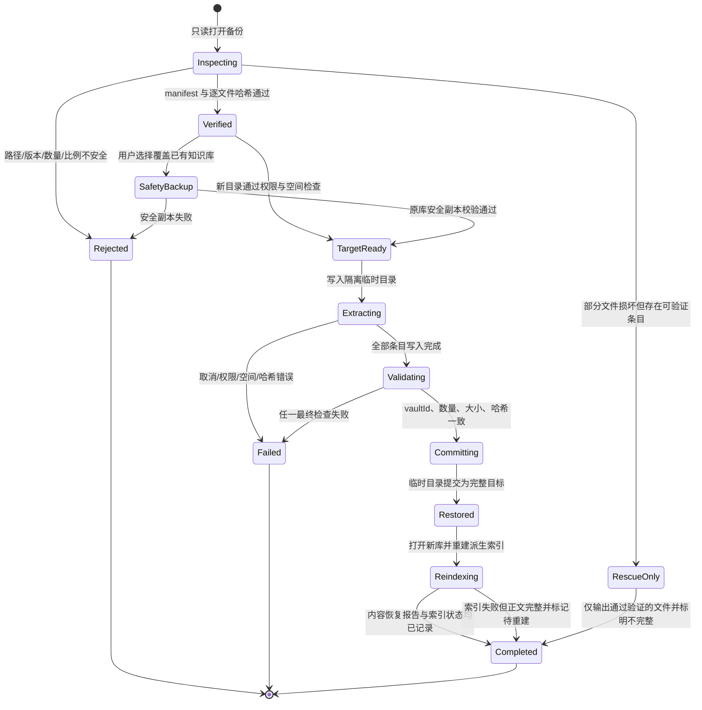

状态约束：`Inspecting/Verified/TargetReady/Extracting/Validating` 均不得修改最终目标；覆盖恢复必须经过 `SafetyBackup`。只有 `Committing` 可改变最终目录，失败时原 ZIP 永不修改，临时目录清理失败则进入恢复中心而不是伪报成功。

**覆盖已有知识库**：目标必须关闭；先创建并验证完整安全副本，失败则禁止覆盖；其余步骤仍在临时目录完成，不能原地逐项覆盖。

**版本和损坏分支**：旧版本只迁移临时副本；高于当前支持版本禁止普通恢复；哈希或安全检查失败时可提供抢救提取，但只输出通过验证的文件，并明确“不构成完整恢复”。任何恢复失败都不得修改原 ZIP。

### 9.15 异常与故障处理矩阵

| 故障 | 检测点 | 处理路径 | 用户可执行恢复 | 数据最终状态 |
|---|---|---|---|---|
| 目录无写权限 | 预检或临时写入 | 返回 E-PERMISSION，不进入提交 | 更改权限、重新选择、取消 | 原状态不变 |
| 磁盘空间不足 | 预检和写入错误 | 停止任务、回滚临时产物 | 清理空间或改选目标后重试 | 原状态或已提交完整状态 |
| 文件被占用 | 原子替换/移动 | 保留原文件和操作日志 | 关闭占用程序并重试 | 原状态不变 |
| 应用异常退出 | 下次启动检查草稿和操作日志 | 展示恢复中心，先处理 applying/rolling-back | 恢复草稿、继续回滚或查看详情 | 明确恢复候选或 recovery-required |
| SQLite 损坏 | 打开/查询/事务 | 隔离数据库，停止写派生数据 | 后台重建索引 | 用户真实数据不变 |
| 文件监视溢出/断开 | WatchPort health 事件 | 标记监视不完整并受控重扫 | 查看进度或重试 | 以磁盘最终扫描结果为准 |
| YAML 非法 | 打开或保存校验 | 保留正文和最后有效元数据，暂停依赖操作 | 定位修复 YAML | 正文与原文件不丢失 |
| 外部修改冲突 | baseVersion 与磁盘哈希比较 | 建立三方冲突并暂停自动保存 | 选择本地、外部、合并、分别保存或稍后 | 三份版本均保留直至处理 |
| 批量补偿失败 | OperationJournal 回滚步骤 | 锁定受影响对象并标记 recovery-required | 恢复中心继续补偿或人工处理 | 不伪装为成功，证据完整 |
| ZIP 路径/哈希异常 | 备份/恢复预检与回读 | 返回 E-ARCHIVE-UNSAFE | 取消或抢救合规文件 | 原 ZIP 和目标均不改变 |
| 后台线程崩溃 | TaskRuntime 退出事件 | 任务失败，清理临时资源或保留恢复日志 | 重试任务 | 正文不因派生任务失败回滚 |
| 默认程序不可用 | ExternalOpenPort | 返回 E-EXTERNAL-OPEN-DENIED | 重新配置默认程序或取消 | 笔记和附件不变 |
| 用户取消长任务 | 安全检查点 | 状态进入 cancelling，清理或回滚后发 cancelled | 可重新发起 | 原状态或完整已提交步骤 |
| 设置/界面状态损坏 | JSON 解析/版本校验 | 保存诊断副本并使用默认值 | 重设选项 | 用户内容不变 |

### 9.16 启动恢复顺序

知识库打开后按以下顺序检查，前一项未完成时限制后续写操作：

1. 校验知识库身份和写锁。
2. 检查 `operations/` 中 `applying`、`rolling-back` 或 `recovery-required` 日志。
3. 检查覆盖恢复或备份留下的临时目标。
4. 检查 pending 冲突、紧急草稿和异常退出会话。
5. 校验配置与界面状态，损坏时回退默认值。
6. 检查索引健康度并启动可取消重建。
7. 恢复普通工作区；若存在必须处理的操作日志，相关对象保持只读。

### 9.17 流程设计验证

| 编号 | 验证目标 | 主要场景与通过标准 |
|---|---|---|
| TEST-FLOW-001 | 知识库生命周期 | 分别测试空目录、普通 Markdown 目录、有效库、损坏配置、损坏索引和写锁冲突；每种进入唯一明确状态 |
| TEST-FLOW-002 | 保存与草稿 | 覆盖自动保存、手动保存、切换、关闭、持续输入、写入失败和异常退出；无静默丢失 |
| TEST-FLOW-003 | 三方冲突 | 基准相同/不同、本地干净/脏、外部删除/YAML 错误组合；仅正确组合进入冲突且三版本可恢复 |
| TEST-FLOW-004 | 批量回滚 | 对移动、重命名、标签和链接更新的每个步骤注入失败；全部提交、全部回滚或 recovery-required 三种结果可区分 |
| TEST-FLOW-005 | 搜索一致性 | 保存、改名、删除、未保存缓冲区、索引失败与重建期间查询；结果状态和警告准确 |
| TEST-FLOW-006 | 链接与图谱 | 同名、缺失、章节失效、外部移动、大图截断、布局取消；不误跳转且界面不被阻塞 |
| TEST-FLOW-007 | 附件安全 | 类型不符、双扩展名、大文件、复制失败、插入失败、缺失附件和默认程序失败；无库外直接引用或执行 |
| TEST-FLOW-008 | 回收站 | 删除、10 秒撤销、路径冲突恢复、到期清理和永久删除失败；失败项可见且内容不被误删 |
| TEST-FLOW-009 | 导出与备份 | 源版本变化、目标冲突、缺失资源、取消、空间不足和回读校验失败；未校验产物不报告成功 |
| TEST-FLOW-010 | 恢复安全 | 新目录、覆盖、旧版本、高版本、路径穿越、哈希错误、压缩膨胀和抢救提取；原 ZIP 和原知识库受到保护 |
| TEST-FLOW-011 | 标签删除范围 | 分别验证无子标签、仅移除父标签、删除整个子树、未选择范围、预检过期和中途失败；笔记不删除，选择外标签不变，批量结果全部提交、全部回滚或明确进入 recovery-required |

## 10. 界面与交互设计

### 10.1 用户角色与使用状态

本产品无账号、组织、管理员或权限审批，因此首版只有“本机普通学生用户”一个访问角色，不虚构不存在的管理员角色。界面同时适配以下使用状态和操作熟练度：

| 用户状态/操作特征 | 主要目标 | 设计响应 |
|---|---|---|
| 首次使用者 | 在 3 分钟内创建知识库并保存第一篇笔记 | 欢迎页提供单一路径向导、合理默认值和首次操作提示 |
| 日常记录者 | 快速记录、自动保存、插入附件和标签 | 默认打开最近工作区；编辑操作不被多余对话框打断 |
| 复习检索者 | 通过关键词、标签、链接和图谱找回资料 | 全局搜索入口固定可见；筛选条件和结果来源明确显示 |
| 键盘熟练用户 | 使用快捷键、命令和大纲快速导航 | 所有核心操作可键盘访问，快捷键可发现且冲突可检测 |
| 只读状态用户 | 查看被其他实例占用或高版本知识库 | 明确只读横幅，隐藏或禁用写操作并说明原因 |
| 故障恢复状态用户 | 处理草稿、冲突、未完成操作或损坏索引 | 启动时进入恢复中心，按风险顺序提供安全操作 |

首次提示可关闭且不反复打扰；关闭提示不会隐藏功能。界面不根据熟练度改变业务规则或安全确认要求。

### 10.2 信息架构

```text
应用
├─ 欢迎页 UI-WELCOME-001
│  ├─ 新建知识库
│  ├─ 打开/初始化文件夹
│  └─ 最近知识库
├─ 主工作区 UI-WORKSPACE-001
│  ├─ 文件/最近/标签侧栏
│  ├─ 多标签编辑与预览 UI-EDITOR-001
│  ├─ 属性/大纲/反向链接侧栏
│  ├─ 全文检索 UI-SEARCH-001
│  └─ 连接图 UI-GRAPH-001
├─ 回收站 UI-TRASH-001
├─ 恢复中心 UI-RECOVERY-001
├─ 导出/备份/恢复向导 UI-TRANSFER-001
└─ 设置 UI-SETTINGS-001
```

顶层导航不超过“工作区、搜索、图谱、回收站、恢复、设置”六类。导出、备份和恢复从当前上下文或设置菜单进入，不长期占用主导航。

### 10.3 UI-WELCOME-001：欢迎页

**布局**：顶部显示产品名称；中央提供“新建知识库”和“打开文件夹”两个主操作；下方显示最多 10 个最近知识库。

**交互**：

1. “新建知识库”打开两步向导：选择父目录、填写名称；名称实时校验，同名或不可写问题在进入下一步前显示。
2. “打开文件夹”先检查是否为有效知识库；普通 Markdown 文件夹展示扫描摘要和“初始化”确认，不立即改写原文件。
3. 最近知识库显示名称、最后有效路径、最后打开时间和状态；失效项标记“位置不可用”，提供重新定位或移除记录。
4. 首次创建成功后直接打开主工作区，文件树突出“新建笔记”；首篇笔记创建后焦点进入标题或正文。

**状态**：扫描中显示阶段与取消；初始化失败保留用户原文件并显示重试/重新选择；写锁冲突显示“只读打开”和“取消”，不把只读作为隐含默认。

### 10.4 UI-WORKSPACE-001：主工作区

```text
┌──────────────────────────────────────────────────────────────────────┐
│ 知识库名称 ▾  [只读/索引状态]       全局搜索      图谱  设置       │
├──────────────┬────────────────────────────────────┬──────────────────┤
│ 文件         │ 标签页：笔记A × | 笔记B ● | ...  │ 属性 / 大纲 /    │
│ 最近         ├────────────────────────────────────┤ 反向链接         │
│ 标签         │                                    │                  │
│              │     编辑器 | 预览 | 分屏           │                  │
│ 文件树       │                                    │                  │
│              │                                    │                  │
├──────────────┴────────────────────────────────────┴──────────────────┤
│ 字数 | 字符 | 行:列 | 保存状态 | 索引状态 | 后台任务              │
└──────────────────────────────────────────────────────────────────────┘
```

**区域职责**：

- 顶栏显示当前知识库、读写模式、索引健康度和全局入口。
- 左侧栏在文件、最近、标签三种视图切换；文件树负责稳定目录结构，标签负责跨目录分类。
- 中央标签区支持临时预览标签与固定标签；同一笔记只存在一个标签。
- 右侧栏显示当前笔记属性、大纲和反向链接，不重复提供文件操作。
- 底栏持续显示字数、字符数、光标行列、保存状态、索引状态和长任务入口。

在 1366×768 或 150% 缩放下，右侧栏默认可折叠，左侧栏允许缩窄；中央编辑区保持可用。折叠后通过带文字提示的按钮恢复，不仅使用图标表达。

### 10.5 UI-EDITOR-001：编辑、预览与属性

#### 编辑模式

- 支持源码、预览和分屏三种模式；模式按钮具有文字、选中状态和快捷键提示。
- 工具栏作用于选中文本；无选择时插入结构并把光标放到可继续输入的位置。
- YAML 默认折叠，通过右侧属性面板管理标题和标签；系统字段只读，自定义字段可保留。
- 编辑器默认自动换行、行号关闭，设置变化即时预览但只在确认后持久化。
- 大纲点击后同时定位源码与预览；滚动同步可关闭。

#### 保存状态

| 状态 | 界面表现 | 允许操作 |
|---|---|---|
| 已保存 | 底栏显示“已保存”和时间 | 全部普通操作 |
| 有未保存修改 | 标签和底栏显示文字“未保存”及圆点 | 继续编辑、手动保存 |
| 正在保存 | 显示“正在保存”，不阻塞输入 | 新修改进入更高 revision，不重复提交旧版本 |
| 已保存，待索引 | 显示“已保存；搜索结果稍后更新” | 编辑可继续，允许查看索引状态 |
| 保存失败 | 持久错误条显示原因和“重试/另存恢复副本/查看详情” | 继续编辑并写紧急草稿；切换前再次提醒 |
| 冲突待处理 | 顶部警告条显示“检测到外部修改” | 普通自动保存暂停；进入冲突处理或稍后处理 |
| 只读 | 顶部和编辑区均标明只读原因 | 允许选择和复制，不允许编辑或粘贴 |

状态同时使用文字、图标和可访问名称，不只使用颜色或标签页圆点。

#### 局部渲染错误

公式、Mermaid、代码高亮或局部 Markdown 渲染失败时，只在对应预览区域显示错误类型、源码行和“查看源码”，其余正文继续渲染。过滤危险 HTML 不修改原始正文，属性面板显示“已在预览中阻止不安全内容”。

### 10.6 UI-SEARCH-001：全文检索与筛选

**结构**：搜索框、当前生效条件条、结果列表、排序控件和索引状态提示。

- 搜索框支持普通关键词和双引号短语；帮助提示说明多关键词默认全部满足。
- 标签、文件夹、修改时间和排除标签以可删除的条件标签显示；“清除全部”固定可见。
- 多标签默认“同时满足”，用户可切换“满足任一”；父标签范围明确显示“含后代”或“仅当前标签”。
- 每条结果显示标题、路径、匹配字段、最多三个片段、修改时间及“未保存”标识。
- 单击结果打开临时预览标签，双击或开始编辑后固定；键盘上下移动并按 Enter 打开。
- 回收站搜索与普通搜索使用不同标题和范围提示，不能在同一结果中混合。

**状态**：空查询展示最近笔记或说明；无结果显示当前条件并提供清除入口；索引重建中显示进度和“结果可能不完整”；索引损坏显示重建按钮，不无限转圈。

### 10.7 UI-GRAPH-001：连接图

- 顶部明确“全局图”或“当前笔记局部图”，局部图显示中心笔记名称和层级深度。
- 工具栏提供搜索、标签/目录筛选、显示孤立节点、重置视图和重新布局。
- 节点聚焦时展示标题、路径、标签、入链数和出链数；点击打开笔记，键盘 Enter 等价。
- 图旁提供可切换的列表视图，按标题列出可见节点和连接数，作为键盘和无障碍替代。
- 图被截断时显示已载入/总量、继续加载入口和性能原因；不得只静默省略节点。
- 布局进行中允许平移、缩放和取消；新筛选启动后旧布局结果不得闪回。

颜色可辅助区分标签，但标签和连接状态仍通过文字、形状、边样式或辅助说明表达。

### 10.8 UI-TRASH-001：回收站

列表显示名称、原路径、类型、删除时间、预计到期时间和关联附件数量。支持按名称搜索及多选恢复/永久删除。

- 恢复前预检原路径；冲突项逐项显示“改名、选择位置、取消”。
- 普通删除完成后显示 10 秒撤销条，包含对象名称和“撤销”按钮。
- 永久删除、清空回收站和清除恢复快照使用阻断式确认，列出不可撤销影响。
- 批量永久删除只对校验成功项执行；失败项保留并显示原因，结果摘要区分成功和失败数量。

### 10.9 UI-RECOVERY-001：恢复中心与冲突处理

恢复中心按风险排序显示：未完成操作、待处理冲突、紧急草稿、恢复快照、失败临时产物和索引问题。

#### 三方冲突视图

```text
┌───────────────────────────────────────────────────────────────┐
│ 数据结构复习.md：检测到外部修改       [稍后处理]             │
├──────────────────┬──────────────────┬─────────────────────────┤
│ 基准版本（只读） │ 本地未保存版本   │ 外部磁盘版本（只读）    │
│ 差异标记         │ 可编辑/选中      │ 差异标记                │
├──────────────────┴──────────────────┴─────────────────────────┤
│ [保留本地] [保留外部] [手动合并] [分别保存]                  │
│ 未选择版本将先保存到恢复记录。                                │
└───────────────────────────────────────────────────────────────┘
```

在窄屏或高缩放下改为三个可切换面板，始终显示版本标签和时间，避免横向区域过窄。任何选择前展示最终路径和未选版本保存方式；提交失败时三份版本保持可用。

未完成批量操作显示 operationId、对象数量、最后完成步骤和当前锁定对象，只提供“继续自动恢复”“导出诊断摘要”“稍后以只读打开”等安全操作，不要求用户理解内部文件名。

### 10.10 UI-TRANSFER-001：导出、备份与恢复向导

统一采用“范围与格式 → 预检 → 确认 → 执行 → 结果”五阶段，但不同业务不混用术语。

| 阶段 | 导出 | 备份 | 恢复 |
|---|---|---|---|
| 范围 | Markdown/HTML/PDF、资源选项 | 活动内容、附件、回收站、恢复数据等 | 选择备份、恢复到新目录或覆盖 |
| 预检 | 缺失附件、失效链接、预计大小 | 文件数、大小、缺失项、目标位置 | 版本、路径安全、哈希、空间、冲突 |
| 确认 | 同名策略、远程资源单次选择 | 未加密隐私提示 | 覆盖时安全副本和不可逆影响 |
| 执行 | 进度、当前阶段、安全取消 | 进度、文件数、安全取消 | 校验、解压、复验、提交阶段；提交点后限制取消 |
| 结果 | 路径、大小、警告、打开位置 | backupId、路径、文件数、校验摘要 | 成功/失败文件、迁移和索引重建状态 |

任务窗口关闭不等于任务取消；用户关闭时提示“后台继续”“请求取消”或“返回任务”。应用退出时对未完成备份/恢复作明确处理。

### 10.11 UI-SETTINGS-001：设置

设置按“外观、编辑器、快捷键、数据保护、知识库、诊断”分组。

- 每项显示当前值、来源（默认/全局/当前知识库）和恢复默认入口。
- 快捷键录入时即时检查系统保留组合和应用内冲突，指出冲突动作。
- 回收站期限和快照数量改变时，说明何时生效以及是否会触发清理；不立即删除数据。
- 配置迁移或损坏时显示已恢复默认值，并允许定位本地诊断副本。
- 强制安全提示不可被永久关闭，包括永久删除、覆盖恢复、风险附件打开和未加密备份提示。

### 10.12 通用反馈与错误提示

| 反馈类型 | 使用场景 | 表现与规则 |
|---|---|---|
| 字段内校验 | 名称、标签、快捷键、路径选项 | 靠近字段显示问题和修正方法；焦点移入错误摘要 |
| Toast | 保存成功、复制路径等低风险短反馈 | 自动消失，但不承载必须处理的错误 |
| 撤销条 | 移动、重命名、移入回收站等可撤销操作 | 显示对象、剩余时间和明确“撤销”按钮 |
| 持久横幅 | 只读、索引重建、保存失败、待处理冲突 | 在状态解除前不自动消失，提供恢复入口 |
| 阻断式确认 | 永久删除、覆盖恢复、高风险附件、未加密备份 | 默认焦点在安全取消；明确对象、影响和不可撤销性 |
| 任务中心 | 索引、图布局、导出、备份、恢复、批量操作 | 显示阶段、进度、取消状态、完成摘要和失败项 |

错误文本采用统一结构：

> **发生了什么**：无法保存“数据结构复习.md”。  
> **可能原因**：目标文件正被其他程序占用。  
> **数据状态**：原文件未被覆盖，当前内容已保存为紧急草稿。  
> **可以做什么**：关闭占用程序后重试，或打开恢复中心查看草稿。  
> **诊断编号**：仅在需要查看详情时展示。

不得只显示“操作失败”“未知错误”或第三方异常原文。

### 10.13 键盘、焦点与无障碍

- 使用系统语义控件或等价可访问角色、名称、状态和描述。
- Tab 顺序遵循顶栏、左侧栏、标签、编辑区、右侧栏、底栏；打开对话框后焦点限制在对话框内，关闭后回到触发控件。
- 所有核心操作可键盘完成；右键菜单中的核心操作同时存在于菜单、工具栏或快捷键中。
- 焦点指示在浅色和深色主题中清晰可见；普通文本对比度至少 4.5:1，大文本至少 3:1。
- 状态不只依赖颜色；保存、冲突、风险、图边和筛选均包含文字或形状表达。
- 默认正文字号不小于 14 px，并允许调整；125%/150% 缩放下不遮挡确认按钮和错误内容。
- 动画尊重系统减少动态效果设置；进度变化不频繁抢占屏幕阅读器焦点。
- 连接图提供列表替代；Mermaid 或公式渲染失败时保留源码可访问。

### 10.14 窗口、响应式与状态恢复

- 最低验收视口为 1366×768；窗口变窄时按“右侧栏 → 左侧栏 → 非核心工具栏文字”顺序折叠，编辑区不低于可用宽度。
- 标签过多时水平滚动或下拉列出，不无限压缩标题；临时标签与固定标签状态有文字提示。
- 重启恢复打开标签和活动笔记，但不恢复完整前进/后退历史、搜索查询和筛选。
- 缺失笔记在恢复标签中显示“文件不存在”，提供重新定位或关闭，不创建空白文件。
- 设置损坏时使用默认布局，并显示一次性可追踪通知；不会因此清空用户笔记或附件。

### 10.15 界面与交互状态追溯

| 界面 | 主要模块/接口 | 主要需求 |
|---|---|---|
| UI-WELCOME-001 | MOD-KB；IF-KB-001/002 | FR-KB-001～003、008～010；NFR-USE-001 |
| UI-WORKSPACE-001 | MOD-SHELL、MOD-SETTINGS | FR-NAV-001～005、FR-SET-003；NFR-USE-005～007 |
| UI-EDITOR-001 | MOD-EDITOR、MOD-META、MOD-PROTECT | FR-EDIT-001～016；FR-TAG-001～002 |
| UI-SEARCH-001 | MOD-SEARCH、MOD-SHELL | FR-SEARCH-001～007、FR-NAV-001 |
| UI-GRAPH-001 | MOD-LINK、MOD-SETTINGS | FR-GRAPH-001～005；NFR-PERF-007～008 |
| UI-TRASH-001 | MOD-NOTE、MOD-PROTECT | FR-NOTE-009～012 |
| UI-RECOVERY-001 | MOD-PROTECT、MOD-EDITOR | FR-EDIT-006～007、FR-RESTORE-006、NFR-REL-* |
| UI-TRANSFER-001 | MOD-EXPORT、MOD-PROTECT | FR-EXP-001～006、FR-BACKUP-001～003、FR-RESTORE-001～006 |
| UI-SETTINGS-001 | MOD-SETTINGS | FR-SET-001～010、NFR-USE-003～008 |

### 10.16 界面设计验证

| 编号 | 验证目标 | 方法与通过标准 |
|---|---|---|
| TEST-UI-001 | 首次任务完成 | 至少 5 名目标学生不读说明完成“创建知识库—创建并保存笔记”；每人不超过 3 分钟，逐人记录结果 |
| TEST-UI-002 | 核心任务成功率 | 执行“记录—标签—链接—搜索”脚本；整体成功率不低于 80%，不把研究者提示后的完成计为独立成功 |
| TEST-UI-003 | 键盘访问 | 不使用鼠标完成创建、编辑、保存、搜索、打开结果、恢复删除和设置；焦点始终可见且顺序合理 |
| TEST-UI-004 | 对比度与非颜色表达 | 测量浅/深主题文本和控件状态；普通文本 ≥4.5:1、大文本 ≥3:1，所有状态有非颜色线索 |
| TEST-UI-005 | 分辨率与缩放 | 在 1366×768、Windows 125%/150% 缩放执行核心流程；无不可达按钮、截断确认或遮挡错误 |
| TEST-UI-006 | 保存与冲突状态 | 依次触发 dirty、saving、pending-index、save-failed、conflict、readonly；状态文字、动作和实际数据一致 |
| TEST-UI-007 | 长任务与取消 | 对索引、图布局、导出、备份和恢复观察进度并取消；界面不冻结，终态和数据状态一致 |
| TEST-UI-008 | 错误可恢复性 | 触发权限、空间、占用、损坏索引、危险附件和损坏备份；提示均包含问题、影响和可执行恢复操作 |

## 11. 非功能设计

### 11.1 统一验证环境与证据规则

除具体条目另有说明外，性能与资源测试使用以下统一环境：Windows 11 64 位、四核处理器、8 GB 内存、固态硬盘；标准知识库包含 5,000 篇 Markdown 笔记、500 MB Markdown 数据、20,000 条链接和 2 GB 附件。

- 计时至少执行 5 次独立运行并取中位数；界面事件延迟另按需求统计第 95 百分位。
- 冷启动不得预先保留应用进程；测试前记录操作系统、应用版本、构建类型、数据集版本和测量工具。
- 故障注入必须在临时测试知识库执行，并保存输入、注入点、操作日志状态和文件校验值。
- 本章内容均为实现目标与验证方案；当前尚无可运行软件，不宣称指标已经通过。
- 测试数据集使用固定生成种子，并保留文件数量、字节数、链接数、附件数及 SHA-256 清单，保证重复测试可比较。

### 11.2 性能设计

#### 11.2.1 性能策略

- 启动阶段只同步加载窗口、安全桥、知识库身份、写锁和上次活动笔记；索引健康检查、最近项校验和连接图组件延后或并行执行。
- 编辑主线程只处理输入、光标和必要视图更新；Markdown 预览解析、索引、图布局、导出和备份进入工作线程或受控任务。
- 文件树、搜索结果、标签列表和图节点采用分页、虚拟化或渐进加载，避免一次创建无界界面节点。
- 搜索使用 FTS5 参数化查询和预建索引；首批结果与完整结果分阶段返回，但最终排序规则保持一致。
- 增量索引按 noteId 合并事件，以内容哈希决定是否重解析；同一笔记的全部索引投影在一个事务内替换。
- 性能埋点只记录阶段、耗时、数量和字节数，不记录正文、标签内容或查询原文。

#### 11.2.2 逐项设计与验证

| 设计元素 | 原需求 | 设计落实 | 验证与通过标准 |
|---|---|---|---|
| NFD-PERF-001 | NFR-PERF-001 | 延迟加载非首屏模块；并行读取配置、界面状态和活动笔记；索引重建不阻塞首屏 | 冷启动并打开最近知识库 5 次，中位数 ≤5 秒 |
| NFD-PERF-002 | NFR-PERF-002 | 读取笔记与预览解析分离；先建立可编辑文本模型，再异步生成大纲和预览 | 随机抽取 10 篇接近 1 MB 笔记，每篇打开中位数 ≤1 秒 |
| NFD-PERF-003 | NFR-PERF-003 | 输入路径不做同步磁盘/SQLite/全量 Markdown 工作；预览和状态统计节流；列表虚拟化 | 输入、滚动和 5 种格式命令各 30 次，95% 事件 ≤100 ms |
| NFD-PERF-004 | NFR-PERF-004 | 5 秒防抖调度；同一 noteId 保存串行；临时文件写入与哈希在主进程执行 | 1 MB 内笔记修改 20 次，每次触发后 ≤1 秒完成且内容一致 |
| NFD-PERF-005 | NFR-PERF-005 | FTS5 索引、参数化查询、首批分页和安全片段生成；未保存缓冲区单独合并 | 20 个中英文查询：首批 ≤1 秒，完整结果 ≤2 秒 |
| NFD-PERF-006 | NFR-PERF-006 | 在查询表达式中组合标签/目录/时间条件；复用候选集和稳定 cursor | 不少于 1,000 个候选连续筛选/排序，每次 ≤1 秒 |
| NFD-PERF-007 | NFR-PERF-007 | 图查询只返回必要字段；后台布局；节点/边批量传输；渲染虚拟化与渐进绘制 | 2,000 节点、10,000 边全局图打开 5 次，中位首次可交互 ≤3 秒 |
| NFD-PERF-008 | NFR-PERF-008 | 超规模图立即建立 taskId，1 秒内显示阶段和进度；布局工作线程可取消 | 1 秒内出现加载状态，导航期间无连续 1 秒以上无响应 |
| NFD-PERF-009 | NFR-PERF-009 | 分批扫描与事务提交；后台进度按已处理文件/总文件报告；安全取消后可续建 | 标准库删除索引后重建 5 次，中位数 ≤60 秒且始终有进度、可取消 |
| NFD-PERF-010 | NFR-PERF-010 | 文件监视事件去重；以路径、大小、mtime 快筛并用哈希确认变化；仅更新受影响投影 | 仅修改 10 篇后，审计记录无未变化笔记重解析，结果与全量索引一致 |

### 11.3 可靠性与数据完整性设计

| 设计元素 | 原需求 | 设计落实 | 验证与通过标准 |
|---|---|---|---|
| NFD-REL-001 | NFR-REL-001 | 同目录临时写入、UTF-8/YAML/哈希复验、受保护替换；正式文件始终保留完整旧版或新版 | 在写入各阶段终止进程，重启后不存在截断文件 |
| NFD-REL-002 | NFR-REL-002 | 连续输入期间每 10 秒写紧急草稿；保存失败和冲突期间持续更新；草稿带基准版本和哈希 | 连续输入并随机终止 20 次，恢复内容丢失窗口均 ≤10 秒 |
| NFD-REL-003 | NFR-REL-003 | DATA-OP-001 记录计划、前置哈希、提交步骤和补偿；相关对象在未决状态下锁定 | 对重命名、移动、链接和标签更新注入错误，结果全部提交或全部回滚 |
| NFD-REL-004 | NFR-REL-004 | index.sqlite 仅存派生数据；损坏时隔离并从 Markdown/YAML/附件全量重建 | 重建前后正文和附件 SHA-256 一致，搜索结果恢复 |
| NFD-REL-005 | NFR-REL-005 | JSON 配置按 schema 校验；失败时保留诊断副本并加载安全默认值 | 注入非法配置后应用可启动，损坏副本存在，正文和附件不变 |
| NFD-REL-006 | NFR-REL-006 | 备份清单记录路径、数量、大小和 SHA-256；生成后回读；恢复写入后再次验证 | 标准样本逐项一致；篡改任一文件后普通恢复失败 |
| NFD-REL-007 | NFR-REL-007 | 写前检查权限/空间；捕获占用和设备断开；停止后保留草稿、临时文件或操作日志 | 注入四类故障，不覆盖有效文件；恢复条件后可继续、重试或另选目标 |

附加可靠性规则：主进程发生未处理异常时不自动重启并继续写入当前知识库；应先释放或判定陈旧写锁，并在下次启动进入恢复检查。后台任务失败只影响其派生结果，不使已成功保存的正文回滚。

### 11.4 易用性与无障碍设计

| 设计元素 | 原需求 | 设计落实 | 验证与通过标准 |
|---|---|---|---|
| NFD-USE-001 | NFR-USE-001 | 欢迎页仅保留新建/打开两个主入口；创建成功后直接聚焦新建笔记；默认值可立即使用 | 至少 5 名目标学生不读说明，每人 ≤3 分钟完成创建并保存首篇笔记 |
| NFD-USE-002 | NFR-USE-002 | 文件、标签、链接和搜索入口固定；每一步即时反馈；同一术语贯穿界面和测试脚本 | 至少 5 名目标学生执行统一脚本，任务总成功率 ≥80% |
| NFD-USE-003 | NFR-USE-003 | 语义控件、完整 Tab 路径、菜单等价操作、可发现快捷键和图谱列表替代 | 不用鼠标完成创建、编辑、搜索、链接、导出和备份且无键盘陷阱 |
| NFD-USE-004 | NFR-USE-004 | 统一高对比焦点环；对话框焦点限制与关闭后焦点恢复；不通过去除 outline 美化 | Tab/Shift+Tab 遍历主要页面，每个焦点位置可辨识 |
| NFD-USE-005 | NFR-USE-005 | 浅/深主题令牌在设计阶段计算对比度；自定义主题不在首版开放任意颜色 | 普通文本对比度 ≥4.5:1，大文本 ≥3:1 |
| NFD-USE-006 | NFR-USE-006 | 颜色与文字、图标、形状组合；图边状态和错误均提供可访问名称 | 逐项检查错误、成功、失效链接和图节点，无仅靠颜色的状态 |
| NFD-USE-007 | NFR-USE-007 | 默认 14 px；设置 schema 限制 12～32 px；缩放后工具栏与对话框可重排 | 检查默认值、12/32 边界与越界拒绝 |
| NFD-USE-008 | NFR-USE-008 | AppError 映射为“问题、原因、数据状态、处理办法、诊断编号”模板 | 抽查文件、权限、空间、解析、导出、恢复错误，均含问题、原因和操作 |

外部 5 人测试在当前作业中仍属于待执行验证，不以 AI 推演或文档审查替代真实参与者结果。

### 11.5 隐私与安全设计

#### 11.5.1 信任边界


渲染内容、外部文件、ZIP 条目和第三方同步产生的变更均视为不可信输入。进入主进程后仍必须重新校验，不能把 preload 校验当作唯一安全边界。

#### 11.5.2 逐项设计与验证

| 设计元素 | 原需求 | 设计落实 | 验证与通过标准 |
|---|---|---|---|
| NFD-SEC-001 | NFR-SEC-001 | 不设计登录或服务端依赖；渲染资源和组件随安装包提供；核心接口无网络前置条件 | 断网执行创建、编辑、搜索、链接、导出、备份、恢复，均可完成 |
| NFD-SEC-002 | NFR-SEC-002 | 默认无遥测、分析或内容上传模块；应用页面 CSP 禁止任意网络连接；外部链接仅交给系统浏览器 | 监测代表性任务网络请求，除用户主动外链外无内容或行为传输 |
| NFD-SEC-003 | NFR-SEC-003 | SecurityAuditLogger 只记录代码、模块、阶段、数量、耗时、操作 ID 和脱敏路径摘要；正文和附件不进入日志 | 以唯一标记触发错误，日志中不得出现标记或内容 |
| NFD-SEC-004 | NFR-SEC-004 | Markdown 转换后执行 HTML 白名单清理；禁脚本、事件属性、危险协议、远程嵌入和自动播放；Mermaid 使用严格模式 | 恶意样例代码不执行，危险导航和嵌入不加载 |
| NFD-SEC-005 | NFR-SEC-005 | SafeFileGateway 对相对路径规范化、真实父路径/目标解析、知识库边界和符号链接逐次检查 | 路径穿越、符号链接、大小写和编码变体均无法越界读写 |
| NFD-SEC-006 | NFR-SEC-006 | ZIP 先枚举后解压；拒绝绝对/重复/越界路径、符号链接、异常数量与膨胀；临时目录隔离 | Zip Slip、绝对路径、重复路径和压缩炸弹样例在写目标前被拒绝 |
| NFD-SEC-007 | NFR-SEC-007 | 备份确认页固定显示“默认未加密”，提示目标位置隐私风险；提示不可永久关闭 | 启动备份可见提示，取消后无成品备份 |

#### 11.5.3 Electron 安全配置

- 渲染窗口启用 `contextIsolation` 和沙箱，关闭 Node.js 集成，不向页面暴露 `require`、`process`、原始 IPC 或通用文件 API。
- 设置限制严格的 CSP；应用 UI 不加载远程代码，预览资源通过受控协议按 vaultId 和会话授权。
- 禁止任意窗口创建和导航；新窗口请求转换为经协议校验后的 IF-EXT-OS-001 调用。
- IPC handler 校验发送方窗口、活动 vaultId、接口版本、字段白名单和 selection/confirmation token。
- 依赖版本在实现阶段锁定；发布前执行依赖漏洞扫描和许可证清单检查，但不自动把用户内容发送给扫描服务。

### 11.6 兼容性与可移植性设计

| 设计元素 | 原需求 | 设计落实 | 验证与通过标准 |
|---|---|---|---|
| NFD-COMP-001 | NFR-COMP-001 | 构建 Windows x64 安装包；在 Windows 10 22H2 和 Windows 11 建立发布测试矩阵 | 两类干净虚拟机完成安装及核心回归 |
| NFD-COMP-002 | NFR-COMP-002 | 当前用户范围安装，应用与配置写入用户可写位置；不安装系统服务或驱动 | 标准非管理员账号完成安装、升级、卸载且不触发提权 |
| NFD-COMP-003 | NFR-COMP-003 | 使用 Windows 文件名、路径长度、大小写、时间和占用语义；所有写操作经 FilePort | NTFS 目录全部核心用例通过 |
| NFD-COMP-004 | NFR-COMP-004 | 文件监视重连、设备断开错误、三方冲突和明确风险提示；不依赖固定盘符 | 可移动盘和同步目录断开/冲突时保护原数据并给出恢复路径 |
| NFD-COMP-005 | NFR-COMP-005 | 写锁只保证本应用实例；检测并发变化进入只读/冲突，不宣传网络共享多人编辑 | 帮助与错误文本无支持承诺，并发写入不静默合并 |
| NFD-COMP-006 | NFR-COMP-006 | HTML 自包含必要样式和允许资源、不依赖在线 CDN；PDF 使用标准 A4、嵌入可再分发字体或安全回退 | 在测试时仍受支持的两种浏览器、两种 PDF 阅读器离线打开样例 |
| NFD-COMP-007 | NFR-COMP-007 | 全链路 UTF-8；路径比较可规范化但不改写正文字符；SQLite 使用 Unicode 文本 | 中英文、重音、数学符号和表情保存、搜索、导出、重开一致 |
| NFD-COMP-008 | NFR-COMP-008 | 响应式折叠侧栏、对话框滚动、最小编辑区和缩放测试快照 | 1366×768 与 125%/150% 缩放核心任务无不可达或含义丢失 |

跨平台不是首版产品目标。采用普通 Markdown、相对路径、UTF-8 和 ZIP `/` 分隔符是数据可移植性设计，不等同于承诺提供 macOS 或 Linux 客户端。

### 11.7 资源占用设计

| 设计元素 | 原需求 | 设计落实 | 验证与通过标准 |
|---|---|---|---|
| NFD-RES-001 | NFR-RES-001 | 生产包移除源码映射、测试资源、未使用语言和重复依赖；大组件按功能懒加载 | 正式 Windows x64 安装包 ≤200 MB |
| NFD-RES-002 | NFR-RES-002 | 当前用户安装只包含运行文件；示例数据和测试数据不随包安装；升级清理过期版本 | 干净 Windows 11 安装目录总量 ≤500 MB，不计知识库/备份 |
| NFD-RES-003 | NFR-RES-003 | 单窗口复用编辑器与预览；搜索/图数据分页；缓存使用有界 LRU；工作线程任务结束释放；不把附件整份载入内存 | 8 GB 机器打开标准库并空闲 2 分钟，5 次工作集峰值中位数 ≤500 MB |
| NFD-RES-004 | NFR-RES-004 | FTS 只索引必要字段；附件正文不索引；事务后检查点和临时文件清理；定期优化索引但不阻塞界面 | 索引 ≤Markdown UTF-8 字节的 150%；100 次增量后 1 分钟内临时文件 ≤50 MB |

资源指标不得通过删除用户恢复数据、降低备份完整性或不再索引需求规定字段来“达标”；若实测不达标，应优化实现或履行需求变更流程。

### 11.8 可扩展性设计

首版不提供第三方插件系统，但内部仍通过稳定端口降低扩展成本：

- Markdown 解析扩展按固定流水线注册，新的安全扩展必须声明语法优先级、HTML 输出和失败隔离方式。
- 导出器实现统一 `ExportAdapter`，新增格式只读取受控文档快照和资源集合，不获得任意文件权限。
- 搜索分词通过 `TokenizerPort` 隔离，可在 SQLite trigram 与经验证的中文分词策略之间替换。
- 存储技术通过 FilePort、IndexStorePort、ArchivePort 等端口隔离；替换实现不改变领域接口。
- JSON、SQLite 和 ZIP 均有独立 schemaVersion 和迁移器；迁移只处理副本或事务，支持失败回退。
- 新增模块只能依赖公开契约和领域事件，架构检查禁止跨模块导入内部目录。

这些扩展点服务于可维护实现，不改变 D-003 排除的首版插件、云同步或多端范围。

### 11.9 可维护性设计

| 方面 | 设计要求 | 验证方法 |
|---|---|---|
| 类型与契约 | TypeScript 严格模式；IPC、JSON 和数据库边界执行运行时 schema 校验 | 编译、契约测试和非法输入测试 |
| 模块边界 | 每模块公开 `index`/contract；禁止其他模块导入内部目录或数据库实现 | 静态依赖检查，无循环和越界导入 |
| 决策记录 | 关键选型、备选、理由、影响需求和复核条件使用 DEC 编号 | 文档审查；变更时更新关联项 |
| 数据迁移 | 每个 schema 迁移有输入版本、输出版本、回滚/保留策略和黄金样例 | 对所有支持版本执行迁移及失败注入 |
| 自动测试 | 领域规则单元测试、端口契约测试、模块集成测试、桌面端到端测试、故障注入 | 发布门禁中测试通过且保留报告 |
| 诊断 | correlationId 串联界面错误、应用操作和本地日志；记录阶段和结果而非正文 | 抽查错误可定位且无敏感内容 |
| 术语与编号 | 代码用例、接口、文档和测试沿用 vault/note/tag/link 等统一术语及需求编号 | 自动检查引用和人工抽查 |

为避免“可维护”只能主观判断，定义以下实现期度量。它们是工程门禁，不替代 44 项 NFR，也不表示当前文档阶段已经达标。

| 度量编号 | 字段与计算口径 | 数据来源 | 目标/门禁 |
|---|---|---|---|
| MAINT-001 契约覆盖率 | `具有正常、非法输入、版本冲突用例的公开接口数 ÷ 公开接口总数 × 100%`；接口以第 8 章 IF 编号去重 | 契约测试清单、测试报告 | 100%；任一公开 IF 缺少三类用例则不通过 |
| MAINT-002 模块边界违规数 | 跨模块导入 `internal/`、直接访问他模块数据库表或绕过端口的静态检查命中数 | 依赖图与静态规则报告 | 0 个违规、0 个模块依赖环 |
| MAINT-003 追溯悬空数 | 无需求/技术原因的设计 ID 数 + 无设计落点的需求 ID 数 + 无所有者的 AC 数 | `audit_design_traceability.py` 与人工抽查记录 | 三项均为 0；脚本 PASS 仅作自检证据 |
| MAINT-004 迁移回归通过率 | `通过的支持版本×样例组合 ÷ 应执行组合 × 100%`，失败注入另逐项计数 | schema 迁移黄金样例和故障注入报告 | 100%，且失败样例均保留原文件或可回滚副本 |
| MAINT-005 变更影响闭合率 | `同时更新需求/DEC、接口或数据、流程、验证项的适用变更数 ÷ 抽查变更数 × 100%` | 变更记录与代码审查清单 | 100%；抽查窗口为本次发布全部设计/契约变更 |
| MAINT-006 诊断可定位率 | `仅凭 correlationId 能定位到模块、阶段、错误代码和恢复动作的抽查失败数` | 脱敏日志与故障测试 | 失败数为 0，且敏感内容泄露数为 0 |

度量记录必须包含版本、提交标识、执行时间、工具版本、分子/分母或原始命中项，不能只写“通过”。阈值未达到时应记录缺陷和责任模块，不得通过降低样本数或排除失败项改写结果。

### 11.10 本地监测与诊断设计

系统不上传遥测。为验证非功能指标，仅提供本地、可关闭和内容脱敏的诊断记录：

| 指标类别 | 记录内容 | 禁止内容 |
|---|---|---|
| 性能 | 操作类型、开始/结束、耗时、对象数量、字节数、是否命中缓存 | 查询原文、标题、正文、标签值 |
| 可靠性 | operationId、状态迁移、失败步骤、补偿结果、文件版本摘要 | 正文、草稿全文、附件内容 |
| 安全 | 被拒绝的规则编号、接口名、风险类别、脱敏路径摘要 | 完整外部路径、附件内容、URL 查询参数 |
| 资源 | 进程工作集、索引/临时文件字节数、任务线程数量 | 用户内容 |

诊断导出必须先展示所含字段和文件列表，由用户主动保存；默认日志轮换不得删除仍被未完成操作引用的恢复日志。

### 11.11 非功能验收矩阵

| 类别 | 原需求数量 | 设计覆盖 | 主要测试层级 | 当前状态 |
|---|---:|---|---|---|
| 性能 | 10 | NFD-PERF-001～010 | 基准测试、性能回归、界面延迟采样 | 待实现后实测 |
| 可靠性 | 7 | NFD-REL-001～007 | 故障注入、崩溃恢复、校验值比对 | 待实现后实测 |
| 易用性 | 8 | NFD-USE-001～008 | 真实学生任务、键盘走查、对比度检查 | 设计可审查；学生测试待执行 |
| 隐私安全 | 7 | NFD-SEC-001～007 | 恶意样例、网络监测、日志审计、路径测试 | 待实现后实测 |
| 兼容性 | 8 | NFD-COMP-001～008 | 虚拟机回归、显示矩阵、格式互操作 | 待实现后实测 |
| 资源占用 | 4 | NFD-RES-001～004 | 构建产物、磁盘和进程资源测量 | 待实现后实测 |
| 合计 | 44 | 44 项逐一映射 | 多层验证 | 无遗漏，尚未宣称达标 |

## 12. 设计决策与权衡

### 12.1 决策记录规则

- `DEC-*` 是设计选择，不改变原需求；若决策需要改变需求范围、优先级或验收指标，必须另走需求变更流程。
- 状态分为“已接受”“有条件接受”“待原型验证”“已取代”。当前文档不保留未说明原因的模糊待定项。
- 每项决策记录采用方案、主要备选、收益、代价、关联需求和复核触发条件。
- 实现人员可以优化内部细节，但不能绕过决策中明确的安全、数据所有权和可验证性约束。

### 12.2 架构与运行决策

#### DEC-001：采用 Electron 模块化单体桌面架构

| 项目 | 内容 |
|---|---|
| 状态 | 已接受 |
| 采用方案 | 单个 Windows 桌面应用；Electron 主进程、沙箱渲染进程和本地后台任务；内部按领域模块划分 |
| 主要备选 | 浏览器 Web 应用；本地 HTTP 服务加浏览器；微服务 |
| 采用理由 | 需要离线访问用户选择的文件夹、系统对话框、默认程序和 PDF 输出；模块化单体适合单用户课程项目规模 |
| 主要收益 | 部署简单、无服务器成本、可复用 TypeScript、跨模块事务和调试边界清晰 |
| 代价/风险 | 安装体积和内存高于原生轻量框架；必须严格配置 Electron 安全边界 |
| 关联需求 | D-003、D-063；NFR-COMP-001～002、NFR-RES-001～003 |
| 复核触发 | 安装包或工作集无法在合理优化后达到指标；Electron 安全支持发生重大变化 |

#### DEC-002：采用分层与端口适配器边界

| 项目 | 内容 |
|---|---|
| 状态 | 已接受 |
| 采用方案 | 界面 → 安全桥接 → 应用服务 → 领域；文件、SQLite、ZIP、PDF 和系统调用作为端口适配器 |
| 主要备选 | 界面组件直接访问文件和数据库；按技术类型堆叠无领域模块 |
| 采用理由 | 需求数量多且涉及恢复、安全和批量一致性，需要集中规则并可替换技术实现 |
| 主要收益 | 可测试、可维护，减少业务规则散落和框架绑定 |
| 代价/风险 | 接口和 DTO 数量增加；简单功能也需经过明确边界 |
| 关联需求 | 全部 FR；NFR-REL-*、NFR-SEC-*；IR-ENV-001～005 |
| 复核触发 | 模块接口频繁穿透内部数据或用例编排出现不可控循环 |

#### DEC-003：长任务使用工作线程或受控子进程

| 项目 | 内容 |
|---|---|
| 状态 | 已接受 |
| 采用方案 | 索引、图布局、批量预检、导出和备份通过 TaskRuntime 运行，使用 taskId、进度事件和安全取消 |
| 主要备选 | 全部在渲染线程或主进程事件循环同步执行 |
| 采用理由 | 需要满足输入响应、进度展示和可取消要求 |
| 主要收益 | 界面保持响应；错误和取消语义统一 |
| 代价/风险 | 增加消息序列、资源释放和任务恢复复杂度 |
| 关联需求 | NFR-PERF-003、007～009；FR-NOTE-007、FR-EXP-*、FR-BACKUP-* |
| 复核触发 | 任务通信开销成为主要瓶颈，或某任务无法安全隔离/取消 |

#### DEC-004：同一知识库采用单写者模型

| 项目 | 内容 |
|---|---|
| 状态 | 已接受 |
| 采用方案 | 一个实例取得写锁；其他实例只读打开或取消；外部编辑器变化仍由三方冲突处理 |
| 主要备选 | 多实例乐观并发写入；操作系统级排他锁覆盖全部文件 |
| 采用理由 | 本地多文件事务和链接更新难以在多个应用实例间安全协调 |
| 主要收益 | 减少静默覆盖和批量操作竞态，恢复模型可解释 |
| 代价/风险 | 用户不能同时在两个本应用窗口写同一知识库；陈旧锁需要安全识别 |
| 关联需求 | FR-KB-007、NFR-COMP-005、IR-ENV-003～004 |
| 复核触发 | 产品未来正式支持多人或多窗口并发写入；不得在首版直接放宽 |

### 12.3 数据与一致性决策

#### DEC-005：Markdown/YAML/附件作为唯一真实用户数据

| 项目 | 内容 |
|---|---|
| 状态 | 已接受 |
| 采用方案 | 正文存普通 UTF-8 Markdown，系统元数据存 YAML，附件存普通文件；数据库只作派生索引 |
| 主要备选 | 正文和关系只存 SQLite；自有二进制文档格式 |
| 采用理由 | 满足本地优先、数据自主、可迁移和应用损坏后可读取 |
| 主要收益 | 用户不被应用锁定；备份和人工抢救简单 |
| 代价/风险 | 跨文件关系和外部修改更难维护；文件系统不是多对象 ACID 数据库 |
| 关联需求 | DR-NOTE-*、NFR-REL-004、NFR-COMP-007 |
| 复核触发 | 不复核；这是产品定位约束。新增数据库不得成为正文唯一来源 |

#### DEC-006：SQLite FTS5 保存可重建搜索与关系投影

| 项目 | 内容 |
|---|---|
| 状态 | 已接受，中文分词策略待原型验证 |
| 采用方案 | SQLite 保存 notes、FTS、tags、links 和附件引用投影；每篇笔记的投影事务替换 |
| 主要备选 | 每次全目录扫描；专用远程搜索服务；正文完全存数据库 |
| 采用理由 | 离线、部署简单，并提供全文、排名、高亮和事务能力 |
| 主要收益 | 搜索与图谱查询性能可控；索引可删除重建 |
| 代价/风险 | 中文短词质量和索引体积必须实测；SQLite 损坏需重建 |
| 关联需求 | FR-SEARCH-*、FR-LINK-*、FR-GRAPH-*；NFR-PERF-005～010、NFR-RES-004 |
| 复核触发 | 中文查询样例不满足召回与 2 秒指标，或索引超过 150% 体积上限 |

#### DEC-007：中文检索通过可替换 TokenizerPort 决定

| 项目 | 内容 |
|---|---|
| 状态 | 待原型验证，但边界已确定 |
| 采用方案 | 首个技术样机比较 FTS5 trigram 与本地自定义分词；使用统一查询语料、排序和体积指标选择 |
| 主要备选 | 直接固定 trigram；无验证地引入大型分词库；全量 LIKE 扫描 |
| 采用理由 | 当前证据只能证明技术入口可用，不能证明中文质量和资源指标同时达标 |
| 主要收益 | 在不改变业务接口和索引所有权的情况下选择更合适实现 |
| 代价/风险 | 正式实现前需要一次原型；短于三个字符的查询要重点处理 |
| 关联需求 | FR-SEARCH-002～003、NFR-PERF-005、NFR-RES-004、ASM-008 |
| 复核触发 | 原型必须在搜索功能实现前完成；结果写入新的技术验证记录，不修改需求指标 |

#### DEC-008：YAML 系统字段受控、未知字段保留

| 项目 | 内容 |
|---|---|
| 状态 | 已接受 |
| 采用方案 | id/title/tags/created/updated 按 schema 校验；未知合法字段往返保留；非法时冻结依赖功能而不丢正文 |
| 主要备选 | 忽略 YAML；应用保存时重写全部字段；发现错误即拒绝打开正文 |
| 采用理由 | 同时满足稳定身份、标签管理、外部编辑兼容和用户数据保护 |
| 主要收益 | 外部工具自定义字段不丢失；错误定位清晰 |
| 代价/风险 | YAML 往返序列化和冲突处理复杂 |
| 关联需求 | FR-EDIT-010、FR-KB-004、DR-NOTE-001 |
| 复核触发 | 所选 YAML 库无法保留必要字段语义或产生不可接受的格式破坏 |

#### DEC-009：采用原子单文件提交与可恢复多文件操作日志

| 项目 | 内容 |
|---|---|
| 状态 | 已接受 |
| 采用方案 | 单文件临时写入后替换；多文件操作使用预检计划、步骤日志和逆序补偿；索引最终一致 |
| 主要备选 | 直接覆盖；把 Markdown 全部移入数据库事务；仅依赖内存回滚 |
| 采用理由 | 文件系统与 SQLite 无统一 ACID 事务，需要跨崩溃的恢复证据 |
| 主要收益 | 可证明全部提交/回滚；异常退出后可继续恢复 |
| 代价/风险 | 操作计划和补偿代码复杂；极端故障可能需要 recovery-required |
| 关联需求 | NFR-REL-001～003、007；FR-NOTE-003～007、FR-LINK-005 |
| 复核触发 | 平台原子替换语义验证失败，或补偿策略无法覆盖某类新增批量操作 |

#### DEC-010：按笔记 ID 划分默认附件目录

| 项目 | 内容 |
|---|---|
| 状态 | 已接受 |
| 采用方案 | 新导入附件存 `attachments/<note-id>/`，正文只保存相对路径；复制笔记复制实际引用的专属附件 |
| 主要备选 | 全库单一附件目录；附件与笔记同目录；内容寻址共享对象库 |
| 采用理由 | 降低命名冲突和孤儿判断复杂度，便于复制/删除/导出形成明确范围 |
| 主要收益 | 所有权清晰；删除和打包易校验 |
| 代价/风险 | 相同附件可能重复存储；跨笔记共享需要显式处理 |
| 关联需求 | FR-ATT-001～003、FR-NOTE-005～006、DR-ATT-001 |
| 复核触发 | 重复附件占用成为实测主要问题；首版不为节省空间引入不透明去重 |

### 12.4 编辑、关联与恢复决策

#### DEC-011：采用“5 秒保存 + 10 秒草稿 + 5 分钟快照”三级保护

| 项目 | 内容 |
|---|---|
| 状态 | 已接受 |
| 采用方案 | 停止输入 5 秒自动保存；连续输入每 10 秒草稿；每 5 分钟最多一份快照且每篇默认最多 20 份 |
| 主要备选 | 每次按键写正式文件；只在手动保存；只依赖编辑器撤销栈 |
| 采用理由 | 在磁盘写入频率、用户无感保存和异常丢失窗口之间平衡 |
| 主要收益 | 正常场景及时保存，异常退出丢失窗口可测且 ≤10 秒 |
| 代价/风险 | 恢复数据占用空间；调度和清理策略需避免互相覆盖 |
| 关联需求 | FR-EDIT-005～006、014；NFR-PERF-004、NFR-REL-002 |
| 复核触发 | 实测磁盘写入或性能指标不满足；调整前需保持 10 秒恢复指标 |

#### DEC-012：外部编辑冲突不自动合并

| 项目 | 内容 |
|---|---|
| 状态 | 已接受 |
| 采用方案 | 基于最后成功保存版本建立基准/本地/外部三方视图；用户选择或手动合并 |
| 主要备选 | 最后写入者覆盖；自动三方合并并直接保存 |
| 采用理由 | Markdown/YAML/链接的语义冲突无法可靠自动解决，静默覆盖风险高 |
| 主要收益 | 三份内容均可追溯，用户掌握最终结果 |
| 代价/风险 | 冲突处理增加交互成本；长期暂缓会占用恢复空间 |
| 关联需求 | FR-EDIT-007、FR-NOTE-013、IR-ENV-003～004 |
| 复核触发 | 未来可增加“预览自动合并建议”，但仍不得跳过用户确认 |

#### DEC-013：Wiki 链接正文保持可读文本，稳定目标只存派生索引

| 项目 | 内容 |
|---|---|
| 状态 | 已接受 |
| 采用方案 | 正文保留 `[[目标]]`/别名/章节；索引解析为 targetNoteId；应用内路径变化通过计划重写正文 |
| 主要备选 | 正文写入不透明 UUID 链接；只按标题运行时解析且不维护路径 |
| 采用理由 | 普通 Markdown 离开应用仍可读，同时需要稳定身份支持反向链接和图谱 |
| 主要收益 | 可移植、可消歧、可检测失效链接 |
| 代价/风险 | 重命名可能涉及多个来源文件，必须使用批量事务语义 |
| 关联需求 | FR-LINK-001～008、DR-LINK-001～002 |
| 复核触发 | 外部工具兼容性测试显示某种链接语法无法可靠往返 |

#### DEC-014：回收站、草稿、快照和操作日志与索引分离

| 项目 | 内容 |
|---|---|
| 状态 | 已接受 |
| 采用方案 | 恢复数据存独立文件目录；index.sqlite 删除或重建不影响恢复数据 |
| 主要备选 | 全部放入 SQLite；只依赖操作系统回收站 |
| 采用理由 | 恢复能力不能随可重建索引一起损坏或删除，且需要携带原路径和版本信息 |
| 主要收益 | 故障隔离、可人工检查、备份范围可选 |
| 代价/风险 | `.pkm` 结构更复杂，需要清理和版本迁移 |
| 关联需求 | FR-NOTE-009～012、FR-EDIT-006～007、FR-RESTORE-006 |
| 复核触发 | 恢复目录体积超过资源预算或迁移复杂度不可控 |

### 12.5 安全与交换决策

#### DEC-015：渲染进程采用沙箱与白名单 preload API

| 项目 | 内容 |
|---|---|
| 状态 | 已接受 |
| 采用方案 | contextIsolation、沙箱、关闭 Node 集成；window.pkm 只暴露用途明确接口，主进程重复校验 |
| 主要备选 | 渲染进程直接使用 Node.js；暴露通用 readFile/exec/IPC |
| 采用理由 | Markdown、HTML、附件和链接均可能包含不可信输入 |
| 主要收益 | 即使预览层出现问题，也难以直接获取任意系统能力 |
| 代价/风险 | IPC 契约较多；开发调试需要跨进程追踪 |
| 关联需求 | NFR-SEC-003～005、IR-ENV-002 |
| 复核触发 | 不复核安全原则；具体 API 可在保持最小权限下演进 |

#### DEC-016：远程资源默认阻止并只允许单次加载

| 项目 | 内容 |
|---|---|
| 状态 | 已接受 |
| 采用方案 | 预览不自动请求远程图片；用户可对当前内容单次允许；不保存永久站点信任 |
| 主要备选 | 默认加载；域名永久白名单；完全禁止任何远程资源 |
| 采用理由 | 避免隐私泄漏和跟踪，同时保留用户临时查看能力 |
| 主要收益 | 默认离线、安全，授权范围清晰 |
| 代价/风险 | 含远程图的笔记默认不完整；用户每次需要确认 |
| 关联需求 | FR-EDIT-008、FR-EXP-005、NFR-SEC-001～002 |
| 复核触发 | 未来增加站点信任必须作为独立需求和安全设计，不在首版暗中加入 |

#### DEC-017：导出、备份和恢复使用临时产物回读后提交

| 项目 | 内容 |
|---|---|
| 状态 | 已接受 |
| 采用方案 | 在临时目标生成，关闭后重新读取并校验结构、数量、大小、路径和哈希，再提交最终位置 |
| 主要备选 | 直接流式写最终文件并在结束时宣称成功 |
| 采用理由 | 目标可能空间不足、被占用或产生损坏 ZIP，需要防止半成品覆盖有效产物 |
| 主要收益 | 成功结果可复验；失败容易清理或隔离 |
| 代价/风险 | 需要额外临时空间和第二次读取时间 |
| 关联需求 | FR-EXP-006、FR-BACKUP-003、FR-RESTORE-001～003；NFR-REL-006 |
| 复核触发 | 大型数据导致双倍空间不可接受时，可研究分卷或流式校验，但不能降低成功判定标准 |

#### DEC-018：首版完整备份不内置加密

| 项目 | 内容 |
|---|---|
| 状态 | 已接受（由需求明确限制） |
| 采用方案 | 普通 ZIP，创建前固定提示“默认未加密”；建议用户选择受保护位置 |
| 主要备选 | 自定义密码加密 ZIP；依赖系统加密目录 |
| 采用理由 | 首版范围明确排除内置加密；仓促设计密码、密钥恢复和算法参数反而增加数据丢失风险 |
| 主要收益 | 格式简单、兼容、易验证和恢复 |
| 代价/风险 | 备份文件获得者可读取内容，必须明确提示 |
| 关联需求 | NFR-SEC-007、BR-099、D-003 |
| 复核触发 | 未来新增加密必须单独定义威胁模型、密钥生命周期和兼容迁移 |

### 12.6 界面与可视化决策

#### DEC-019：采用单窗口工作区和临时/固定标签页

| 项目 | 内容 |
|---|---|
| 状态 | 已接受 |
| 采用方案 | 一个窗口激活一个知识库；单击临时预览、双击/编辑后固定；同一笔记单标签 |
| 主要备选 | 每篇笔记独立窗口；每次单击都新增永久标签；单文档界面 |
| 采用理由 | 兼顾快速浏览、并行参考和有限屏幕空间，避免重复标签造成状态冲突 |
| 主要收益 | 导航一致，编辑会话所有权明确 |
| 代价/风险 | 多知识库并排对照不在首版；标签多时需列表管理 |
| 关联需求 | FR-NAV-001～005、FR-KB-006 |
| 复核触发 | 真实用户任务显示跨知识库并排是高频核心需求 |

#### DEC-020：连接图采用派生图投影与后台渐进布局

| 项目 | 内容 |
|---|---|
| 状态 | 已接受 |
| 采用方案 | 从链接索引生成节点和边；局部图先一层；全局图按上限分页；工作线程布局；提供列表替代 |
| 主要备选 | 启动即预计算完整图；界面线程一次布局全部节点；取消图谱首版能力 |
| 采用理由 | 图谱是高优先级，但大图不能阻塞编辑和导航 |
| 主要收益 | 首次展示更快、可取消、无障碍路径明确 |
| 代价/风险 | 超规模图不是一次完整呈现；布局结果存在渐进变化 |
| 关联需求 | FR-GRAPH-001～005、NFR-PERF-007～008、NFR-USE-003/006 |
| 复核触发 | 边界规模测试无法达到 3 秒，或列表/渐进加载仍不可用 |

#### DEC-021：安全确认按风险分级且不可永久关闭

| 项目 | 内容 |
|---|---|
| 状态 | 已接受 |
| 采用方案 | 低风险反馈用 Toast/撤销条；持久故障用横幅；永久删除、覆盖恢复、风险附件和未加密备份使用阻断确认 |
| 主要备选 | 所有操作弹窗；只在状态栏提示；允许关闭所有警告 |
| 采用理由 | 避免确认疲劳，同时保护不可撤销和安全敏感操作 |
| 主要收益 | 高频编辑流畅，关键风险仍有强提示 |
| 代价/风险 | 需要准确维护风险分类；过度确认仍可能被忽略 |
| 关联需求 | FR-SET-010、FR-NOTE-011、FR-ATT-009、FR-RESTORE-003、NFR-SEC-007 |
| 复核触发 | 可用性测试显示确认过多或用户仍误解数据影响 |

### 12.7 设计风险登记册

| 风险 | 可能性 | 影响 | 影响模块/指标 | 当前缓解 | 验证及触发动作 |
|---|---|---|---|---|---|
| RISK-001 中文短词召回或排序不足 | 中 | 高 | MOD-SEARCH；NFR-PERF-005、NFR-RES-004 | TokenizerPort、固定中文语料、trigram/自定义分词对比 | 技术样机未达召回或 2 秒指标时切换实现并重建索引 |
| RISK-002 Electron 包体和内存超限 | 中 | 高 | 部署；NFR-RES-001～003 | 生产裁剪、懒加载、单窗口、缓存上限、线程释放 | 首个可安装版本立即测量；超限时先优化依赖和窗口模型 |
| RISK-003 Windows/杀毒软件影响原子替换 | 中 | 高 | FilePort；NFR-REL-001/007 | 同目录临时文件、重试退避、草稿、原文件保留 | 在 NTFS、文件占用和安全软件环境故障注入；失败则调整提交策略 |
| RISK-004 大图布局阻塞或内存过高 | 中 | 中 | MOD-LINK；NFR-PERF-007/008、NFR-RES-003 | 工作线程、边界上限、分页、局部图优先、列表替代 | 2,000/10,000 边界测试未达标时降低一次布局规模但不删除图谱能力 |
| RISK-005 第三方同步与外部编辑产生竞态 | 高 | 高 | MOD-EDITOR/MOD-KB；NFR-REL-*、IR-ENV-001/003/004 | 基准哈希、三方冲突、单写锁、受控重扫 | 并发修改矩阵测试；任何静默覆盖视为阻断发布问题 |
| RISK-006 Markdown 扩展解析顺序冲突 | 中 | 中 | MOD-EDITOR/MOD-LINK | 固定解析顺序、黄金样例、局部失败隔离、源码位置诊断 | 公式/脚注/Wiki/Mermaid 组合回归失败时固定或替换扩展 |
| RISK-007 PDF/HTML 字体与分页差异 | 中 | 中 | MOD-EXPORT；COMP-006 | 本地字体策略、A4 参数、黄金文档、两类阅读器验证 | 关键内容丢失或不可读时阻止该格式发布 |
| RISK-008 备份临时空间接近双倍占用 | 中 | 中 | MOD-PROTECT；NFR-REL-006/007 | 预估空间、分阶段清理、目标可重选 | 空间预检无法保证时停止，不直接写最终备份 |
| RISK-009 恢复数据长期累积 | 中 | 中 | MOD-PROTECT；RES 指标 | 快照上限、回收站期限、已完成日志压缩、设置中显示占用 | 资源测试超限时优化策略，不删除未决冲突和恢复证据 |

### 12.8 已知限制与明确不采用事项

- 不采用微服务、远程数据库或云端队列：产品为单用户本地桌面应用，增加部署和隐私成本而无需求收益。
- 不采用渲染进程直接文件访问：即使开发更方便，也破坏最小权限和路径边界。
- 不把 SQLite 当作正文权威来源：会削弱普通 Markdown 可移植性和应用外可读性。
- 不自动合并外部冲突：当前没有足够规则证明不会产生语义错误。
- 不默认加载远程内容，不提供永久信任域名：首版保持最小网络暴露。
- 不在首版加入插件、账号、云同步、多端、多人协作、OCR、生成式 AI 和内置加密。
- 不为满足资源指标删除恢复数据或缩减已确认的索引字段；指标冲突必须通过变更流程处理。

### 12.9 决策变更流程

1. 提交变更建议，引用 DEC 编号、触发证据和受影响需求。
2. 判断是否只改变内部实现；若影响功能、优先级、数据格式或验收标准，则建立需求变更记录。
3. 比较至少一个可行备选，评估数据迁移、安全、性能、兼容和测试影响。
4. 更新决策状态：原决策标为“已取代”，新决策使用新编号，不覆盖历史理由。
5. 同步更新受影响的 ARCH、MOD、IF、DATA、FLOW、UI、NFD 和 TEST 引用。
6. 运行追溯与结构审计；审计通过后才能进入实现基线。

## 13. 需求追溯矩阵

### 13.1 追溯规则

- 正向追溯链为“需求 → 模块 → 接口 → 数据 → 流程/界面 → 验证”。某项不适用时标记为“不适用”并说明原因，不能留空。
- 反向追溯链为“设计元素 → 需求编号或明确技术原因”。所有设计元素必须能够回到需求或用于满足需求的技术约束。
- 范围记法 `FR-KB-001～010` 表示首尾和中间所有同前缀编号，不表示只引用首尾两项。
- 每项 FR 原有的 AC 仍是功能验收标准；本设计中的 TEST 用于补充架构、接口、数据、流程和非功能验证，不取代 AC。
- 需求基线保持作业一 1.2 版不变；本章没有新增、删除、重编号或改变优先级。

### 13.2 功能需求到设计的完整映射

<!-- BEGIN-FUNCTIONAL-TRACE -->
| 需求范围 | 数量 | 模块 | 接口 | 数据 | 关键流程/界面 | 设计验证 |
|---|---:|---|---|---|---|---|
| FR-KB-001～010 | 10 | MOD-KB、MOD-PLATFORM、MOD-SEARCH | IF-KB-001/002、IF-EXT-FS-001、IF-EXT-WATCH-001 | DATA-VAULT-001、DATA-INDEX-001、DATA-SETTINGS-001 | FLOW-KB-001；UI-WELCOME-001 | TEST-ARCH-002/004、TEST-DATA-003、TEST-FLOW-001 |
| FR-NOTE-001～013 | 13 | MOD-NOTE、MOD-META、MOD-LINK、MOD-PROTECT、MOD-PLATFORM | IF-NOTE-001/002、IF-META-001、IF-LINK-001、IF-PROTECT-001 | DATA-NOTE-001、DATA-TRASH-001、DATA-OP-001 | FLOW-FILE-001、FLOW-TRASH-001、FLOW-CONFLICT-001；UI-WORKSPACE-001、UI-TRASH-001 | TEST-DATA-004/005、TEST-FLOW-003/004/008 |
| FR-EDIT-001～016 | 16 | MOD-EDITOR、MOD-META、MOD-ATT、MOD-PROTECT | IF-EDIT-001～003、IF-META-001、IF-ATT-001/002、IF-PROTECT-001 | DATA-NOTE-001、DATA-DRAFT-001、DATA-SNAPSHOT-001、DATA-CONFLICT-001 | FLOW-SAVE-001、FLOW-CONFLICT-001；FR-EDIT-011 另由 IF-EDIT-001/pasteContent → IF-ATT-001/pasteAttachment 落实；UI-EDITOR-001、UI-RECOVERY-001 | TEST-DATA-001/004/006、TEST-FLOW-002/003、TEST-UI-006；AC-FR-EDIT-011-01/02 |
| FR-TAG-001～009 | 9 | MOD-META、MOD-NOTE、MOD-SEARCH | IF-META-001/002、IF-NOTE-002、IF-SEARCH-001 | DATA-NOTE-001、DATA-INDEX-001、DATA-OP-001 | FLOW-FILE-001、FLOW-SEARCH-001；FR-TAG-008 另由 FLOW-TAG-001 明确 `parent-only/subtree` 分支；UI-EDITOR-001、UI-SEARCH-001 | TEST-DATA-001/003/005、TEST-FLOW-004/005/011；AC-FR-TAG-008-01/02 |
| FR-SEARCH-001～007 | 7 | MOD-SEARCH、MOD-EDITOR、MOD-SHELL | IF-SEARCH-001/002、IF-TASK-001 | DATA-INDEX-001 | FLOW-SEARCH-001；UI-SEARCH-001 | TEST-ARCH-002/003、TEST-DATA-003/008、TEST-FLOW-005 |
| FR-NAV-001～005 | 5 | MOD-SHELL、MOD-SETTINGS | IF-NAV-001、IF-SET-001、IF-EDIT-001 | DATA-UISTATE-001 | FLOW-LINK-001；UI-WORKSPACE-001、UI-EDITOR-001 | TEST-IF-001/002/004、TEST-UI-003/005/006 |
| FR-LINK-001～008 | 8 | MOD-LINK、MOD-EDITOR、MOD-NOTE、MOD-SEARCH | IF-LINK-001、IF-NOTE-002、IF-SEARCH-002 | DATA-NOTE-001、DATA-INDEX-001、DATA-OP-001 | FLOW-LINK-001、FLOW-FILE-001；UI-EDITOR-001 | TEST-DATA-003/005、TEST-FLOW-004/006 |
| FR-GRAPH-001～005 | 5 | MOD-LINK、MOD-SHELL、MOD-SETTINGS | IF-LINK-002、IF-TASK-001、IF-SET-001 | DATA-INDEX-001、DATA-UISTATE-001 | FLOW-GRAPH-001；UI-GRAPH-001 | TEST-ARCH-003、TEST-DATA-008、TEST-FLOW-006、TEST-UI-003/007 |
| FR-ATT-001～011 | 11 | MOD-ATT、MOD-EDITOR、MOD-NOTE、MOD-PLATFORM | IF-ATT-001/002、IF-EXT-DIALOG-001、IF-EXT-OS-001、IF-EXT-HASH-001 | DATA-ATT-001 | FLOW-ATT-001；UI-EDITOR-001 | TEST-DATA-002、TEST-IF-002/007、TEST-FLOW-007 |
| FR-EXP-001～006 | 6 | MOD-EXPORT、MOD-ATT、MOD-PLATFORM | IF-EXPORT-001、IF-EXT-ARCHIVE-001、IF-EXT-PDF-001 | DATA-EXPORT-001、DATA-ATT-001 | FLOW-EXPORT-001；FR-EXP-003 的 `>50 MiB` 二次确认由 IF-EXPORT-001 预检与一次性凭证明确；UI-TRANSFER-001 | TEST-DATA-002/007、TEST-IF-003/006、TEST-FLOW-009；AC-FR-EXP-003-01/02 |
| FR-BACKUP-001～003 | 3 | MOD-PROTECT、MOD-PLATFORM | IF-PROTECT-002、IF-EXT-ARCHIVE-001、IF-EXT-HASH-001 | DATA-BACKUP-001 | FLOW-BACKUP-001；UI-TRANSFER-001 | TEST-DATA-007、TEST-IF-003/006、TEST-FLOW-009 |
| FR-RESTORE-001～006 | 6 | MOD-PROTECT、MOD-KB、MOD-SEARCH、MOD-PLATFORM | IF-PROTECT-003、IF-EXT-ARCHIVE-001、IF-SEARCH-002 | DATA-BACKUP-001、DATA-OP-001 | FLOW-RESTORE-001；UI-TRANSFER-001、UI-RECOVERY-001 | TEST-DATA-005/007、TEST-IF-002/006、TEST-FLOW-010 |
| FR-SET-001～010 | 10 | MOD-SETTINGS、MOD-SHELL、MOD-PROTECT | IF-SET-001 | DATA-SETTINGS-001、DATA-UISTATE-001 | UI-SETTINGS-001、UI-WORKSPACE-001 | TEST-DATA-001、TEST-IF-002、TEST-UI-003～005/008 |
<!-- END-FUNCTIONAL-TRACE -->

上述 13 行覆盖 109 项 FR：10+13+16+9+7+5+8+5+11+6+3+6+10=109。

### 13.3 高优先级功能需求逐项核对

<!-- BEGIN-HIGH-FR-TRACE -->
| 高优先级需求 | 数量 | 直接设计落点 | 关键验证 |
|---|---:|---|---|
| FR-KB-001～007 | 7 | MOD-KB；IF-KB-001/002；DATA-VAULT-001；FLOW-KB-001；UI-WELCOME-001 | TEST-FLOW-001 |
| FR-NOTE-001～004 | 4 | MOD-NOTE；IF-NOTE-001/002；DATA-NOTE-001、DATA-OP-001；FLOW-FILE-001 | TEST-DATA-004/005、TEST-FLOW-004 |
| FR-NOTE-009～010、FR-NOTE-013 | 3 | MOD-NOTE、MOD-PROTECT；IF-NOTE-001、IF-PROTECT-001；DATA-TRASH-001；FLOW-TRASH-001、FLOW-CONFLICT-001 | TEST-FLOW-003/008 |
| FR-EDIT-001～003 | 3 | MOD-EDITOR；IF-EDIT-001；DATA-NOTE-001；UI-EDITOR-001 | TEST-UI-003/005 |
| FR-EDIT-005～008、FR-EDIT-010、FR-EDIT-014 | 6 | MOD-EDITOR、MOD-PROTECT、MOD-META；IF-EDIT-001～003；DATA-DRAFT-001、DATA-CONFLICT-001；FLOW-SAVE-001、FLOW-CONFLICT-001 | TEST-FLOW-002/003、TEST-UI-006 |
| FR-TAG-001～002 | 2 | MOD-META；IF-META-001/002；DATA-NOTE-001、DATA-INDEX-001；UI-EDITOR-001 | TEST-DATA-001/003 |
| FR-SEARCH-001～005 | 5 | MOD-SEARCH；IF-SEARCH-001/002；DATA-INDEX-001；FLOW-SEARCH-001；UI-SEARCH-001 | TEST-FLOW-005 |
| FR-LINK-001～005 | 5 | MOD-LINK、MOD-NOTE；IF-LINK-001、IF-NOTE-002；DATA-INDEX-001、DATA-OP-001；FLOW-LINK-001、FLOW-FILE-001 | TEST-FLOW-004/006 |
| FR-LINK-007～008 | 2 | MOD-LINK；IF-LINK-001；DATA-INDEX-001；FLOW-LINK-001；UI-EDITOR-001 | TEST-FLOW-006 |
| FR-GRAPH-001～003 | 3 | MOD-LINK；IF-LINK-002、IF-TASK-001；DATA-INDEX-001；FLOW-GRAPH-001；UI-GRAPH-001 | TEST-FLOW-006、TEST-UI-007 |
| FR-ATT-001～002 | 2 | MOD-ATT；IF-ATT-001；DATA-ATT-001；FLOW-ATT-001 | TEST-FLOW-007 |
| FR-ATT-004～005、FR-ATT-007、FR-ATT-009 | 4 | MOD-ATT、MOD-PLATFORM；IF-ATT-002、IF-EXT-OS-001；DATA-ATT-001；FLOW-ATT-001 | TEST-IF-007、TEST-FLOW-007 |
| FR-SET-007～008、FR-SET-010 | 3 | MOD-SETTINGS、MOD-PROTECT；IF-SET-001；DATA-SETTINGS-001；UI-SETTINGS-001 | TEST-UI-008 |
<!-- END-HIGH-FR-TRACE -->

共覆盖 49 项高优先级 FR，与需求基线中的高优先级数量一致；其中没有使用“其他需求同理”替代具体范围。

### 13.4 非功能需求到设计的映射

<!-- BEGIN-NFR-TRACE -->
| 原需求 | 数量 | 设计措施 | 关联架构/模块 | 验证 |
|---|---:|---|---|---|
| NFR-PERF-001～010 | 10 | NFD-PERF-001～010 | ARCH-VIEW-RUNTIME-001、DEC-001、MOD-SEARCH、MOD-LINK、MOD-PLATFORM | 第 11.2 节性能基准；TEST-ARCH-003、TEST-DATA-008 |
| NFR-REL-001～007 | 7 | NFD-REL-001～007 | MOD-EDITOR、MOD-NOTE、MOD-PROTECT、MOD-PLATFORM | TEST-DATA-004～007、TEST-FLOW-002～004/008～010 |
| NFR-USE-001～008 | 8 | NFD-USE-001～008 | MOD-SHELL、全部 UI-* | TEST-UI-001～008 |
| NFR-SEC-001～007 | 7 | NFD-SEC-001～007 | 安全桥接层、MOD-PLATFORM、IF-EXT-* | TEST-ARCH-001、TEST-DATA-002/007、TEST-IF-001/002/007/008 |
| NFR-COMP-001～008 | 8 | NFD-COMP-001～008 | 部署视图、MOD-PLATFORM、MOD-EXPORT、UI-WORKSPACE-001 | 兼容测试矩阵、TEST-UI-005 |
| NFR-RES-001～004 | 4 | NFD-RES-001～004 | ARCH-VIEW-RUNTIME-001、DEC-001、TaskRuntime、MOD-SEARCH、MOD-LINK | 构建产物、磁盘和进程资源测量 |
<!-- END-NFR-TRACE -->

共覆盖 44 项 NFR，且每一项在第 11 节具有一一对应的 NFD 设计元素。

### 13.5 接口与环境依赖需求映射

<!-- BEGIN-IR-TRACE -->
| 原需求 | 设计落点 | 流程/异常 | 验证 |
|---|---|---|---|
| IR-ENV-001 文件监视与受控重扫 | MOD-PLATFORM、IF-EXT-WATCH-001、IncrementalIndexQueue | FLOW-CONFLICT-001、FLOW-SEARCH-001；监视溢出/重连矩阵 | TEST-FLOW-003/005 |
| IR-ENV-002 默认程序安全调用 | IF-ATT-002、IF-EXT-OS-001、selection/confirmation token | FLOW-ATT-001；E-EXTERNAL-OPEN-DENIED | TEST-IF-007、TEST-FLOW-007 |
| IR-ENV-003 外部编辑器三方冲突 | MOD-EDITOR、IF-EDIT-003、DATA-CONFLICT-001 | FLOW-CONFLICT-001 | TEST-DATA-006、TEST-FLOW-003 |
| IR-ENV-004 第三方同步目录边界 | MOD-KB、MOD-EDITOR、DEC-004/012 | FLOW-CONFLICT-001；异常矩阵中的监视和并发变化 | NFD-COMP-004/005、RISK-005 |
| IR-ENV-005 不可写目录和失效默认程序 | IF-EXT-FS-001、IF-EXT-OS-001；E-PERMISSION/E-EXTERNAL-OPEN-DENIED | FLOW-SAVE-001、FLOW-ATT-001；异常矩阵 | TEST-IF-007、TEST-FLOW-002/007 |
<!-- END-IR-TRACE -->

### 13.6 业务规则与数据要求映射

业务规则和数据要求不逐条复制正文，以连续编号范围追溯到唯一所有者；具体语义仍以作业一基线原文为准。

<!-- BEGIN-BR-DR-TRACE -->
| 需求范围 | 所有模块 | 数据/流程落点 |
|---|---|---|
| BR-001～007、DR-KB-001～003 | MOD-KB | DATA-VAULT-001、DATA-INDEX-001、FLOW-KB-001 |
| BR-008～023、DR-NOTE-001～004 | MOD-NOTE、MOD-PROTECT | DATA-NOTE-001、DATA-TRASH-001、DATA-OP-001、FLOW-FILE-001、FLOW-TRASH-001 |
| BR-024～035、DR-EDIT-001～004 | MOD-EDITOR、MOD-PROTECT | DATA-DRAFT-001、DATA-SNAPSHOT-001、DATA-CONFLICT-001、FLOW-SAVE-001、FLOW-CONFLICT-001 |
| BR-036～043、DR-TAG-001～003 | MOD-META | DATA-NOTE-001、DATA-INDEX-001、IF-META-001/002、FLOW-TAG-001 |
| BR-044～058、DR-SEARCH-001～002、DR-NAV-001～003 | MOD-SEARCH、MOD-SHELL | DATA-INDEX-001、DATA-UISTATE-001、FLOW-SEARCH-001、UI-SEARCH-001 |
| BR-059～073、DR-LINK-001～002、DR-GRAPH-001～003 | MOD-LINK | DATA-INDEX-001、DATA-UISTATE-001、FLOW-LINK-001、FLOW-GRAPH-001 |
| BR-074～086、DR-ATT-001～004 | MOD-ATT | DATA-ATT-001、FLOW-ATT-001 |
| BR-087～107、DR-EXP-001、DR-BACKUP-001、DR-RESTORE-001～002 | MOD-EXPORT、MOD-PROTECT | DATA-EXPORT-001、DATA-BACKUP-001、FLOW-EXPORT/BACKUP/RESTORE-001 |
| BR-108～118、DR-SET-001～003 | MOD-SETTINGS | DATA-SETTINGS-001、DATA-UISTATE-001、UI-SETTINGS-001 |
<!-- END-BR-DR-TRACE -->

以上覆盖 118 项 BR 和 35 项 DR。

#### 13.6.1 高安全业务规则逐条落点

其余业务规则继续使用上表的范围级映射；下列规则因涉及外部资源、最终产物提交或恢复覆盖，单独给出可直接核验的设计落点。

| 业务规则 | 模块/接口落点 | 数据/流程与异常落点 | 直接验证 |
|---|---|---|---|
| BR-089 大型自包含 HTML 二次提示 | MOD-EXPORT；IF-EXPORT-001 `estimatedBytes/requiresLargeHtmlConfirmation` | FLOW-EXPORT-001 第 3 步；一次性 confirmationToken；取消不创建任务 | 49/50/51 MiB 边界样例；AC-FR-EXP-003-01/02、TEST-FLOW-009 |
| BR-091 远程资源默认不抓取 | MOD-EXPORT、MOD-PLATFORM；IF-EXPORT-001 资源策略 | FLOW-EXPORT-001 预检；未确认时保持占位，单次确认不得成为全局设置 | TEST-IF-002/003、TEST-FLOW-009、NFD-SEC-002/003 |
| BR-093 临时目标、校验与同名处理 | MOD-EXPORT；IF-EXPORT-001、IF-EXT-FS-001 | FLOW-EXPORT-001 第 6～7 步；E-NAME-CONFLICT/E-DISK-SPACE；最终提交前不报告成功 | TEST-IF-003/006、TEST-FLOW-009 |
| BR-099 备份回读校验与隐私提示 | MOD-PROTECT；IF-PROTECT-002、IF-EXT-ARCHIVE/HASH-001 | DATA-BACKUP-001 manifest；FLOW-BACKUP-001 回读状态；普通备份不加密提示 | TEST-DATA-007、TEST-FLOW-009、NFD-SEC-007 |
| BR-100 恢复归档安全边界 | MOD-PROTECT、MOD-PLATFORM；IF-PROTECT-003、IF-EXT-ARCHIVE-001 | FLOW-RESTORE-001 `Inspecting→Rejected`；E-ARCHIVE-UNSAFE | 路径穿越、绝对路径、重复规范路径、符号链接、压缩膨胀样例；TEST-FLOW-010 |
| BR-101 任一完整性失败禁止普通恢复 | MOD-PROTECT；IF-PROTECT-003 | DATA-BACKUP-001；FLOW-RESTORE-001 `Inspecting/Validating→Rejected/Failed` | 结构、数量、大小、SHA-256 分别注入错误；TEST-DATA-007、TEST-FLOW-010 |
| BR-103 临时目录复验后提交 | MOD-PROTECT、MOD-PLATFORM；IF-PROTECT-003、IF-EXT-FS-001 | FLOW-RESTORE-001 `Extracting→Validating→Committing`；失败/取消清理或登记恢复 | 在各安全点取消和断电模拟；TEST-IF-006、TEST-FLOW-010 |
| BR-104 覆盖前安全副本 | MOD-PROTECT；IF-PROTECT-003 | FLOW-RESTORE-001 `SafetyBackup`；副本未校验时不得进入 TargetReady | 注入副本写入、空间和哈希失败；原知识库哈希保持不变；TEST-FLOW-010 |

### 13.7 验收用例与设计验证衔接

作业一的 210 项 `AC-FR-<模块>-<编号>-<序号>` 均已绑定一个 FR。验证时按以下规则衔接：

1. 每个 FR 的原 AC 验证用户可观察行为和业务规则。
2. 对应的 FLOW 测试验证跨模块正常、分支和异常路径。
3. DATA 与 IF 测试验证持久化、边界、错误和并发语义。
4. NFD 测试验证性能、可靠性、易用性、安全、兼容性和资源指标。
5. 同一测试可以覆盖多个设计元素，但不得用单个“系统正常”结论替代逐项证据。

示例链：

```text
FR-EDIT-005 自动与手动保存
  → MOD-EDITOR / IF-EDIT-002
  → DATA-NOTE-001 / DATA-DRAFT-001
  → FLOW-SAVE-001 / UI-EDITOR-001
  → 原 AC-FR-EDIT-005-* + TEST-DATA-004 + TEST-FLOW-002 + NFD-PERF-004
```

### 13.8 设计元素到需求的反向追溯

| 设计元素 | 来源需求或技术原因 | 无来源风险检查 |
|---|---|---|
| ARCH-VIEW-LOGICAL/RUNTIME/DEPLOY/MODULE-001、DEC-001 | D-003、D-063；全部 FR/NFR 的运行载体 | 架构视图与决策分开编号；不引入服务器、微服务或云依赖 |
| MOD-KB、MOD-NOTE、MOD-EDITOR、MOD-META | FR-KB-*、FR-NOTE-*、FR-EDIT-*、FR-TAG-* | 与需求模块一一对应，无孤立模块 |
| MOD-SEARCH、MOD-LINK、MOD-ATT | FR-SEARCH/NAV-*、FR-LINK/GRAPH-*、FR-ATT-* | 每个派生模块均有明确功能需求 |
| MOD-EXPORT、MOD-PROTECT、MOD-SETTINGS | FR-EXP/BACKUP/RESTORE-*、FR-SET-*，以及可靠性需求 | 数据保护职责没有仅因技术偏好新增产品功能 |
| MOD-PLATFORM | IR-ENV-001～005、NFR-SEC-*、NFR-REL-*、NFR-COMP-* | 只提供技术端口，不新增用户功能 |
| IF-KB/NAV/NOTE/EDIT/META/SEARCH/LINK/ATT/PROTECT/EXPORT/SET-* | 对应同名前缀 FR 与模块用例 | 方法均由用例触发，没有通用命令或任意文件接口 |
| IF-TASK-001、IF-EXT-* | NFR-PERF-008/009、NFR-SEC-004～006、IR-ENV-001/002/005 | 只用于进度、取消和环境隔离 |
| DATA-VAULT/NOTE/ATT/INDEX-* | DR-KB/NOTE/ATT/SEARCH/TAG/LINK/GRAPH-* | 字段来自数据要求或实现一致性所需版本信息 |
| DATA-DRAFT/SNAPSHOT/CONFLICT/TRASH/OP-* | DR-EDIT-*、DR-NOTE-002～004、NFR-REL-* | 只保存恢复所需数据，不扩展产品范围 |
| DATA-SETTINGS/UISTATE/BACKUP/EXPORT-* | DR-SET-*、DR-NAV-*、DR-BACKUP/RESTORE/EXP-* | 与交换和状态需求一致 |
| FLOW-KB/SAVE/CONFLICT/FILE/TAG/SEARCH/LINK/GRAPH/ATT/TRASH/EXPORT/BACKUP/RESTORE-001 | 第 13.2 节对应 FR 和 IR | 13 条均覆盖用户场景或高风险恢复流程 |
| UI-WELCOME/WORKSPACE/EDITOR/SEARCH/GRAPH/TRASH/RECOVERY/TRANSFER/SETTINGS-001 | 对应 FR；NFR-USE-001～008、NFR-COMP-008 | 无账号/管理员等范围外页面 |
| NFD-PERF/REL/USE/SEC/COMP/RES-* | 44 项 NFR 一一对应 | 数量与基线一致 |
| DEC-001～021 | D-003、D-018、D-023～028、D-035、D-038、D-046、D-056/057、D-063/066及关联 FR/NFR | 每项均列出需求、代价和复核条件 |
| TEST-ARCH/DATA/IF/FLOW/UI-* | 对应架构和具体设计元素、原 AC | 验证结构与交互设计，不以此代替真实用户易用性结果 |
| TEST-USE-* | NFR-USE-001～008 | 非功能易用性验证；其中 TEST-USE-001/002 必须由真实目标学生执行 |

### 13.9 追溯完整性判定

| 检查项 | 期望值 | 当前设计结果 |
|---|---:|---:|
| 功能需求 FR | 109 | 109，完整映射 |
| 高优先级 FR | 49 | 49，单独核对 |
| 非功能需求 NFR | 44 | 44，一一对应 NFD |
| 接口环境需求 IR | 5 | 5，逐项映射 |
| 业务规则 BR | 118 | 118，按唯一模块范围映射 |
| 数据要求 DR | 35 | 35，按数据所有者映射 |
| 原功能验收用例 AC | 210 | 经所属 FR 继承到设计验证链 |
| 孤立核心设计模块 | 0 | 0 |
| 未说明来源的用户功能 | 0 | 0 |

最终提交前使用自动审计脚本复算编号集合和范围展开结果；本表中的“完整映射”表示文档静态覆盖，不表示软件已经实现或测试通过。

## 14. 测试与验证计划

### 14.1 测试目标与原则

测试目标不是证明“界面能打开”，而是验证需求、设计边界和异常恢复能够共同成立：

1. 每项功能需求通过所属 AC 验证用户可观察行为。
2. 每个模块、接口、数据结构和关键流程通过对应 TEST 目标验证设计可实现性。
3. 每项 NFR 在统一环境下按明确阈值测量，不以主观“流畅、稳定、安全”代替数据。
4. 故障测试同时检查错误提示和磁盘最终状态，不能只检查界面是否出现提示。
5. 测试默认使用副本或生成数据；破坏性样例不得在真实用户知识库执行。
6. 自动检查只能证明其检查范围内的事实；可用性、导出视觉质量和恢复结果仍需人工验证。

### 14.2 测试层级

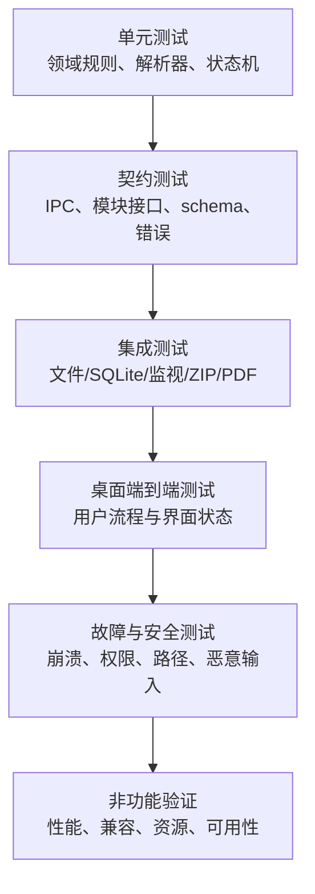

| 层级 | 主要对象 | 执行特点 | 失败定位 |
|---|---|---|---|
| 单元测试 | 命名、路径、YAML、标签、链接、查询、状态机、清单规则 | 不依赖真实 UI；使用内存端口或临时小样本 | 领域函数或规则 |
| 契约测试 | IF-* 输入输出、错误代码、版本和幂等语义 | 调用同一 schema 校验器；正常、边界、非法样例成对 | 接口提供方/调用方 |
| 集成测试 | SafeFileGateway、SQLite、WatchPort、ArchivePort、PdfPort | 使用隔离临时目录和真实组件，不触碰用户目录 | 适配器或跨模块事务 |
| 端到端测试 | Electron 窗口、键盘、对话框代理、主流程和持久状态 | 使用专用测试知识库；验证界面与磁盘双重结果 | 用例编排或 UI |
| 故障与安全测试 | 异常退出、磁盘/权限、占用、路径、ZIP、恶意 Markdown | 在确定步骤注入故障，保存前后哈希和日志状态 | 恢复、安全边界 |
| 非功能验证 | 性能、资源、兼容、无障碍、真实用户任务 | 固定环境与数据集，多次测量并保留原始结果 | 指标与设计措施 |

### 14.3 测试数据集

| 数据集 | 规模与内容 | 用途 |
|---|---|---|
| TD-UNIT | 每类 1～20 个最小样例，含合法/非法 YAML、路径、标签和链接 | 单元与契约测试 |
| TD-FUNCTIONAL | 200 篇笔记、20 MB Markdown、800 条链接、100 个附件，覆盖全部功能组合 | 日常集成和端到端回归 |
| TD-MILESTONE | 500 篇笔记、50 MB Markdown、2,000 条链接及代表性附件 | 首个里程碑性能和数据安全验证 |
| TD-STANDARD | 5,000 篇笔记、500 MB Markdown、20,000 条链接、2 GB 附件 | 首版性能、资源、索引、图谱和备份验收 |
| TD-UNICODE | 中文、英文、重音字符、数学符号、表情、组合字符和不同规范形式 | UTF-8、搜索、路径、导出兼容性 |
| TD-MARKDOWN-GOLDEN | CommonMark/GFM、脚注、公式、Mermaid、Wiki 链接及冲突组合 | 解析、预览、安全过滤和导出视觉比对 |
| TD-SECURITY | XSS、危险协议、双扩展名、符号链接、路径穿越、Zip Slip、重复路径和异常压缩样例 | 安全与边界测试 |
| TD-RECOVERY | 每个操作状态、草稿、冲突、损坏配置/索引、被篡改备份和中断恢复样例 | 故障恢复测试 |

生成型数据集使用固定随机种子；每版数据集保存生成参数、文件数量、总字节、链接数、附件数和 SHA-256 清单。含恶意样例的目录必须醒目标记，禁止由系统默认程序直接打开。

### 14.4 测试环境矩阵

| 环境 | 目的 | 必测范围 |
|---|---|---|
| Windows 11 64 位、四核、8 GB、SSD | 统一性能和资源基准 | 全部高优先级功能、44 项 NFR、TD-STANDARD |
| Windows 10 22H2 64 位、非管理员账户 | 正式兼容性 | 安装、升级、卸载、核心功能、路径与默认程序 |
| Windows 11、1366×768、100% | 最低分辨率 | 核心界面任务和所有阻断式对话框 |
| Windows 11、125% 与 150% 缩放 | 显示兼容 | 工作区、冲突、设置、备份恢复和错误显示 |
| NTFS 本地盘 | 正式文件系统 | 全部核心与故障注入用例 |
| 可移动盘测试目录 | 断开风险 | 保存、索引、附件、备份及断开恢复 |
| 第三方同步目录测试副本 | 外部并发风险 | 监视、冲突副本、延迟写入和只读保护 |
| 断网环境 | 离线与隐私 | 创建、编辑、搜索、链接、导出、备份、恢复及网络监测 |

网络共享目录只用于确认“不承诺多人并发支持”的边界，不作为正式支持环境执行全量兼容验收。

### 14.5 功能测试组织

作业一的 210 项 AC 是功能测试用例主体，按 FR 模块组织：

| 功能域 | FR 范围 | 原 AC | 补充设计验证 |
|---|---|---|---|
| 知识库 | FR-KB-001～010 | AC-FR-KB-* | TEST-ARCH-002/004、TEST-FLOW-001 |
| 笔记与目录 | FR-NOTE-001～013 | AC-FR-NOTE-* | TEST-DATA-004/005、TEST-FLOW-004/008 |
| 编辑与预览 | FR-EDIT-001～016 | AC-FR-EDIT-* | TEST-DATA-001/004/006、TEST-FLOW-002/003 |
| 标签 | FR-TAG-001～009 | AC-FR-TAG-* | TEST-DATA-003/005、TEST-FLOW-004/005 |
| 检索与导航 | FR-SEARCH-001～007、FR-NAV-001～005 | AC-FR-SEARCH-*、AC-FR-NAV-* | TEST-FLOW-005、TEST-UI-003/006 |
| 链接与图谱 | FR-LINK-001～008、FR-GRAPH-001～005 | AC-FR-LINK-*、AC-FR-GRAPH-* | TEST-FLOW-004/006、TEST-UI-007 |
| 附件 | FR-ATT-001～011 | AC-FR-ATT-* | TEST-IF-007、TEST-FLOW-007 |
| 导出 | FR-EXP-001～006 | AC-FR-EXP-* | TEST-DATA-007、TEST-FLOW-009 |
| 备份与恢复 | FR-BACKUP-001～003、FR-RESTORE-001～006 | AC-FR-BACKUP-*、AC-FR-RESTORE-* | TEST-DATA-007、TEST-FLOW-009/010 |
| 设置 | FR-SET-001～010 | AC-FR-SET-* | TEST-UI-003～005/008 |

执行 AC 时除预期界面结果外，凡涉及文件、索引、回收站、备份或恢复的用例还应比较相对路径、文件数量、内容哈希和操作日志终态。

### 14.6 架构、数据、接口、流程和界面验证套件

| 套件 | 已定义目标 | 执行重点 | 门槛 |
|---|---:|---|---|
| TEST-ARCH-001～006 | 6 | 安全进程边界、索引可重建、后台任务、多实例和故障隔离 | 全部通过 |
| TEST-DATA-001～008 | 8 | YAML、路径、索引、原子保存、批量一致性、冲突、备份和规模 | 全部通过 |
| TEST-IF-001～008 | 8 | 白名单、双重校验、幂等、版本、任务、取消、外部打开和错误脱敏 | 全部通过 |
| TEST-FLOW-001～011 | 11 | 13 条关键流程的正常、分支、异常和恢复路径 | 全部高风险路径通过 |
| TEST-UI-001～008 | 8 | 界面状态、键盘路径、显示适配、任务反馈与错误恢复设计 | 自动/人工项分别达标；不作为 5 名学生实测结果 |

本表中的 `TEST-UI-*` 是第 10.16 节的界面与交互设计验证；第 14.7.5 节 `TEST-USE-*` 是 NFR-USE-* 的非功能验收。首次任务时长与核心任务成功率最终只以 TEST-USE-001/002 的真实参与者记录为准。

### 14.7 非功能测试套件

#### 14.7.1 性能与资源

| 测试编号 | 对应需求/设计 | 测量方法和通过标准 |
|---|---|---|
| TEST-PERF-001 | NFR-PERF-001 / NFD-PERF-001 | 5 次真实冷启动，中位数 ≤5 秒 |
| TEST-PERF-002 | NFR-PERF-002 / NFD-PERF-002 | 10 篇接近 1 MB 笔记，逐篇打开中位数 ≤1 秒 |
| TEST-PERF-003 | NFR-PERF-003 / NFD-PERF-003 | 输入、滚动和 5 种格式命令各 30 次，95% ≤100 ms |
| TEST-PERF-004 | NFR-PERF-004 / NFD-PERF-004 | 20 次 1 MB 内笔记修改，5 秒触发后 ≤1 秒保存完成 |
| TEST-PERF-005 | NFR-PERF-005 / NFD-PERF-005 | 20 个中英文查询，首批 ≤1 秒、完整 ≤2 秒 |
| TEST-PERF-006 | NFR-PERF-006 / NFD-PERF-006 | ≥1,000 候选切换筛选/排序，每次 ≤1 秒 |
| TEST-PERF-007 | NFR-PERF-007 / NFD-PERF-007 | 2,000 节点/10,000 边图 5 次，中位首次可交互 ≤3 秒 |
| TEST-PERF-008 | NFR-PERF-008 / NFD-PERF-008 | 超规模图 1 秒内显示进度，主界面无连续 1 秒无响应 |
| TEST-PERF-009 | NFR-PERF-009 / NFD-PERF-009 | TD-STANDARD 重建索引 5 次，中位数 ≤60 秒且可取消 |
| TEST-PERF-010 | NFR-PERF-010 / NFD-PERF-010 | 只改 10 篇，审计显示未变化笔记未重解析且结果一致 |
| TEST-RES-001 | NFR-RES-001 / NFD-RES-001 | 正式 Windows x64 安装包 ≤200 MB |
| TEST-RES-002 | NFR-RES-002 / NFD-RES-002 | 干净安装后应用目录 ≤500 MB |
| TEST-RES-003 | NFR-RES-003 / NFD-RES-003 | TD-STANDARD 空闲 2 分钟，5 次工作集峰值中位数 ≤500 MB |
| TEST-RES-004 | NFR-RES-004 / NFD-RES-004 | 索引 ≤Markdown 字节 150%；100 次增量后临时文件 ≤50 MB |

每次性能测试记录原始样本，不只保存中位数；若首次运行具有额外迁移或杀毒扫描开销，应同时保留但不得从冷启动指标中随意剔除。

#### 14.7.2 可靠性与故障注入

| 测试编号 | 对应需求 | 注入点与通过标准 |
|---|---|---|
| TEST-REL-001 | NFR-REL-001 | 临时写入、复验、替换前后强制结束进程；仅存在完整旧版或新版 |
| TEST-REL-002 | NFR-REL-002 | 连续输入随机终止 20 次；恢复丢失窗口均 ≤10 秒 |
| TEST-REL-003 | NFR-REL-003 | 批量重命名/移动/链接/标签各步骤注入权限和磁盘错误；完全提交或回滚 |
| TEST-REL-004 | NFR-REL-004 | 损坏/删除索引并重建；正文附件哈希不变，结果恢复 |
| TEST-REL-005 | NFR-REL-005 | 损坏全局和知识库配置；默认启动、诊断副本存在、内容不变 |
| TEST-REL-006 | NFR-REL-006 | 备份恢复逐项比对；篡改路径、数量、大小和哈希均失败 |
| TEST-REL-007 | NFR-REL-007 | 注入空间、权限、占用、设备断开；有效文件不被覆盖并可恢复 |

故障注入结束后必须重新启动应用并再次检查操作日志、草稿、正式文件、索引健康度和界面提示，不能只观察注入瞬间。

#### 14.7.3 隐私与安全

| 测试编号 | 对应需求 | 攻击/检查样例 | 通过标准 |
|---|---|---|---|
| TEST-SEC-001 | NFR-SEC-001 | 断网执行核心流程 | 无登录、联网或远程资源前置条件 |
| TEST-SEC-002 | NFR-SEC-002 | 抓取进程网络连接和请求 | 除用户主动外链外不传输用户内容或行为 |
| TEST-SEC-003 | NFR-SEC-003 | 唯一标记正文/附件触发各类错误 | 日志不包含标记和内容 |
| TEST-SEC-004 | NFR-SEC-004 | script、事件属性、危险 URL、iframe、SVG、Mermaid 点击 | 代码不执行，危险资源不加载 |
| TEST-SEC-005 | NFR-SEC-005 | `..`、绝对路径、UNC、符号链接、大小写/编码变体 | 所有未授权越界访问被拒绝 |
| TEST-SEC-006 | NFR-SEC-006 | Zip Slip、重复规范路径、绝对路径、符号链接、异常膨胀 | 预检拒绝，目标无越界文件 |
| TEST-SEC-007 | NFR-SEC-007 | 启动完整备份并取消/确认 | 未加密提示始终可见；取消无成品 |

额外执行 IPC 枚举、依赖漏洞扫描、CSP 检查和外部程序参数注入测试。发现任意代码执行、任意文件越界读写或静默内容上传均为阻断发布缺陷。

#### 14.7.4 兼容性

| 测试编号 | 对应需求 | 通过标准 |
|---|---|---|
| TEST-COMP-001 | NFR-COMP-001 | Windows 10 22H2 与 Windows 11 干净环境核心回归通过 |
| TEST-COMP-002 | NFR-COMP-002 | 非管理员安装、升级、卸载不要求提权 |
| TEST-COMP-003 | NFR-COMP-003 | NTFS 上全部核心和文件错误用例通过 |
| TEST-COMP-004 | NFR-COMP-004 | 可移动盘和同步目录断开/冲突时保护数据并明确提示 |
| TEST-COMP-005 | NFR-COMP-005 | 网络共享并发时只读或冲突，不出现支持多人编辑的声明 |
| TEST-COMP-006 | NFR-COMP-006 | 测试时仍受支持的两种浏览器和两种 PDF 阅读器离线打开样例 |
| TEST-COMP-007 | NFR-COMP-007 | TD-UNICODE 保存、搜索、导出、重开内容一致 |
| TEST-COMP-008 | NFR-COMP-008 | 1366×768、125%/150% 缩放无关键控件不可达或含义丢失 |

浏览器和 PDF 阅读器的产品名称及版本在执行时记录，不在设计文档中固化为永久标准。

#### 14.7.5 易用性与无障碍

| 测试编号 | 对应需求 | 方法 | 通过标准/状态 |
|---|---|---|---|
| TEST-USE-001 | NFR-USE-001 | 至少 5 名目标学生独立完成首次任务 | 每人 ≤3 分钟；待真实执行 |
| TEST-USE-002 | NFR-USE-002 | 同一批或另行至少 5 名学生执行统一核心任务 | 总成功率 ≥80%；待真实执行 |
| TEST-USE-003 | NFR-USE-003 | 纯键盘走查主要任务 | 全部完成，无键盘陷阱 |
| TEST-USE-004 | NFR-USE-004 | Tab/Shift+Tab 遍历 | 焦点始终可辨识且关闭对话框后正确返回 |
| TEST-USE-005 | NFR-USE-005 | 对比度工具检查两种主题 | 普通文本 ≥4.5:1，大文本 ≥3:1 |
| TEST-USE-006 | NFR-USE-006 | 关闭颜色或使用灰阶检查状态 | 所有状态仍由文字/图标/形状表达 |
| TEST-USE-007 | NFR-USE-007 | 检查默认及 12、32、越界字号 | 默认 ≥14 px，边界生效，越界拒绝 |
| TEST-USE-008 | NFR-USE-008 | 抽查六类错误 | 每条含问题、可判断原因和至少一个处理办法 |

真实学生测试需记录参与者是否为目标用户、开始/结束时间、是否独立完成、失败步骤、观察事实和原话摘要；不得补填或推测未发生的结果。

### 14.8 代表性端到端场景

| 场景编号 | 场景 | 主要检查 |
|---|---|---|
| E2E-001 | 首次启动—创建知识库—首篇笔记—自动保存 | 用时、焦点、文件/YAML、保存状态和索引 |
| E2E-002 | 记录—标签—Wiki 链接—搜索找回 | 标签规范、补全、链接解析、反向链接、搜索排序 |
| E2E-003 | 重命名课程文件夹并更新链接 | 预检、操作日志、链接计划、全部提交和索引更新 |
| E2E-004 | 外部编辑器修改正在编辑的笔记 | 三版本、暂停自动保存、各解决选项和恢复记录 |
| E2E-005 | 导入图片、风险附件与缺失附件 | 类型检测、相对路径、预览隔离、每次确认和重新定位 |
| E2E-006 | 删除—10 秒撤销—再次删除—回收站恢复 | 路径、附件、索引、冲突命名和永久删除确认 |
| E2E-007 | 全局/局部图—筛选—展开—打开节点 | 性能、任务取消、导航历史、固定位置和列表替代 |
| E2E-008 | 导出 Markdown/HTML/PDF | 预检、资源、缺失项、临时产物、离线打开和视觉黄金样例 |
| E2E-009 | 完整备份—恢复到新目录—重建索引 | 清单、哈希、文件数、恢复数据区和搜索一致性 |
| E2E-010 | 异常退出后重新打开 | 写锁、未完成日志、草稿、冲突、配置和索引恢复顺序 |

### 14.9 测试用例记录格式

每条实际测试记录至少包含：

| 字段 | 内容 |
|---|---|
| testId | 稳定测试编号；引用 AC、TEST、NFR 或 E2E |
| requirementIds | 被验证的 FR/NFR/IR/BR/DR |
| designIds | 被验证的 MOD/IF/DATA/FLOW/UI/NFD/DEC |
| environment | 操作系统、硬件、缩放、应用构建和数据集版本 |
| preconditions | 初始知识库、文件版本、锁和网络状态 |
| steps | 可重复的操作与故障注入点 |
| expected | 界面、接口、文件、索引和日志的预期状态 |
| actual | 观察到的事实；不得只写“正常” |
| evidence | 截图、计时原始值、哈希、报告或脱敏日志路径 |
| result | PASS/FAIL/BLOCKED；BLOCKED 必须说明外部条件 |
| defectId | 失败时关联缺陷编号和复测结果 |

### 14.10 缺陷等级与发布门槛

| 等级 | 定义 | 示例 | 发布规则 |
|---|---|---|---|
| P0 阻断 | 数据丢失、任意代码执行、越界读写、备份恢复破坏原数据 | 静默覆盖、Zip Slip、草稿与原文件同时丢失 | 必须修复并全量相关回归 |
| P1 严重 | 高优先级核心流程无法完成或关键 NFR 不达标 | 无法保存/搜索/恢复；写锁失效 | 必须修复并回归 |
| P2 一般 | 有明确替代路径的中低优先级功能错误 | 某排序方式错误、非核心设置不保存 | 评估后修复或记录已知问题 |
| P3 轻微 | 不影响理解和操作的视觉/文本问题 | 非关键间距、文案细节 | 可延期但需记录 |

进入首个里程碑或首版发布候选必须同时满足：

1. 追溯审计为 PASS，需求与设计集合无缺失。
2. 当前范围内所有高优先级 AC 通过。
3. TEST-ARCH、TEST-DATA、TEST-IF 及对应 TEST-FLOW 无失败。
4. 当前关口规定的高优先级 NFR 达标并保留原始证据。
5. 无未解决 P0/P1；所有 recovery-required 测试样例均已处理。
6. 安装包、依赖清单、测试环境和数据集版本均可识别。
7. 真实用户测试如尚未执行，不能把发布状态写为“易用性已通过”。

### 14.11 自动化与人工验证边界

| 可自动化 | 必须人工或半人工 |
|---|---|
| 编号与追溯、schema、路径、解析、状态机、接口契约、索引一致性、哈希、恶意样例、性能采样 | 真实学生任务、错误文案是否易懂、PDF/HTML 视觉质量、屏幕阅读器体验、默认程序实际交互 |

自动化脚本应能在测试副本上重复执行并返回非零失败码。人工测试必须使用统一脚本和记录表，不得只提交结论截图而缺少条件、步骤与观察结果。

### 14.12 测试证据与隐私

- 截图和录屏应使用生成数据或取得参与者许可，避免展示真实课程隐私内容。
- 诊断日志先执行敏感内容检查；参与者姓名使用 P01～P05 等编号。
- 性能报告保留原始样本、汇总算法和异常说明；不能只保留通过后的数字。
- 失败证据与修复后复测证据都要保留，防止只展示最终成功结果。
- 当前作业阶段仅能确认设计和验证方案完整，软件运行结果、真实学生任务和兼容性结果仍为待执行。

## 15. 需求来源、变更说明与文档管理

### 15.1 需求来源

本设计唯一规范性需求基线为作业一《大学生个人 Markdown 笔记与知识管理工具需求分析文档》改进提交版 1.2。

| 项目 | 内容 |
|---|---|
| 基线文档 | `选题2_个人Markdown知识库/01_需求分析文档.md` |
| 基线状态 | 改进提交版 1.2 |
| 决策基线 | D-001～D-066 |
| 需求集合 | 109 FR、44 NFR、118 BR、35 DR、5 IR |
| 验收集合 | 210 AC |
| 产品对象 | 面向大学生的 Windows 本地优先 Markdown 笔记与知识管理工具 |
| 当前范围 | 完整首版设计；详细实现优先首个里程碑和高优先级安全闭环 |

作业一文档中的背景、目标用户、使用场景、范围、优先级和编号化需求在本设计中继续有效。设计文档不重新定义第二套功能需求；若设计描述与需求基线发生歧义，应先查原需求及其验收标准，再通过变更流程解决。

### 15.2 本次需求变更说明

本次作业未修改需求基线，具体如下：

| 变更类别 | 结果 | 说明 |
|---|---|---|
| 新增功能需求 | 无 | 未增加账号、云同步、插件、AI、OCR、多人协作等范围外功能 |
| 删除功能需求 | 无 | 109 项 FR 全部进入设计映射 |
| 修改功能语义 | 无 | 模块、接口和数据结构是实现设计，不改变用户可观察需求 |
| 修改优先级 | 无 | 49 项高优先级 FR 保持原优先级并单独追溯 |
| 修改非功能指标 | 无 | 44 项 NFR 的数值、环境和通过标准全部沿用 |
| 修改业务/数据规则 | 无 | 118 项 BR、35 项 DR 保持原编号和含义 |
| 修改验收标准 | 无 | 210 项 AC 继续作为功能验收主体 |

以下内容属于设计细化，不属于需求变更：

- 将参考技术方向落实为模块化单体、分层和进程边界；
- 为模块、接口、数据、流程、界面和非功能措施增加设计编号；
- 选择临时写入、操作日志、可重建索引等实现策略；
- 建立错误代码、并发限制、任务取消和恢复状态；
- 将需求验收方法组织成分层测试计划。

DEC-007 中的中文分词方案仍需技术样机选择，但两种候选均必须满足既有搜索行为、性能和资源指标，因此不构成需求变更。若原型表明指标无法同时实现，必须新增需求变更记录，说明拟修改内容、原因、影响需求和替代方案，经确认后才能改变基线。

### 15.3 规范性优先级

当文档内容出现不一致时，按以下顺序处理：

1. 已确认的需求基线及其原子需求、业务规则、数据要求和验收用例；
2. 本文档中经过确认的设计决策和安全/一致性约束；
3. 模块、接口、数据、流程和界面详细设计；
4. 示例、示意图和非规范性说明。

不能用较低层级示例推翻较高层级规则。发现矛盾时停止相关实现，按第 12.9 节记录并处理。

### 15.4 已知待验证事项

| 项目 | 当前状态 | 后续证据 |
|---|---|---|
| 5 名目标学生首次任务和核心任务 | 未实际执行 | TEST-USE-001/002 的逐人记录；不得由 AI 或作者模拟 |
| 性能与资源指标 | 无软件，待实测 | TD-MILESTONE/TD-STANDARD 的原始计时与资源报告 |
| Windows 10/11 兼容 | 待实测 | 干净虚拟机安装和核心回归报告 |
| 中文分词实现 | 待技术原型 | 固定语料下 trigram 与自定义分词的召回、排序、耗时、体积比较 |
| PDF/HTML 视觉一致性 | 待实现后人工检查 | TD-MARKDOWN-GOLDEN 在指定阅读器中的对照记录 |
| Electron 依赖具体版本 | 实现阶段锁定 | 锁文件、依赖清单、安全公告和兼容测试 |

这些待验证项不影响本设计文档的结构完整性，但在获得真实证据前不得标记为“已达标”。

### 15.5 核心术语

| 术语 | 定义 |
|---|---|
| 知识库（Vault） | 用户选择的本地目录，包含 Markdown、附件及 `.pkm` 系统目录 |
| 笔记（Note） | 带可选/受管理 YAML 元数据的 UTF-8 Markdown 文件 |
| 真实数据 | Markdown、YAML、附件及必要恢复材料；不能依赖索引才能读取 |
| 派生索引 | 可从真实数据重建的 SQLite 搜索、标签、链接、图谱和附件引用投影 |
| 编辑基准版本 | 编辑会话最后一次成功保存文件的哈希、大小和修改时间组合 |
| 紧急草稿 | 为限制异常退出丢失窗口而保存的未提交编辑内容 |
| 恢复快照 | 按策略保存的完整笔记历史副本 |
| 操作计划 | 批量操作提交前生成的源、目标、前置条件、步骤和补偿集合 |
| 提交点 | 操作从“可无副作用取消”进入“已产生正式结果”的明确边界 |
| 安全取消 | 在检查点停止任务并完成清理或回滚后进入 cancelled 终态 |
| 只读打开 | 允许查看但不允许改变知识库的运行模式 |
| 抢救提取 | 从损坏备份中只提取通过安全与完整性检查的文件，不等同于完整恢复 |

### 15.6 实现使用顺序

建议实现团队按以下顺序使用本设计：

1. 先建立 ARCH-VIEW-LOGICAL/RUNTIME-001 所示边界、DEC-001、安全桥接、MOD-PLATFORM 端口和 DATA-VAULT/NOTE-001。
2. 完成知识库、笔记、编辑和自动保存核心闭环，同时实现草稿和原子写入。
3. 实现元数据、标签、增量索引、搜索和链接闭环。
4. 实现附件、回收站和基础恢复，并执行首个里程碑测试。
5. 实现冲突、批量操作、图谱、导出、备份、恢复和设置收尾能力。
6. 按第 14 章运行功能、故障、安全、性能、兼容和资源验证。
7. 任何实现取舍必须回查第 12 章决策和第 13 章追溯，不得直接改变需求。

### 15.7 文档完成度

| 作业要求 | 本文档位置 | 状态 |
|---|---|---|
| 架构设计 | 第 3、4 章 | 完成 |
| 模块设计 | 第 6 章 | 完成 |
| 关键流程设计 | 第 9 章 | 完成 |
| 接口设计 | 第 8 章 | 完成 |
| 数据设计 | 第 7 章 | 完成 |
| 界面与交互设计 | 第 10 章 | 完成 |
| 非功能设计 | 第 11 章 | 完成，运行指标待实现后实测 |
| 异常与故障处理 | 第 9.15、9.16 及相关流程 | 完成 |
| 设计决策与权衡 | 第 4、12 章 | 完成 |
| 需求追溯矩阵 | 第 13 章 | 完成，自动审计通过 |
| 测试与验证考虑 | 第 5、7.18、8.17、9.17、10.16、11、14 章 | 完成 |
| 需求来源与变更说明 | 第 1.1、15.1、15.2 章 | 完成，无需求变更 |
| 约束、假设与外部依赖 | 第 16 章 | 完成，未实测项均显式标注 |

### 15.8 文档规模与设计元素汇总

| 项目 | 数量 |
|---|---:|
| 核心逻辑模块 | 12 |
| 已编号接口 | 30 |
| 已编号核心数据结构 | 13 |
| 关键业务流程 | 13 |
| 主要界面/交互状态 | 9 |
| 非功能设计措施 | 44 |
| 正式设计决策 | 21 |
| 架构/数据/接口/流程/界面测试目标 | 41 |
| 非功能测试目标 | 44 |
| 代表性端到端场景 | 10 |

上述数量用于结构审计，不表示已经实现或实际执行测试。

### 15.9 修订记录

| 版本 | 日期 | 内容 | 需求基线影响 |
|---|---|---|---|
| 0.1 | 2026-10-23 | 建立需求基线、总体架构、模块、数据、接口、流程、界面、非功能设计和决策 | 无 |
| 1.0 | 2026-10-23 | 补齐双向追溯、测试计划、来源与变更说明，并执行结构审计 | 无 |
| 1.1 | 2026-10-23 | 依据改进建议补齐导航接口、三类分支需求落点、编号语义和独立约束/假设/依赖章节 | 无 |
| 1.2 | 2026-10-23 | 补充 UI 状态字段契约、可维护性度量、冲突/恢复状态图、高安全规则逐条追溯及标签命令契约 | 无 |

## 16. 约束、假设与外部依赖

本章集中声明设计成立所依赖的环境条件、尚未由本作业实际运行证明的组件能力与量化假设。状态为“待原型/实测”的项目只能作为实现输入，不能写成已达成结论。

### 16.1 约束与假设清单

| 编号 | 约束、假设或外部依赖 | 当前依据 | 当前状态 | 后续核验与失败处置 |
|---|---|---|---|---|
| ASM-001 | 目标运行环境为 Windows 10 22H2 / Windows 11 64 位，本地 NTFS 为正式支持存储 | 需求基线 IR-ENV-*、NFR-COMP-* | 已确认为设计范围；兼容性待实测 | 在干净虚拟机和 NTFS 样本库运行安装及核心回归；不满足则修复实现或走需求变更 |
| ASM-002 | Markdown、YAML、附件为真实数据，SQLite 仅为可重建派生索引 | DR-*、DEC-002/003 | 设计已确定；恢复性待故障试验 | 删除/损坏索引后从文件重建并核对哈希；失败则阻止发布 |
| ASM-003 | Windows 文件系统与 Node 文件 API 能支持同目录临时写入、刷新、替换/重命名及占用错误识别 | NFR-REL-001/007、IF-EXT-FS-001 | 待 Windows 原型与故障注入确认 | 在 NTFS、文件占用、权限和安全软件场景测试；不可靠时调整 FilePort 提交及重试策略 |
| ASM-004 | 文件监视可提供变化提示，但可能丢失、合并、乱序或溢出；正确性依赖受控重扫 | IR-ENV-001、IF-EXT-WATCH-001 | 能力待实测，限制已纳入设计 | 注入突发变更、断开和溢出；最终状态不一致则扩大重扫或降级策略 |
| ASM-005 | SQLite FTS5 能提供全文检索、参数化查询和可重建事务投影 | DEC-003、IF-EXT-SQLITE-001 | 组件能力待原型确认 | 固定 schema/语料验证查询、事务、损坏恢复和重建；失败则替换 IndexStorePort 实现 |
| ASM-006 | FTS5 trigram 或可替换本地分词能满足中文及中英混合检索质量 | DEC-007、原基线 ASM-008 | 待技术样机选择，不承诺已达标 | 对固定查询集比较召回、排序、耗时和索引体积，记录最终选择及版本 |
| ASM-007 | Electron `printToPDF` 能生成 A4 PDF，但字体、公式、图表、分页和阅读器兼容性依赖实际环境 | IF-EXT-PDF-001、NFR-COMP-006 | API 路径待原型确认；输出质量待人工核验 | 用黄金文档在指定阅读器对照；关键内容缺失或不可读则阻止 PDF 发布 |
| ASM-008 | ZIP/PDF/哈希/Markdown 清理等第三方组件的具体实现和版本将在实现阶段锁定 | IF-EXT-ARCHIVE/PDF/HASH-001、NFR-SEC-* | 未选型/未锁版本 | 保存锁文件与依赖清单，执行恶意样例、升级兼容和安全公告检查；不满足接口契约则替换端口实现 |
| ASM-009 | 11.2～11.7 的响应、可靠性、可用性、安全、兼容性与资源数值均是验收目标，不是本文实测结果 | 44 项 NFR、44 项 NFD | 全部待实现后按第 14 章验证 | 保留原始计时、资源、故障、兼容和人工记录；未达标不得用文档自检 PASS 代替 |
| ASM-010 | 至少 5 名目标学生的首次任务与核心任务可用性测试可按统一脚本执行 | NFR-USE-001/002、TEST-USE-001/002 | 尚未执行 | 记录参与者特征、逐人时长、独立成功与失败步骤；样本不足或未达阈值时只报告实际结果并改进设计 |

### 16.2 外部依赖隔离原则

- 所有外部组件只能经第 8.14 节端口接入，业务模块不得直接依赖组件错误字符串或私有数据格式。
- 组件“存在某 API”只证明可能的实现入口，不证明本项目的正确性、性能、安全性或兼容性；这些结论必须由第 14 章证据产生。
- 组件版本、运行参数或平台语义变化时，先复跑对应契约与故障测试，再决定是否更新 DEC、接口或需求变更记录。
- 若任何关键假设失败，保持需求基线不变并优先替换适配器或实现策略；只有确实无法满足原需求时，才按第 12.9 节发起显式需求变更。

## 17. 结论

本设计采用 Windows 本地模块化单体架构，以普通 Markdown、YAML 和附件作为用户真实数据，以 SQLite 作为可重建派生索引，通过沙箱渲染进程、白名单 IPC、原子写入、操作日志、三方冲突、回读校验和分层测试保证安全与可恢复性。

文档已覆盖作业要求的全部 12 类设计要素，并将 109 项 FR、44 项 NFR、118 项 BR、35 项 DR、5 项 IR 和 210 项 AC 纳入正向或继承式追溯。当前结论仅证明设计文档完整、可检查并可作为实现和测试依据；软件运行指标、兼容性和真实用户测试仍须在实现后取得证据。
